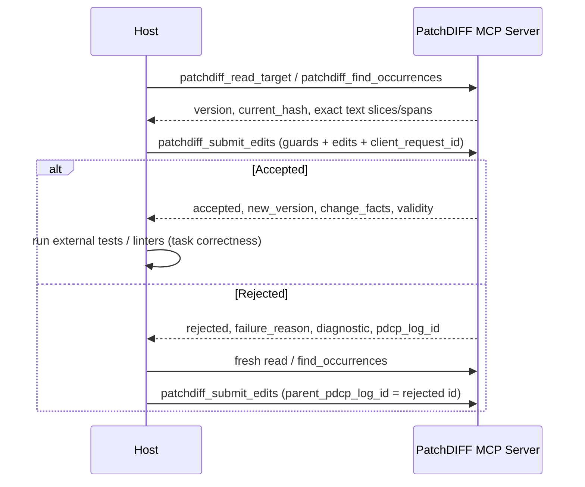

# PatchDIFF MCP Orchestration Skill

## Transport & System Boundaries

PatchDIFF is an authoritative transaction service exposed over Model Context Protocol (MCP).

The service boundaries are strict:

```text
PatchDIFF server = deterministic transaction runtime + authoritative read/commit service
MCP = transport/interface (stdio JSON-RPC adapter / internal registry)
Host / Chatbot / Model = planning, context selection, proposal generator, retry owner
Postgres = canonical working substrate
```

The host (e.g., Claude Desktop, custom agent runner) owns planning, prompt building, context selection, and retries.

The PatchDIFF MCP service provides deterministic validation, authoritative bounded reads, exact search, atomic target updates, append-only logging with idempotency, manifest recording, and replay.

## Tool Surface Overview

PatchDIFF provides 20 tools across five functional areas:

1. **Target Lifecycle**:
   - `patchdiff_handle_upload`: register uploaded file content as a target.
   - `patchdiff_initialize_target`: create a new managed document with a fresh target ID.
   - `patchdiff_get_target`: inspect current version, hash, length, and metadata.
   - `patchdiff_export_target`: retrieve current full text for saving/export.
2. **Authoritative Reads & Exact Search**:
   - `patchdiff_read_target`: bounded slice reading with code-point offset `start`, `length`, and `next_start` pagination.
   - `patchdiff_read_lines`: bounded inclusive LF line ranges with range-relative continuation and one coherent version/hash observation.
   - `patchdiff_find_occurrences`: exact string search returning all occurrence code-point spans, snippet context, `start_occurrence`, `max_results`, and `next_occurrence_index`.
3. **Guarded Edit Submission**:
   - `patchdiff_submit_edits`: primary typed edit submission (`patchdiff-tx/1`). Requires `expected_target_version` and/or `expected_current_hash`. Supports `client_request_id` idempotency and `parent_pdcp_log_id` retry lineage.
   - `patchdiff_submit_pdcp`: legacy `.pdcp` text submission (frozen v0.2.3 format).
   - `patchdiff_submit_operations`: guarded match/span transactions (tx/2, profile0.3.0).
   - `patchdiff_submit_replacement`: guarded sole replace_all (tx/3, profile0.4.0); valid fresh oversize is a structured no-attempt admission error.
4. **Checkpoints, Replay & History**:
   - `patchdiff_save`: snapshots target and rotates editing cycle.
   - `patchdiff_replay`: deterministically reconstructs target from initial state and accepted history.
   - `patchdiff_get_pdcp_log`: bounded newest-first inspection of attempt history.
   - `patchdiff_get_manifest_ledger`: bounded inspection of accepted changes with runtime facts.
5. **Bounded Preview & Deprecated Wrappers**:
   - `patchdiff_preview`: advisory zero-audit/keyless evaluation of a fresh proposal through the shared read-only evaluator; later submission rechecks guards.
   - `patchdiff_build_prompt_context`: convenience bounded prefix preview (`context_truncated`).
   - `patchdiff_get_regeneration_context`, `patchdiff_build_regeneration_prompt`, `patchdiff_request_regeneration`: deprecated server-prompt wrappers preserved for compatibility.

## Modern Host Workflow

The expected host-owned orchestration loop:



## Request Idempotency & Lost Responses

Hosts should provide `client_request_id` (1–128 printable ASCII characters without whitespace; a UUID is optional) with `patchdiff_submit_edits` and `patchdiff_submit_pdcp`.

- When a request is received, the server checks `uq_pdcp_logs_target_client_request_id` under per-target row lock.
- If an existing log with that `client_request_id` matches the request fingerprint, the recorded terminal outcome is returned with `deduplicated: true`; rejected responses separately refresh `current_context` under the target lock.
- If a duplicate `client_request_id` has conflicting arguments, it is rejected with `failure_reason: "context_invalid"` and `diagnostic.existing_pdcp_log_id`.
- If a client call times out, repeating the exact call with the same `client_request_id` safely succeeds even if the first attempt committed and advanced the target version.

Invalid edit strings on known targets return an audited target_encoding_invalid domain rejection at PROTOCOL_VALIDATION; evidence is reversibly ASCII-escaped, not repaired. Read/search string errors return invalid_argument without edit-attempt rows. Keep every response/diagnostic safe for real stdio, including invalid target IDs and strings that cannot be stored in PostgreSQL. Do not turn anticipated validation failures into generic tool errors or swallow infrastructure exceptions.

For a conflicting request key, persist a distinct rejected attempt with NULL stored key and the submitted fingerprint through the existing locked rejection helper. Return its new log ID, link the original log and retain a bounded submitted-key diagnostic. Echoing the submitted key in the response must not accidentally persist that key on the conflict row. Every admitted repeated conflict adds a row; exact recovery adds none. Never overwrite the original keyed outcome.

## Stdio Adapter Details

The stdio adapter (`backend/app/mcp/external_adapter.py`):
- Communicates via newline-delimited JSON-RPC over `stdin` and `stdout`.
- Advertises the full schema of all tools in `tools/list`, including `TYPED_EDIT_JSON_SCHEMA` for `patchdiff_submit_edits`.
- Validates JSON-RPC `params`: if `params` is provided and is not a JSON object, it returns error `-32602` (`Invalid params: params must be an object`).
- Pass-through execution: delegates tool execution to `registry.call(...)` and wraps domain payloads as tool results; handler failures return tool results with `isError: true`. JSON-RPC envelope errors use their own RPC error responses.

## Forbidden MCP Orchestration Behavior

Do not let MCP orchestration:

- apply unvalidated model text directly to targets
- mutate target content without the deterministic core runtime
- bypass exact `MATCH/REPLACE` validation
- delete rejected attempts from `append_only_pdcp_logs`
- execute model-generated code or script files
- treat model output as trusted
- silently repair malformed edits or guess ambiguous matches
- merge concurrent edits or perform partial commits

## Bounded search and history

Validate context_chars as a non-bool integer >=0, default40 and cap400. Both history tools use positive non-bool integer limits (null/omitted50,cap200) and exclusive positive integer cursors. Attempts fetch limit+1 after filters and render descending; ledger selects newest eligible rows then renders its page ascending. Return entries/has_more/next_sequence on every response; cursor is the smallest returned sequence only when more rows remain. Keep safe exact historical request-key filters, not new-submission syntax. Include flags are boolean; no generic handler errors for invalid argument types.

## F01 rejection context

Keep immutable `diagnostic.failure_context` separate from response-only fresh `current_context`. Capture only the actual failing buffer prefix (at most 256 code points), counts and prior simulated changes; label canonical versus intermediate state and use transaction-start canonical observed hash/version. Do not retain an unbounded failed buffer, alter verdicts/profiles/fingerprints, retrofit old diagnostics, commit caller transactions or release their locks. Explicit unavailable contexts cover malformed/missing targets and unlocked local state. MCP_TOOLS specifies fields and actual compact ASCII-escaped JSON byte caps:4096 per context and8192 combined including wrapper keys. Tests must cover non-BMP/escapes, sequential buffers, refreshed recovery after later edits, audit/ledger nonmutation and caller rollback.

## Pass A additions

Follow docs/usability/PASS-A-decision.md and normative contracts: tx/2 ordered match/span operations use mandatory guards, exact expected text, sequential canonical code-point spans and explicit empty-span insertion through the shared applier/profile 0.3.0. Old formats/profiles/fingerprints remain unchanged; no replace_all yet. Correlation is opt-in response-only UUID metadata. Persist bounded exact failure candidates/query once; compute response-only bounded near misses only after service-owned commit/lock release, or explicitly omit for caller ownership. Preserve all original recovered diagnostics and actual byte/work budgets. Run focused PG/stdio matrices while iterating; root runs one consolidated full verification/review per user-authorized pass.

## Pass B additions

Preview-only output projection follows PASS-B-decision.md:32768compact ASCII-escaped payload bytes; accepted facts prefix32/perfact2048/wrapper16384; text1024code points/8192wrapper and diagnostic16384. Expose total/returned/truncation/omission metadata. Keep verdict/stage/coherent state/hash, omit oversized identity rather than shortening it, and preserve all submit/core/history facts.

Follow docs/usability/PASS-B-decision.md: explicit tx/3 sole whole-target replacement uses immutable0.4.0, mandatory guards, inclusive raw/result byte/code-point admission limits and existing-key recovery before stricter fresh admission; old formats/profiles/identity remain unchanged. Read-only LF line ranges use coherent column observations and bounded offset continuation. Zero-audit advisory preview shares submit's evaluator and preserves every managed table/caller transaction, with no request-key option or submit-rollback. Publish bounded discovery examples and execute every advertised pair over actual stdio/PG. Implement the whole batch before root's final suite/manual/review; avoid routine intermediate test loops. Data/performance evidence is local synthetic only.
