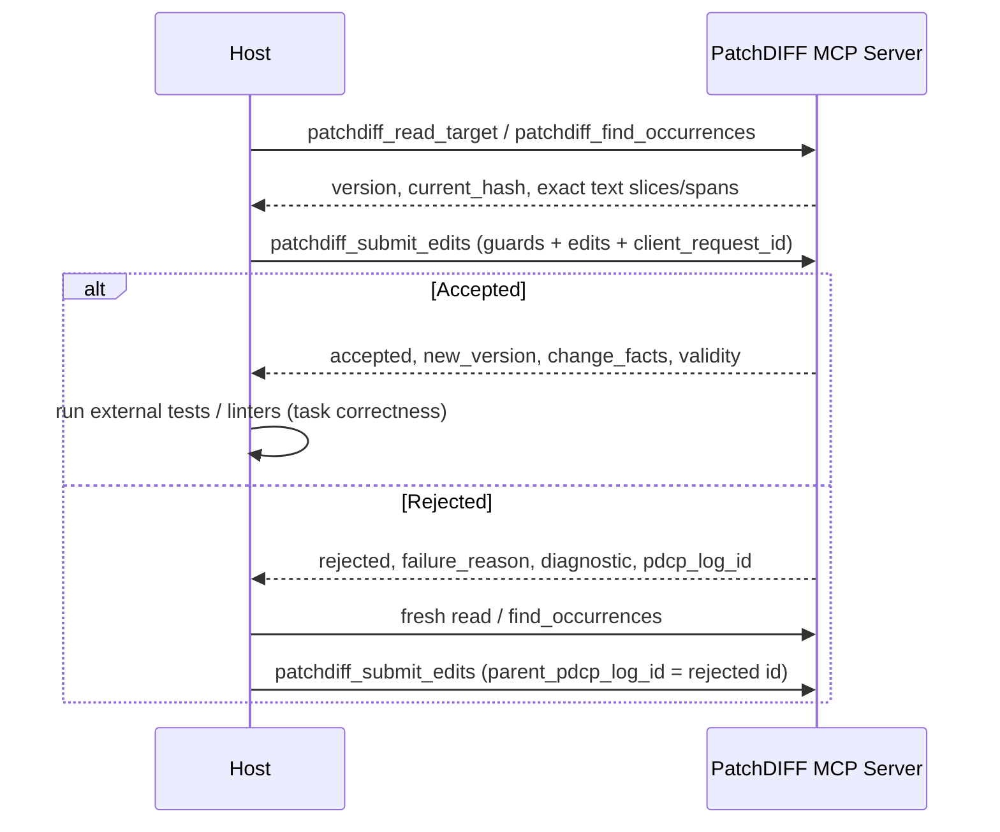

# PatchDIFF MCP Orchestration Skill

## Transport & System Boundaries

PatchDIFF is an authoritative transaction service exposed over Model Context Protocol (MCP).

The service boundaries are strict:

```text
PatchDIFF server = deterministic transaction runtime + authoritative read/commit service
MCP = transport/interface (stdio JSON-RPC adapter / internal registry)
Host / Chatbot / Model = planning, context selection, proposal generator, retry owner
Postgres = canonical working substrate
```

The host (e.g., Claude Desktop, custom agent runner) owns planning, prompt building, context selection, and retries.

The PatchDIFF MCP service provides deterministic validation, authoritative bounded reads, exact search, atomic target updates, append-only logging with idempotency, manifest recording, and replay.

## Tool Surface Overview

PatchDIFF provides 20 tools across five functional areas:

1. **Target Lifecycle**:
   - `patchdiff_handle_upload`: register uploaded file content as a target.
   - `patchdiff_initialize_target`: create a new managed document with a fresh target ID.
   - `patchdiff_get_target`: inspect current version, hash, length, and metadata.
   - `patchdiff_export_target`: retrieve current full text for saving/export.
2. **Authoritative Reads & Exact Search**:
   - `patchdiff_read_target`: bounded slice reading with code-point offset `start`, `length`, and `next_start` pagination.
   - `patchdiff_read_lines`: bounded inclusive LF line ranges with range-relative continuation and one coherent version/hash observation.
   - `patchdiff_find_occurrences`: exact string search returning all occurrence code-point spans, snippet context, `start_occurrence`, `max_results`, and `next_occurrence_index`.
3. **Guarded Edit Submission**:
   - `patchdiff_submit_edits`: primary typed edit submission (`patchdiff-tx/1`). Requires `expected_target_version` and/or `expected_current_hash`. Supports `client_request_id` idempotency and `parent_pdcp_log_id` retry lineage.
   - `patchdiff_submit_pdcp`: legacy `.pdcp` text submission (frozen v0.2.3 format).
   - `patchdiff_submit_operations`: guarded match/span transactions (tx/2, profile 0.3.0).
   - `patchdiff_submit_replacement`: guarded sole replace_all (tx/3, profile 0.4.0); valid fresh oversize is a structured no-attempt admission error.
4. **Checkpoints, Replay & History**:
   - `patchdiff_save`: snapshots target and rotates editing cycle.
   - `patchdiff_replay`: deterministically reconstructs target from initial state and accepted history.
   - `patchdiff_get_pdcp_log`: bounded newest-first inspection of attempt history.
   - `patchdiff_get_manifest_ledger`: bounded inspection of accepted changes with runtime facts.
5. **Bounded Preview & Deprecated Wrappers**:
   - `patchdiff_preview`: advisory zero-audit/keyless evaluation of a fresh proposal through the shared read-only evaluator; later submission rechecks guards.
   - `patchdiff_build_prompt_context`: convenience bounded prefix preview (`context_truncated`).
   - `patchdiff_get_regeneration_context`, `patchdiff_build_regeneration_prompt`, `patchdiff_request_regeneration`: deprecated server-prompt wrappers preserved for compatibility.

## Modern Host Workflow

The expected host-owned orchestration loop:



## Request Idempotency & Lost Responses

Hosts should provide `client_request_id` (1–128 printable ASCII characters without whitespace; a UUID is optional) with `patchdiff_submit_edits` and `patchdiff_submit_pdcp`.

- When a request is received, the server checks `uq_pdcp_logs_target_client_request_id` under per-target row lock.
- If an existing log with that `client_request_id` matches the request fingerprint, the recorded terminal outcome is returned with `deduplicated: true`; rejected responses separately refresh `current_context` under the target lock.
- If a duplicate `client_request_id` has conflicting arguments, it is rejected with `failure_reason: "context_invalid"` and `diagnostic.existing_pdcp_log_id`.
- If a client call times out, repeating the exact call with the same `client_request_id` safely succeeds even if the first attempt committed and advanced the target version.

Invalid edit strings on known targets return an audited target_encoding_invalid domain rejection at PROTOCOL_VALIDATION; evidence is reversibly ASCII-escaped, not repaired. Read/search string errors return invalid_argument without edit-attempt rows. Keep every response/diagnostic safe for real stdio, including invalid target IDs and strings that cannot be stored in PostgreSQL. Do not turn anticipated validation failures into generic tool errors or swallow infrastructure exceptions.

For a conflicting request key, persist a distinct rejected attempt with NULL stored key and the submitted fingerprint through the existing locked rejection helper. Return its new log ID, link the original log and retain a bounded submitted-key diagnostic. Echoing the submitted key in the response must not accidentally persist that key on the conflict row. Every admitted repeated conflict adds a row; exact recovery adds none. Never overwrite the original keyed outcome.

## Stdio Adapter Details

The stdio adapter (`backend/app/mcp/external_adapter.py`):
- Communicates via newline-delimited JSON-RPC over `stdin` and `stdout`.
- Advertises the full schema of all tools in `tools/list`, including `TYPED_EDIT_JSON_SCHEMA` for `patchdiff_submit_edits`.
- Validates JSON-RPC `params`: if `params` is provided and is not a JSON object, it returns error `-32602` (`Invalid params: params must be an object`).
- Pass-through execution: delegates tool execution to `registry.call(...)` and wraps domain payloads as tool results; handler failures return tool results with `isError: true`. JSON-RPC envelope errors use their own RPC error responses.

## Forbidden MCP Orchestration Behavior

Do not let MCP orchestration:

- apply unvalidated model text directly to targets
- mutate target content without the deterministic core runtime
- bypass exact `MATCH/REPLACE` validation
- delete rejected attempts from `append_only_pdcp_logs`
- execute model-generated code or script files
- treat model output as trusted
- silently repair malformed edits or guess ambiguous matches
- merge concurrent edits or perform partial commits

## Bounded search and history

Validate context_chars as a non-bool integer >=0, default 40 and cap 400. Both history tools use positive non-bool integer limits (null/omitted50,cap 200) and exclusive positive integer cursors. Attempts fetch limit+1 after filters and render descending; ledger selects newest eligible rows then renders its page ascending. Return entries/has_more/next_sequence on every response; cursor is the smallest returned sequence only when more rows remain. Keep safe exact historical request-key filters, not new-submission syntax. Include flags are boolean; no generic handler errors for invalid argument types.

## Goal F additions

- Tools: `patchdiff_submit_operations` (tx/2), `patchdiff_submit_replacement` (tx/3), `patchdiff_read_lines` and `patchdiff_preview`. Discovery advertises 20 tools, 13 examples across nine tools, and `x-patchdiff-capabilities` built from the runtime constants.
- Submissions accept boolean `include_correlation_id`; the UUID is response-only and never part of request identity.
- Rejections return immutable `diagnostic.failure_context` and fresh, response-only `current_context`; exact recovery keeps the original diagnostic. Near misses are computed only after a service-owned commit releases the lock (banded exact Levenshtein within the 1,000,000-cell cap) and are omitted for caller-owned transactions.
- Preview is advisory: no writes, locks or request keys; a payload bounded to 32,768 bytes with explicit omission metadata; submission always rechecks guards.
- tx/3 fresh admission (1,000,000 code points and 1,048,576 UTF-8 bytes, raw and canonical) runs after request-key recovery/conflict and returns `invalid_argument` / `replacement_too_large` with no row.
- Contract: `docs/MCP_TOOLS.md` ("Guarded editing, reads, preview and diagnostics"); decisions in `docs/usability/F01-decision.md`, `PASS-A-decision.md` and `PASS-B-decision.md`.
