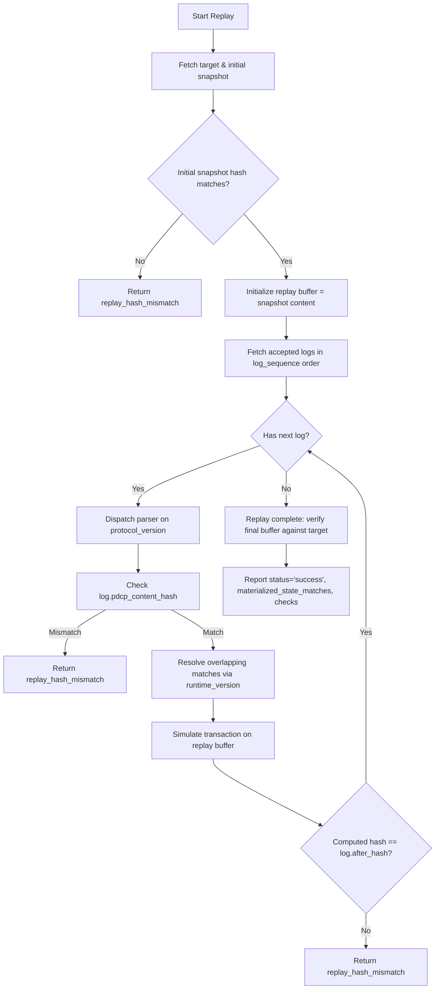

# PatchDIFF Persistence, Replay, and SAVE Skill

## Persistence Architecture

Postgres is PatchDIFF's single source of truth for managed target content, transaction attempts, manifest history, and snapshots.

Target mutations require row-level locking:

```text
Incoming submit
  -> BEGIN TRANSACTION
  -> SELECT ... FROM cloud_target_files WHERE target_file_id = :id FOR UPDATE
  -> Check client_request_id idempotency in append_only_pdcp_logs
  -> Check version / hash concurrency guards
  -> Apply transaction deterministically in memory
  -> If accepted:
       UPDATE cloud_target_files (current_content, current_version, current_hash)
       INSERT INTO append_only_pdcp_logs (status='accepted')
       INSERT INTO append_only_manifest_ledger (with origin and derived_json)
     If rejected:
       INSERT INTO append_only_pdcp_logs (status='rejected', failure_reason)
  -> COMMIT
```

Target mutation is strictly atomic: all edits succeed or none do. Rejected attempts are durably logged.

## Database Migrations

Schema migrations are managed by Alembic in `backend/app/migrations/`:

1. `20260510_0001_initial_schema.py`:
   - `cloud_target_files` (managed targets)
   - `append_only_pdcp_logs`
   - `append_only_manifest_ledger`
   - `editing_cycles`
   - `target_snapshots`
2. `20261020_0002_typed_ledger.py`:
   - Adds `client_request_id` TEXT NULL (1–128 printable ASCII characters without whitespace) and `request_fingerprint` (VARCHAR(64)) to `append_only_pdcp_logs`.
   - Adds partial unique index `uq_pdcp_logs_target_client_request_id` where `client_request_id IS NOT NULL`.
   - Makes `manifest_ledger` legacy prose columns nullable (`input_state`, `output_state`, `affected_region`, `user_visible_change`, `risk`).
   - Adds `origin` TEXT NOT NULL (default `'pdcp_manifest'`) and `derived_json` JSONB NULL to `append_only_manifest_ledger`.
   - Guarded downgrade: refuses to downgrade to `0001` if typed ledger rows exist (`origin = 'typed'`).

Migrations must always run cleanly on live Postgres:
```powershell
$env:PYTHONPATH = "backend"
.\.venv\Scripts\python.exe -m alembic -c backend/app/migrations/alembic.ini upgrade head
```

## Append-Only Attempt Log (`append_only_pdcp_logs`)

Every submission (accepted or rejected) creates an append-only row:
- `log_sequence`: strictly ascending BigInteger sequence number (`BIGSERIAL`).
- `target_file_id`: foreign key to `cloud_target_files`.
- `protocol_version`: `'patchdiff-tx/1'`, `'patchdiff-tx/2'` or `'0.2.3'`.
- `runtime_version`: `'patchdiff-mvp-0.2.2'` (or historical `'patchdiff-mvp-0.1.0'`).
- `status`: `'accepted'` or `'rejected'`.
- `failure_reason`: canonical failure string if rejected; `None` if accepted.
- `client_request_id`: client-supplied TEXT key for idempotency (1–128 printable ASCII characters without whitespace; `req-001` is valid, a UUID is optional).
- `request_fingerprint`: SHA-256 hash of submission parameters.
- `parent_pdcp_log_id`: link to predecessor log in retry lineage.
- `before_version`, `after_version`: target version progression.
- `before_hash`, `after_hash`: target SHA-256 progression.
- `pdcp_content`: canonical JSON string for `patchdiff-tx/1`; raw text for `0.2.3`.
- `pdcp_content_hash`: SHA-256 of `pdcp_content`.

For rejected invalid Unicode, pdcp_content contains a deterministic ASCII-escaped patchdiff-invalid-input/1 evidence envelope of the original input, not an accepted transaction. JSONB holds safe marker/path strings only. A safe request key recovers its original rejection with a domain-separated invalid-evidence fingerprint; unencodable keys remain NULL on the row and are preserved in evidence. Never write decoded surrogate/NUL text to PostgreSQL or change valid-input fingerprints. Caller-owned commit/rollback and target locks retain their usual semantics.

Conflicting request fingerprints append independent NULL-key rejection rows carrying the submitted fingerprint and safe original-log/submitted-key diagnostics. Original keyed rows remain authoritative. Repeated conflicts are never collapsed/capped/updated/deleted. Supported concurrent recovery is tested at READ COMMITTED using actual blocked independent sessions; stronger-isolation retries belong to the owner. Caller-owned transactions remain provisional until commit and must retain locks through that boundary.

## Accepted-Only Manifest Ledger (`append_only_manifest_ledger`)

Only accepted transactions record rows in the manifest ledger:
- `ledger_sequence`: strictly ascending BigInteger sequence number (`BIGSERIAL`).
- `origin`: `'typed'` for `patchdiff_submit_edits`, `'pdcp_manifest'` for `patchdiff_submit_pdcp` (TEXT).
- `derived_json`: JSONB object containing exact runtime facts computed by the applier:
  - `span_start`, `span_end`, `matched_chars`, `replacement_chars`, `matched_sha256`, `replacement_sha256`.
- For typed rows, legacy prose fields (`input_state`, `output_state`, `affected_region`, `user_visible_change`, `risk`) are `NULL` except that supplied advisory `risk` is retained.

## SAVE Checkpoints & Editing Cycles

- `patchdiff_save` creates a snapshot row in `target_snapshots` and advances the active cycle in `editing_cycles`.
- SAVE does **not** mutate target text, change target version, change target hash, or alter manifest history.
- SAVE does not compact host context; context compaction is host-managed.

## Deterministic Replay Algorithm

Replay reconstructs target state strictly from initial target content plus accepted transaction history:



### Component-Level Materialized State Checks
The replay result provides detailed boolean verification:
- `content_matches`: raw stored current_content equals the reconstructed canonical replay buffer; never normalize stored text before comparing.
- `stored_hash_matches`: logged `after_hash` of final log matches current database `current_hash`.
- `recomputed_hash_matches`: canonical_sha256 of stored current_content equals the reconstructed hash (separate from stored_hash_matches).
- `version_matches`: final log `after_version` matches current database `current_version`.
- `materialized_state_matches`: `true` only when all four component checks pass.

Replay uses the exact `(protocol_version, runtime_version)` recorded on each log row via `SUPPORTED_RUNTIME_PROFILES` in `backend/app/core/versions.py`. Legacy logs recorded with `patchdiff-mvp-0.1.0` replay with non-overlapping match enumeration; modern logs recorded with `patchdiff-mvp-0.2.2` replay with overlapping enumeration.

Current typed submissions record patchdiff-mvp-0.2.2. Replay explicitly retains patchdiff-mvp-0.2.1 overlapping matches with ignored singleton selectors, patchdiff-mvp-0.2.0 overlapping-match and original change-ID decoding behavior, plus the 0.1.0 non-overlapping profile. Strict new-key syntax does not prevent exact recovery of already-persisted request IDs; unknown/new invalid IDs still reject. Do not trim historical IDs or rewrite accepted history.

The current 0.2.2 profile enforces every supplied selector even for one occurrence. All older supported profiles retain ignored singleton selectors. Resolve both profile settings in submission and replay; never repurpose a recorded profile.

A successful reconstruction can report materialized_state_matches=false. CRLF/bare-CR storage corruption must fail content_matches even with matching canonical hashes; replay never repairs storage.

## F01 rejection context

Keep immutable `diagnostic.failure_context` separate from response-only fresh `current_context`. Capture only the actual failing buffer prefix (at most 256 code points), counts and prior simulated changes; label canonical versus intermediate state and use transaction-start canonical observed hash/version. Do not retain an unbounded failed buffer, alter verdicts/profiles/fingerprints, retrofit old diagnostics, commit caller transactions or release their locks. Explicit unavailable contexts cover malformed/missing targets and unlocked local state. MCP_TOOLS specifies fields and actual compact ASCII-escaped JSON byte caps:4096 per context and8192 combined including wrapper keys. Tests must cover non-BMP/escapes, sequential buffers, refreshed recovery after later edits, audit/ledger nonmutation and caller rollback.

## Pass A additions

Follow docs/usability/PASS-A-decision.md and normative contracts: tx/2 ordered match/span operations use mandatory guards, exact expected text, sequential canonical code-point spans and explicit empty-span insertion through the shared applier/profile 0.3.0. Old formats/profiles/fingerprints remain unchanged; no replace_all yet. Correlation is opt-in response-only UUID metadata. Persist bounded exact failure candidates/query once; compute response-only bounded near misses only after service-owned commit/lock release, or explicitly omit for caller ownership. Preserve all original recovered diagnostics and actual byte/work budgets. Run focused PG/stdio matrices while iterating; root runs one consolidated full verification/review per user-authorized pass.
