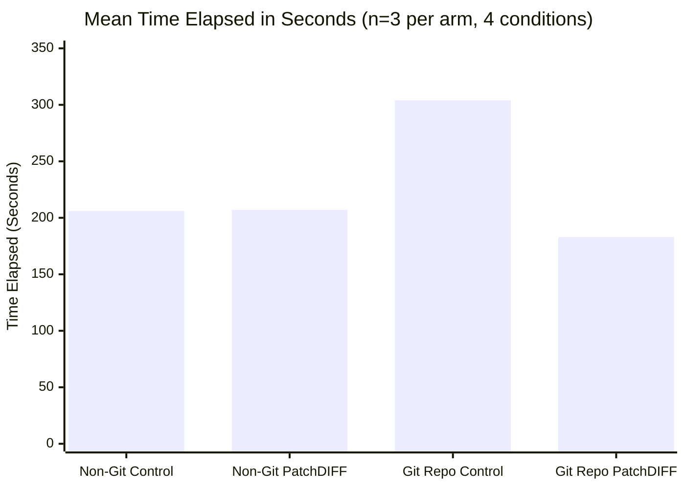

# PatchDIFF

[](https://github.com/paragon-ux/Patch-DIFF/actions/workflows/ci.yml)
[](https://paragon-ux.github.io/Patch-DIFF/)
[](https://github.com/paragon-ux/Patch-DIFF/actions/workflows/ci.yml)
[-blue)](https://www.python.org/)
[](https://hub.docker.com/_/postgres)
[](https://modelcontextprotocol.io/)
[](LICENSE)

**Transactional document-editing service for MCP-connected agents.**

PatchDIFF turns model-generated document edits into **explicitly preconditioned, atomic, auditable, and deterministically replayable PostgreSQL transactions** over the Model Context Protocol (MCP).

| ⚡ Time Elapsed (Git) | ⏱️ Turnaround Predictability | 📉 Context Window Burn | 🎯 Byte Accuracy |
| :---: | :---: | :---: | :---: |
| **1.66× Faster** | **4.7× Tighter** | **-64.8%** | **100.0%** |
| *(3m 03s vs. 5m 04s in Git)* | *(±20s vs. ±96s variance)* | *(1.61M tokens saved/task)* | *(0 diffs across all runs)* |



> **Evaluation Disclaimer**: Measured in the Google Antigravity agent runtime ($n=3$ per arm across 4 experimental conditions, Gemini 3.8 Flash High) comparing Modernized PatchDIFF (`observed_v2`) against the native Antigravity file-editing control baseline on a standardized 5-file, 21-edit canary task. Transcripts, seeds, and evaluation methodology are published in the [Modernized Benchmark Report](docs/benchmarks/modernized_benchmark_report.md). The earlier baseline evaluation is separated in [Legacy Benchmark Report](docs/legacy/git_benchmark_report.md) due to prompt confounds in early iterations.

### How Validated Hypotheses and Operational Mechanisms Drive Faster Time Elapsed

When agent throughput is constrained, every redundant turn, prefill token, and verification step compounds into severe wall-clock delays. PatchDIFF completes tasks in **3 minutes flat (1.66× faster Time Elapsed in Git environments)** by validating core research hypotheses and eliminating operational friction:

1. **Decoding & Context Reduction (`H1`)**: Emitting targeted patches instead of full-file rewrites cuts total context tokens by **-64.8%** (876K vs. 2.49M, saving 1.61M tokens/task, Welch $t=10.292, \text{df}=7.17, p < 0.00002$), drastically reducing model prefill and generation overhead.
2. **Reliability & Turnaround Predictability (`H7`)**: The model reliably generated valid declarative transactions, achieving **100.0% full-byte accuracy** against the oracle reference (0 byte diffs across all 12 runs × 5 canary files = 60 targets evaluated; 240/240 test assertions passed) with zero rejections, collapsing Time Elapsed standard deviation from $\pm 96.0\text{s}$ down to **$\pm 20.3\text{s}$** ($\pm 14\text{s}$ in Git).
3. **Structural Batching (Operational Finding)**: Submitting multi-scope edits in a single atomic bundle (`observed_v2`) rather than sequential roundtrips cuts interaction steps by **-55.8%** (24.2 vs. 54.8 turns, $p < 0.00001$) and tool invocations by **-57.8%** (22.7 vs. 53.8 calls, $p < 0.00001$).
4. **Authoritative State Confirmation (Operational Finding)**: Receiving cryptographic receipts (`after_hash`) under PostgreSQL row locks confirms atomic transaction application directly to the agent, eliminating the **10.0 exploratory `git diff` / `git status` commands** per task observed in the control baseline canary. Independent semantic and task validation remain host responsibilities.

| Operating Environment | Paradigm ($n=3$ per cell) | Mean Time Elapsed | Mean Steps | Mean Tool Calls | Git Commands | Mean Context Tokens | Full-Byte Match |
| :--- | :--- | :---: | :---: | :---: | :---: | :---: | :---: |
| **Non-Git Workspace** | Control Baseline | 3m 26s ± 1m 11s | 53.0 ± 3.6 | 52.0 ± 3.6 | N/A | 2,451,605 ± 507,644 | 100% (0 diffs) |
| **Non-Git Workspace** | Modernized PatchDIFF | **3m 27s ± 21s** | **26.7 ± 2.5** | **24.7 ± 4.2** | N/A | **1,001,039 ± 143,395** | **100% (0 diffs)** |
| **Git Repository** | Control Baseline | 5m 04s ± 1m 44s | 56.7 ± 6.1 | 55.7 ± 6.1 | 10.0 ± 0.0 | 2,529,918 ± 196,075 | 100% (0 diffs) |
| **Git Repository** | Modernized PatchDIFF | **3m 03s ± 14s** | **21.7 ± 1.2** | **20.7 ± 1.2** | **0.0 ± 0.0** | **750,230 ± 30,670** | **100% (0 diffs)** |

---

## System Architecture

```text
PatchDIFF server = deterministic transaction runtime + authoritative read and edit service
MCP              = transport/interface (stdio JSON-RPC / internal registry)
Host / Model     = planning, context selection, proposal generator, retry owner
PostgreSQL 16+   = authoritative document store (SELECT ... FOR UPDATE)
```

> For interactive visual flowcharts of the host transaction lifecycle and 5-stage validation pipeline, see the **[Visual Architecture & Flow](https://paragon-ux.github.io/Patch-DIFF/architecture/)** guide.

---

## Why PatchDIFF?

| Editing Problem | Conventional Approach | What PatchDIFF Provides Directly |
| --- | --- | --- |
| **Small edit in large file** | Full regeneration emits complete replacement document | `patchdiff-tx/1` and `tx/2` emit only matched/replaced spans |
| **Repeated identical text** | `str_replace` requires expanding `old_str` with surrounding lines | Explicit `occurrence_index`, `anchor_before` / `anchor_after`, or code-point spans |
| **Line-diff grammars (`diff -u`)** | Requires line-prefixed diff syntax or numeric hunk headers | Structured JSON fields (`edits[]` / `operations[]`); no delimiter collisions |
| **Coordinate & state drift** | Line-based edits assume positions remain unchanged | Required `expected_target_version` / `expected_current_hash` under `SELECT ... FOR UPDATE` |
| **Multiple changes in one file** | Single-replacement requires $N$ calls with partial failure risks | Single submission simulated sequentially in memory and applied atomically all-or-nothing |
| **Missing or ambiguous match** | Basic interfaces return uninformative error strings | Bounded diagnostics: `failure_context`, `exact_candidates`, and Levenshtein `near_misses` |
| **Lost submission response** | Host must re-read to guess if a timed-out write succeeded | Resubmitting with the same `client_request_id` returns recorded outcome (`deduplicated: true`) |
| **Audit & session history** | Host must maintain custom logging and verification | Append-only attempt log, audit ledger with runtime-derived facts, `save` & `replay` |

---

## Transaction Formats

PatchDIFF supports three structured transaction input formats (pure declarative data, no executable code):

- **`patchdiff-tx/1` (`patchdiff_submit_edits`)**: Ordered exact `MATCH/REPLACE` edits with optional `occurrence_index`, `anchor_before`, or `anchor_after` disambiguation.
- **`patchdiff-tx/2` (`patchdiff_submit_operations`)**: Ordered exact match and `[start, end)` code-point span operations with `expected_text` and optional adjacency guards.
- **`patchdiff-tx/3` (`patchdiff_submit_replacement`)**: Sole explicit whole-document replacement (`<= 1,000,000` code points and `<= 1,048,576` UTF-8 bytes).

All formats require `expected_target_version` and/or `expected_current_hash` and are processed by the same deterministic core engine. See [PDCP Format](docs/spec/PDCP_FORMAT.md) and [Host Integration Guide](docs/guides/HOST_INTEGRATION_GUIDE.md) for full request schemas and examples.

---

## Quickstart

PatchDIFF supports two independent, non-conflicting PostgreSQL runtime routes out of the box—**`native`** (user-space `initdb`/`pg_ctl` cluster on `127.0.0.1:5434`) and **`docker`** (Docker Compose `patchdiff-postgres` container on `127.0.0.1:5433`)—with identical setup and daemon lifecycle commands.

### 1. Provision Runtime & Apply Migrations

```bash
# Provision both routes (native on 5434 + docker on 5433), apply Alembic migrations
# through head (20261031_0007), verify the Waymark JS bridge, and smoke-test MCP stdio:
patchdiff-mcp setup --route both

# Or provision a single route independently:
patchdiff-mcp setup --route native   # User-space PostgreSQL cluster on 127.0.0.1:5434
patchdiff-mcp setup --route docker   # Docker Compose container on 127.0.0.1:5433
```

Manage the database daemons identically across either or both routes:

```bash
patchdiff-mcp daemon start   --route <native|docker|both>
patchdiff-mcp daemon stop    --route <native|docker|both>
patchdiff-mcp daemon restart --route <native|docker|both>
patchdiff-mcp daemon status  --route <native|docker|both>
```

### 2. Connect via MCP Stdio Adapter

PatchDIFF exposes a stdio JSON-RPC MCP adapter (`patchdiff-mcp`, `uvx patchdiff-mcp`, or `python -m app.mcp.external_adapter`). Running `patchdiff-mcp setup --route both --update-mcp-config --mcp-route <native|docker>` generates per-installation 256-bit `scram-sha-256` credentials in `~/.local/share/patchdiff-runtime/db_credentials.json` (`0600`), provisions separate PostgreSQL roles (`patchdiff_admin` for `full` host lifecycle vs. least-privilege `patchdiff_agent` for `observed_v2` agent editing), and atomically writes your host `mcp_config.json`:

```json
{
  "mcpServers": {
    "patchdiff": {
      "command": "patchdiff-mcp",
      "args": [],
      "env": {
        "PATCHDIFF_DB_CREDENTIALS_FILE": "/home/user/.local/share/patchdiff-runtime/db_credentials.json",
        "PATCHDIFF_ACTIVE_ROUTE": "native",
        "PATCHDIFF_MCP_PROFILE": "observed_v2",
        "PATCHDIFF_WAYMARK_MODE": "resident"
      }
    }
  }
}
```

*(Use `"PATCHDIFF_ACTIVE_ROUTE": "native"` for port `5434` or `"docker"` for port `5433`, or pass `PATCHDIFF_DATABASE_URL` directly).*

See [Claude Desktop Setup](docs/guides/CLAUDE_DESKTOP_SETUP.md) for full host integration details.

---

## MCP Profiles, Migration & Compatibility (`PR23-IMPL-DOC-002`)

External MCP defaults to the **5-tool `observed_v2` profile**: `patchdiff_read_target`, `patchdiff_find_occurrences`, `patchdiff_list_scopes`, `patchdiff_observe_scopes`, and `patchdiff_commit_bundle`.

Configure the profile via `PATCHDIFF_MCP_PROFILE`:
- **`observed_v2`** (default, 5 tools): Streamlined agent editing with explicit AST snapshots and compact receipts (representative ~800 B–2 KB; 8,192 byte hard ceiling). Intentionally excludes target initialization and finalization tools (`Unknown PatchDIFF MCP tool: <name>`) and connects as the least-privilege `patchdiff_agent` DB role. See [MCP Editor v2](docs/spec/MCP_EDITOR_V2.md).
- **`full`** (24 tools): Complete trusted-host tool suite (`patchdiff_admin` DB role) including `patchdiff_initialize_target`, `patchdiff_finalize_target`, `patchdiff_read_finalized_export`, `patchdiff_save`, `patchdiff_replay`, audit inspection, and legacy compatibility wrappers. Hosts must run a separate `full` process (or call the Python service layer) to initialize targets before agent editing and to finalize/export targets after agent editing.
- **Legacy compatibility profiles** (`editor` [7], `observed` [6], `unobserved` [5], `observed_editor` [4], `unobserved_editor` [3], `hybrid_editor` [1]): Retained for backward compatibility with a once-per-process stderr migration notice. Existing integrations expecting the 7-tool `editor` default must explicitly set `PATCHDIFF_MCP_PROFILE=editor`.
- **PostgreSQL Port Mapping**: Docker Compose now binds `127.0.0.1:5433:5432` by default (configurable via `PATCHDIFF_POSTGRES_PORT`) and native user-space clusters bind `127.0.0.1:5434` (`PATCHDIFF_NATIVE_POSTGRES_PORT`) so neither collides with a host PostgreSQL instance on `5432`.

---

## Documentation

Full documentation is available on the **[Zensical Documentation Site](https://paragon-ux.github.io/Patch-DIFF/)**:

- **Visual Architecture**: [Visual Architecture & Transaction Lifecycle](docs/architecture.md)
- **Specifications**: [Core Runtime](docs/spec/PATCHDIFF_CORE_SPEC.md) | [MCP Tools](docs/spec/MCP_TOOLS.md) | [Data Model](docs/spec/DATA_MODEL.md) | [PDCP Formats](docs/spec/PDCP_FORMAT.md) | [Editor v2](docs/spec/MCP_EDITOR_V2.md) | [Batch Editing](docs/spec/STRUCTURAL_BATCH_EDITING.md)
- **Guides**: [Host Integration Guide](docs/guides/HOST_INTEGRATION_GUIDE.md) | [Claude Desktop Setup](docs/guides/CLAUDE_DESKTOP_SETUP.md) | [Observed Workflow](docs/guides/OBSERVED_EDITOR_WORKFLOW.md)
- **Whitepapers**: [Concept Paper v6](docs/papers/PatchDIFF-Concept-Paper-6.md) | [Modernization Architecture](docs/papers/MODERNIZATION_ARCHITECTURE.md)
- **Benchmarks**: [Modernized Benchmark](docs/benchmarks/modernized_benchmark_report.md) | [Test Matrix](docs/benchmarks/TEST_MATRIX.md)
- **Standards & Legacy**: [PR Review Standard](docs/standards/PR_REVIEW_STANDARD.md) | [Release Readiness](docs/standards/RELEASE_READINESS.md) | [Legacy Compatibility](docs/legacy/LEGACY_COMPATIBILITY.md) | [Legacy Benchmark Report](docs/legacy/git_benchmark_report.md)

---

## License

[MIT](LICENSE)
