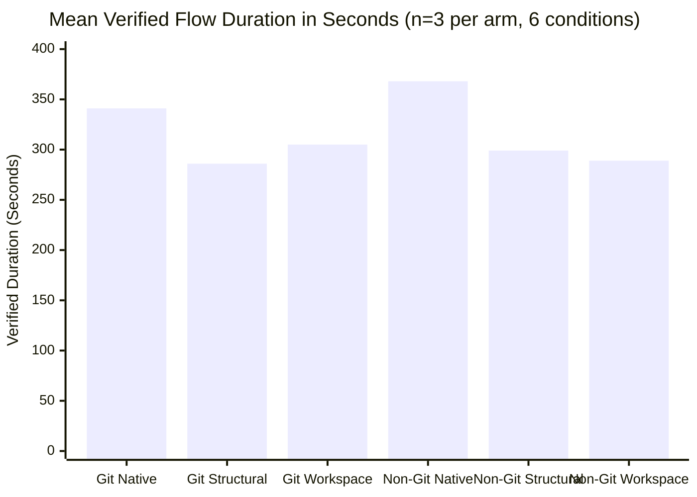

# PatchDIFF

[](https://github.com/paragon-ux/Patch-DIFF/actions/workflows/ci.yml)
[](https://paragon-ux.github.io/Patch-DIFF/)
[-blue)](https://www.python.org/)
[](https://hub.docker.com/_/postgres)
[](https://modelcontextprotocol.io/)
[](LICENSE)

**Transactional document-editing service for MCP-connected agents.**

PatchDIFF turns model-generated document edits into preconditioned, atomic, auditable, and deterministically replayable PostgreSQL transactions over the Model Context Protocol (MCP).

---

## Why PatchDIFF?

Conventional language-model editing workflows rely on full-file regeneration, fragile line diffs, or unguarded search-and-replace strings. PatchDIFF replaces these failure modes with structured, transactional document updates:

| Editing Problem | Conventional Approach | What PatchDIFF Provides Directly |
| :--- | :--- | :--- |
| **Small edit in large file** | Full regeneration emits complete replacement document | `patchdiff-tx/1` and `tx/2` emit only matched or replaced spans |
| **Repeated identical text** | `str_replace` requires expanding `old_str` with surrounding lines | Explicit `occurrence_index`, `anchor_before` / `anchor_after`, or code-point spans |
| **Line-diff grammars (`diff -u`)** | Line-prefixed diff syntax or numeric hunk headers | Structured JSON fields (`edits[]` / `operations[]`) without delimiter collisions |
| **Coordinate and state drift** | Line-based edits assume target positions remain unchanged | Required `expected_target_version` and `expected_current_hash` under row locks |
| **Multiple changes in one file** | Single replacements require repeated calls with partial failure risks | Multi-scope bundles simulated sequentially and committed atomically |
| **Missing or ambiguous match** | Basic interfaces return uninformative error strings | Structured diagnostics: `failure_context`, `exact_candidates`, and near misses |
| **Lost submission response** | Host must re-read disk to guess whether a timed-out write succeeded | Resubmitting with the same `client_request_id` returns the recorded outcome |
| **Audit and session history** | Host must build custom logging and snapshot tracking | Append-only attempt logs, audit ledger with runtime-derived facts, and replay tools |

---

## Architecture and Editing Models

PatchDIFF coordinates model proposals, transactional validation, and disk persistence through an explicit runtime boundary:

```text
PatchDIFF server = deterministic transaction runtime + authoritative read and edit service
MCP              = transport/interface (stdio JSON-RPC / internal registry)
Host / Model     = planning, context selection, proposal generator, retry owner
PostgreSQL 16+   = canonical working copy and audit history
Workspace file   = source bytes and explicit SAVE publication destination
```

### Editing Models and Profiles

PatchDIFF supports multiple editing workflows by configuring the `PATCHDIFF_MCP_PROFILE` environment variable. The evaluation benchmarks compare three distinct editing models:

1. **Native Baseline**: Standard agent editing using native host filesystem tools (for example, direct file reads, whole-file rewrites, or unindexed search-and-replace). This approach uses no transaction engine, no AST indexing, and no rollback protections.
2. **Host-Orchestrated Structural Editing (`observed_v2`)**: A 5-tool MCP profile providing Abstract Syntax Tree (AST) scope discovery and guarded atomic commits. The host environment retains lifecycle authority, executing separate orchestration calls to initialize targets, save revisions, export files to disk, and verify state.
3. **Agent-Owned Workspace Editing (`observed_workspace`)**: A 7-tool MCP profile where the editing agent directly owns the complete lifecycle over MCP. The agent imports files (`initialize_target`), discovers and inspects AST scopes (`list_scopes`, `observe_scopes`), commits atomic bundles (`commit_bundle`), and publishes verified edits directly to disk (`save` with `sync_workspace: true`), requiring zero external host lifecycle calls.

Additional profiles include `workspace` (a 5-tool profile for exact text editing without Node.js AST dependencies), `editor` (the default 7-tool profile for existing database targets), and `full` (a 17-tool trusted lifecycle catalog). See the [profile catalog](docs/spec/profiles/index.md) for full details.

### Transaction Formats

PatchDIFF supports three declarative, non-executable transaction formats:

- **`patchdiff-tx/1` (`patchdiff_submit_edits`)**: Ordered exact `MATCH/REPLACE` edits with optional disambiguation anchors.
- **`patchdiff-tx/2` (`patchdiff_submit_operations`)**: Ordered code-point span operations with `expected_text` and adjacency guards.
- **`patchdiff-tx/3` (`patchdiff_submit_replacement`)**: Explicit whole-document replacement for files up to 1,000,000 code points and 1,048,576 UTF-8 bytes.

All formats enforce `expected_target_version` and `expected_current_hash` concurrency guards. For request schemas and examples, see [Transaction formats](docs/spec/transaction-formats.md) and the [Host Integration Guide](docs/guides/host-integration-guide.md).

---

## Quickstart

Follow the [workspace quickstart](docs/guides/workspace-quickstart.md) to install the wheel, connect PostgreSQL 16, and configure your MCP host.

### 1. Install and Migrate

```bash
python3.11 -m venv .venv
. .venv/bin/activate
python -m pip install /absolute/path/to/patchdiff_mvp-0.1.0-py3-none-any.whl
export PATCHDIFF_DATABASE_URL='postgresql+psycopg://patchdiff@localhost:5432/patchdiff'
alembic_ini=$(python -c 'from pathlib import Path; import app; print(Path(app.__file__).with_name("migrations") / "alembic.ini")')
python -m alembic -c "$alembic_ini" upgrade head
```

### 2. Configure Resident AST Service (Structural Profiles)

For the 7-tool `observed_workspace` profile, install the pinned Waymark Engine 4.1.0 dependencies beside the bridge shipped in the wheel:

```bash
waymark_dir=$(python -c 'from app.services.waymark_adapter import WAYMARK_INTEGRATION_DIR; print(WAYMARK_INTEGRATION_DIR)')
npm --prefix "$waymark_dir" ci --omit=dev
```

### 3. Connect the MCP Client

Configure your MCP host (such as Claude Desktop or Antigravity):

```json
{
  "mcpServers": {
    "patchdiff-workspace": {
      "command": "/absolute/path/to/venv/bin/python",
      "args": ["-m", "app.mcp.external_adapter"],
      "env": {
        "PATCHDIFF_MCP_PROFILE": "observed_workspace",
        "PATCHDIFF_DATABASE_URL": "postgresql+psycopg://patchdiff@localhost:5432/patchdiff",
        "PATCHDIFF_WORKSPACE_ROOT": "/absolute/project/root",
        "PATCHDIFF_WAYMARK_MODE": "resident",
        "PATCHDIFF_WORKSPACE_SYNC_ON_SAVE": "0"
      }
    }
  }
}
```

Additional setup guides:
- [Claude Desktop setup](docs/guides/claude-desktop-setup.md)
- [Workspace profile specification](docs/spec/profiles/workspace-profile.md)

---

## Workspace Editing Benchmark

The end-to-end benchmark evaluates editing performance across 6 test conditions ($n=3$ per arm, 18 trials total). The evaluation tests a standardized 5-file, 21-edit canary task in Google Antigravity using operator-attested Gemini 3.8 Flash High across Git Repository and Non-Git Workspace environments.

| Verified Flow Duration | Editor Tool Invocations | Host Lifecycle Calls | Accuracy Across All Arms |
| :---: | :---: | :---: | :---: |
| **16.2% Faster** | **42.7% Fewer Calls** | **0 Separate Calls** | **100.0%** |
| (296.7s vs. 354.2s pooled mean) | (32.0 vs. 55.8 calls per task) | (Agent-owned SAVE vs. 20 host calls) | (90/90 files exact, 360/360 checks) |



> **Evaluation Disclaimer**: Measured in Google Antigravity ($n=3$ per arm across 6 conditions, operator-attested Gemini 3.8 Flash High) comparing agent-owned Workspace (`observed_workspace`), host-orchestrated structural editing (`observed_v2`), and native file editing on a standardized 5-file, 21-edit canary task. Preparation and connector handoffs are excluded from the verified flow interval and recorded separately as setup overhead. The [Workspace Benchmark Report](docs/benchmarks/workspace-e2e-benchmark.md) publishes the methodology, per-trial metrics, and verification hashes.

### Key Performance Findings

Across the 6 evaluation conditions ($n=3$ per arm, 18 trials total), agent-owned Workspace averaged 296.7s compared to 354.2s for Native baseline editing (a 16.2% reduction in pooled mean duration; up to 28.3% faster in Non-Git median duration). Editor tool calls dropped from 55.8 down to 32.0 calls per task (a 42.7% reduction):

1. **Context-gathering efficiency**: Workspace averaged 6 `list_scopes`, 5 `observe_scopes`, and 1.67 exact-search calls per trial, whereas Native baseline editing required an average of 34.83 `read_file` calls. This workflow comparison reflects combined indexing, prompt policy, and context batching.
2. **Self-contained agent lifecycle**: In Workspace mode (`observed_workspace`), the agent imports files (`initialize_target`), submits guarded multi-scope bundles (`commit_bundle`), and publishes directly to project files (`save` with `sync_workspace: true`) using its own 7 MCP tools. This eliminates the 20 separate host lifecycle calls and 5 host file writes required per run by the host-orchestrated Structural profile (`observed_v2`).
3. **Turnaround consistency**: All trials across all arms achieved 100.0% full-byte accuracy against the independent oracle across all 90 target files (zero byte diffs) and passed all 360 behavioral assertions, with zero MCP errors, zero rejections, and zero retries.
4. **Paired comparison results**: Workspace finished faster than its paired Native baseline control in all 6 test blocks across both Git and Non-Git environments.

### Benchmark Summary

The table below presents the verified timing and tool invocation metrics for each condition ($n=3$ per arm). Non-differentiating columns (100% full-byte match across all 90 files, 360/360 behavioral checks passed) and pooled rows have been omitted so individual conditions stand out clearly:

| Environment | Arm | Mean Verified Flow (s) | Median Verified Flow (s) | Mean Steps | Mean Editor Calls |
| :--- | :--- | :---: | :---: | :---: | :---: |
| **Git Repository** | Native Baseline | 340.94s | 330.32s | 52.67 | 52.00 |
| **Git Repository** | Structural (`observed_v2`) | **286.14s** | **299.42s** | **30.00** | **29.00** |
| **Git Repository** | Workspace (`observed_workspace`) | **304.65s** | **307.74s** | **31.67** | **30.67** |
| **Non-Git Workspace** | Native Baseline | 367.53s | 398.03s | 60.67 | 59.67 |
| **Non-Git Workspace** | Structural (`observed_v2`) | **299.34s** | **281.28s** | **35.33** | **34.33** |
| **Non-Git Workspace** | Workspace (`observed_workspace`) | **288.84s** | **285.55s** | **34.33** | **33.33** |

---

## Documentation

Full documentation is available on the [Zensical Documentation Site](https://paragon-ux.github.io/Patch-DIFF/):

- **Architecture**: [Visual Architecture and Transaction Lifecycle](docs/architecture.md)
- **Specifications**: [Core Runtime](docs/spec/core-runtime.md) | [MCP Tools](docs/spec/mcp-tools.md) | [Data Model](docs/spec/data-model.md) | [Transaction Formats](docs/spec/transaction-formats.md) | [Structural Batch Editing](docs/spec/structural-batch-editing.md)
- **MCP Profiles**: [Profile Catalog](docs/spec/profiles/index.md) | [Workspace Profile](docs/spec/profiles/workspace-profile.md) | [Observed Editor v2](docs/spec/profiles/observed-editor-v2.md)
- **Guides**: [Host Integration Guide](docs/guides/host-integration-guide.md) | [Claude Desktop Setup](docs/guides/claude-desktop-setup.md) | [Workspace Editing Quickstart](docs/guides/workspace-quickstart.md) | [Observed Workflow](docs/guides/observed-editor-workflow.md)
- **Whitepapers**: [Concept Paper v6](docs/papers/concept-paper-v6.md) | [Modernization Architecture](docs/papers/modernization-architecture.md)
- **Benchmarks**: [Workspace Benchmark Report](docs/benchmarks/workspace-e2e-benchmark.md) | [Test Matrix](docs/benchmarks/test-matrix.md)
- **Standards**: [PR Review Standard](docs/standards/pr-review-standard.md) | [Release Readiness](docs/standards/release-readiness.md)

---

## License

[MIT](LICENSE)
