# PatchDIFF

[](https://github.com/paragon-ux/Patch-DIFF/actions/workflows/ci.yml)
[](https://paragon-ux.github.io/Patch-DIFF/)
[-blue)](https://www.python.org/)
[](https://hub.docker.com/_/postgres)
[](https://modelcontextprotocol.io/)
[](LICENSE)

**Transactional document-editing service for MCP-connected agents.**

PatchDIFF turns model-generated document edits into preconditioned, atomic, auditable, and deterministically replayable PostgreSQL transactions over the Model Context Protocol (MCP).

---

## Why PatchDIFF?

Modern coding agents in Native Git environments achieve high accuracy when editing code through iterative reading and exact string replacement. In benchmark evaluations on multi-file canary tasks, Native Git editing achieved 100 percent byte accuracy. However, native filesystem editing operates without transactional guarantees:

- **High discovery overhead**: Locating target context and verifying line coordinates requires repeated chunk scanning, averaging nearly 35 read calls per task.
- **Direct disk mutation without rollback**: Edits write directly to the filesystem. If edit four of a five-step refactor fails, preceding changes remain on disk without automatic rollback.
- **Post-hoc concurrency**: Collisions and stale reads are detected only after mutations hit the filesystem, relying on git diffs or file modification timestamps.
- **Ephemeral audit history**: Failed attempts, syntax rejections, and discarded candidate patches disappear with the chat context, leaving only explicit git commits for inspection.
- **Premature workspace exposure**: The workspace filesystem serves as the active scratchpad, exposing intermediate and broken states to compilers, test runners, and language servers.

PatchDIFF provides a deterministic, transactional editing runtime backed by PostgreSQL. The foundation of the system is exact matching: every edit requires an exact, unique substring or a strictly guarded `[start, end)` code-point span matching `expected_text`. If a target shifts by even a single character, the operation fails closed without mutating state.

Every transactional guarantee builds directly on top of exact matching:

| Operational Dimension | Native Git Baseline | PatchDIFF Transactional Runtime |
| :--- | :--- | :--- |
| **Bedrock matching** | Search-and-replace strings requiring manual line offset tracking or context padding | Exact matching on unique substrings or guarded code-point spans; fails closed if target shifts |
| **Context discovery** | Iterative chunk reads (averaging 34.8 calls per task) to inspect surrounding code and line coordinates | Targeted AST scope discovery (11 inspections per task), reducing editor tool calls by 42.7% |
| **Multi-edit atomicity** | Direct filesystem writes; an error midway leaves partial modifications on disk | Sequential in-memory simulation with all-or-nothing commits within a target across its edits and scopes (`commit_bundle`) |
| **Concurrency control** | Post-hoc detection using git diff or file modification timestamps after writes occur | Optimistic row locks (`SELECT ... FOR UPDATE`) checking target version and content hash before mutation |
| **Audit and replay** | Ephemeral tool attempts; only explicit git commits persist, losing intermediate trials and failure diagnostics | Append-only attempt log with client request keys, structured failure context, and deterministic replay |
| **Workspace isolation** | Workspace filesystem serves as scratchpad, exposing unverified intermediate states | PostgreSQL maintains the authoritative working copy; `save` verifies disk drift before writing to disk |

### The Determinism Hierarchy

PatchDIFF organizes transactional safety as a strict progression from exact matching:

1. **Exact Matching**: Every edit applies to an exact, unique substring or strictly guarded `[start, end)` code-point span matching `expected_text`. If the target shifts by even one character, the transaction aborts without mutating state.
2. **Optimistic Concurrency**: Row locks (`SELECT ... FOR UPDATE`) verify `expected_target_version` and `expected_current_hash` before any update executes. Stale reads fail immediately.
3. **Multi-Edit Atomicity**: Multi-scope bundles simulate sequentially in memory against the verified base version. If any single replacement or coordinate guard fails, the entire transaction rolls back.
4. **AST Structural Discovery**: Resident AST indexing locates target scopes directly (`list_scopes`, `observe_scopes`), replacing iterative chunk reads with targeted inspections.
5. **Append-Only Durability**: An immutable attempt ledger records client request keys, execution parameters, and failure diagnostics for auditability and deterministic replay.
6. **Controlled Publication**: PostgreSQL holds the authoritative working copy during editing. Disk publication (`save` with `sync_workspace: true`) verifies filesystem drift before writing bytes to the workspace.

---

## Architecture and Editing Models

PatchDIFF coordinates model proposals, transactional validation, and disk persistence through an explicit runtime boundary:

```text
PatchDIFF server = deterministic transaction runtime + authoritative read and edit service
MCP              = transport/interface (stdio JSON-RPC / internal registry)
Host / Model     = planning, context selection, proposal generator, retry owner
PostgreSQL 16+   = canonical working copy and audit history
Workspace file   = source bytes and explicit SAVE publication destination
```

### Editing Models and Profiles

PatchDIFF supports multiple editing workflows by configuring the `PATCHDIFF_MCP_PROFILE` environment variable. The evaluation benchmarks compare three distinct editing models:

1. **Native Baseline**: Standard agent editing using native host filesystem tools (for example, direct file reads, whole-file rewrites, or unindexed search-and-replace). This approach uses no transaction engine, no AST indexing, and no rollback protections.
2. **Host-Orchestrated Structural Editing (`observed_v2`)**: A 5-tool MCP profile providing Abstract Syntax Tree (AST) scope discovery and guarded atomic commits. The host environment retains lifecycle authority, executing separate orchestration calls to initialize targets, save revisions, export files to disk, and verify state.
3. **Agent-Owned Workspace Editing (`observed_workspace`)**: A 7-tool MCP profile where the editing agent directly owns the complete lifecycle over MCP. The agent imports files (`initialize_target`), discovers and inspects AST scopes (`list_scopes`, `observe_scopes`), commits atomic bundles (`commit_bundle`), and publishes verified edits directly to disk (`save` with `sync_workspace: true`), requiring zero external host lifecycle calls.

Additional profiles include `workspace` (a 5-tool profile for exact text editing without Node.js AST dependencies), `editor` (the default 7-tool profile for existing database targets), and `full` (a 17-tool trusted lifecycle catalog). See the [profile catalog](docs/spec/profiles/index.md) for full details.

### Transaction Formats

PatchDIFF supports three declarative, non-executable transaction formats:

- **`patchdiff-tx/1` (`patchdiff_submit_edits`)**: Ordered exact `MATCH/REPLACE` edits with optional disambiguation anchors.
- **`patchdiff-tx/2` (`patchdiff_submit_operations`)**: Ordered code-point span operations with `expected_text` and adjacency guards.
- **`patchdiff-tx/3` (`patchdiff_submit_replacement`)**: Explicit whole-document replacement for files up to 1,000,000 code points and 1,048,576 UTF-8 bytes.

All formats enforce `expected_target_version` and `expected_current_hash` concurrency guards. For request schemas and examples, see [Transaction formats](docs/spec/transaction-formats.md) and the [Host Integration Guide](docs/guides/host-integration-guide.md).

---

## Quickstart

Follow the [workspace quickstart](docs/guides/workspace-quickstart.md) to install the package, connect PostgreSQL 16, and configure your MCP host.

### 1. Install and Migrate

```bash
python3.11 -m venv .venv
. .venv/bin/activate
pip install patchdiff-mcp
export PATCHDIFF_DATABASE_URL='postgresql+psycopg://patchdiff@localhost:5432/patchdiff'
patchdiff-mcp --migrate
```

### 2. Configure Resident AST Service (Structural Profiles)

For the 7-tool `observed_workspace` profile, install the pinned Waymark Engine 4.1.0 dependencies beside the bridge shipped with the package:

```bash
waymark_dir=$(python -c 'from app.services.waymark_adapter import WAYMARK_INTEGRATION_DIR; print(WAYMARK_INTEGRATION_DIR)')
npm --prefix "$waymark_dir" ci --omit=dev
```

### 3. Connect the MCP Client

Configure your MCP host (such as Claude Desktop or Antigravity):

```json
{
  "mcpServers": {
    "patchdiff-workspace": {
      "command": "/absolute/path/to/venv/bin/patchdiff-mcp",
      "args": [],
      "env": {
        "PATCHDIFF_MCP_PROFILE": "observed_workspace",
        "PATCHDIFF_DATABASE_URL": "postgresql+psycopg://patchdiff@localhost:5432/patchdiff",
        "PATCHDIFF_WORKSPACE_ROOT": "/absolute/project/root",
        "PATCHDIFF_WAYMARK_MODE": "resident",
        "PATCHDIFF_WORKSPACE_SYNC_ON_SAVE": "0"
      }
    }
  }
}
```

Additional setup guides:
- [Claude Desktop setup](docs/guides/claude-desktop-setup.md)
- [Workspace profile specification](docs/spec/profiles/workspace-profile.md)

---

## Workspace Editing Benchmark

The end-to-end benchmark evaluates editing performance across 6 test conditions ($n=3$ per arm, 18 trials total). The evaluation tests a standardized 5-file, 21-edit canary task in Google Antigravity using operator-attested Gemini 3.8 Flash High across Git Repository and Non-Git Workspace environments.

| Verified Flow Duration | Editor Tool Invocations | Separate Host Lifecycle Calls | Accuracy Across All Arms |
| :---: | :---: | :---: | :---: |
| **16.2% Faster** | **42.7% Fewer Calls** | **0 Separate Calls** | **100.0%** |
| (296.7s vs. 354.2s pooled mean) | (32.0 vs. 55.8 calls per task) | (Agent-owned SAVE vs. 20 host calls) | (90/90 files exact, 360/360 checks) |



*Chart values are rounded to the nearest second. The benchmark summary below provides exact means and medians.*

> **Evaluation Disclaimer**: Measured in Google Antigravity ($n=3$ per arm across 6 conditions, operator-attested Gemini 3.8 Flash High) comparing agent-owned Workspace (`observed_workspace`), host-orchestrated structural editing (`observed_v2`), and native file editing on a standardized 5-file, 21-edit canary task. Preparation and connector handoffs are excluded from the verified flow interval and recorded separately as setup overhead. The [Workspace Benchmark Report](docs/benchmarks/workspace-e2e-benchmark.md) publishes the methodology, per-trial metrics, and verification hashes.

### Key Performance Findings

Across the 6 evaluation conditions ($n=3$ per arm, 18 trials total), agent-owned Workspace averaged 296.7s compared to 354.2s for Native baseline editing (a 16.2% reduction in pooled mean duration; up to 28.3% faster in Non-Git median duration). Editor tool calls dropped from 55.8 down to 32.0 calls per task (a 42.7% reduction):

1. **Context-gathering efficiency**: Workspace averaged 6 `list_scopes`, 5 `observe_scopes`, and 1.67 exact-search calls per trial, whereas Native baseline editing required an average of 34.83 `read_file` calls. This workflow comparison reflects combined indexing, prompt policy, and context batching.
2. **Self-contained agent lifecycle**: In Workspace mode (`observed_workspace`), the agent imports files (`initialize_target`), submits guarded multi-scope bundles (`commit_bundle`), and publishes directly to project files (`save` with `sync_workspace: true`) using its own 7 MCP tools. This eliminates the 20 separate host lifecycle calls and 5 host file writes required per run by the host-orchestrated Structural profile (`observed_v2`).
3. **Turnaround consistency**: All trials across all arms achieved 100.0% full-byte accuracy against the independent oracle across all 90 target files (zero byte diffs) and passed all 360 behavioral assertions, with zero MCP errors, zero rejections, and zero retries.
4. **Paired comparison results**: Workspace finished faster than its paired Native baseline control in all 6 test blocks across both Git and Non-Git environments.

### Benchmark Summary

The table below presents the verified timing and tool invocation metrics for each condition ($n=3$ per arm). Non-differentiating columns (100% full-byte match across all 90 files, 360/360 behavioral checks passed) and pooled rows have been omitted so individual conditions stand out clearly:

| Environment | Arm | Mean Verified Flow (s) | Median Verified Flow (s) | Mean Steps | Mean Editor Calls |
| :--- | :--- | :---: | :---: | :---: | :---: |
| **Git Repository** | Native Baseline | 340.94s | 330.32s | 52.67 | 52.00 |
| **Git Repository** | Structural (`observed_v2`) | **286.14s** | **299.42s** | **30.00** | **29.00** |
| **Git Repository** | Workspace (`observed_workspace`) | **304.65s** | **307.74s** | **31.67** | **30.67** |
| **Non-Git Workspace** | Native Baseline | 367.53s | 398.03s | 60.67 | 59.67 |
| **Non-Git Workspace** | Structural (`observed_v2`) | **299.34s** | **281.28s** | **35.33** | **34.33** |
| **Non-Git Workspace** | Workspace (`observed_workspace`) | **288.84s** | **285.55s** | **34.33** | **33.33** |

---

## Documentation

Full documentation is available on the [Zensical Documentation Site](https://paragon-ux.github.io/Patch-DIFF/):

- **Architecture**: [Visual Architecture and Transaction Lifecycle](docs/architecture.md)
- **Specifications**: [Core Runtime](docs/spec/core-runtime.md) | [MCP Tools](docs/spec/mcp-tools.md) | [Data Model](docs/spec/data-model.md) | [Transaction Formats](docs/spec/transaction-formats.md) | [Structural Batch Editing](docs/spec/structural-batch-editing.md)
- **MCP Profiles**: [Profile Catalog](docs/spec/profiles/index.md) | [Workspace Profile](docs/spec/profiles/workspace-profile.md) | [Observed Editor v2](docs/spec/profiles/observed-editor-v2.md)
- **Guides**: [Host Integration Guide](docs/guides/host-integration-guide.md) | [Claude Desktop Setup](docs/guides/claude-desktop-setup.md) | [Workspace Editing Quickstart](docs/guides/workspace-quickstart.md) | [Observed Workflow](docs/guides/observed-editor-workflow.md)
- **Whitepapers**: [Concept Paper v6](docs/papers/concept-paper-v6.md) | [Formal Transaction Model](docs/papers/formal-transaction-model.md) | [Modernization Architecture](docs/papers/modernization-architecture.md)
- **Benchmarks**: [Workspace Benchmark Report](docs/benchmarks/workspace-e2e-benchmark.md) | [Test Matrix](docs/benchmarks/test-matrix.md)
- **Standards**: [PR Review Standard](docs/standards/pr-review-standard.md) | [Release Readiness](docs/standards/release-readiness.md)

---

## License

[MIT](LICENSE)
