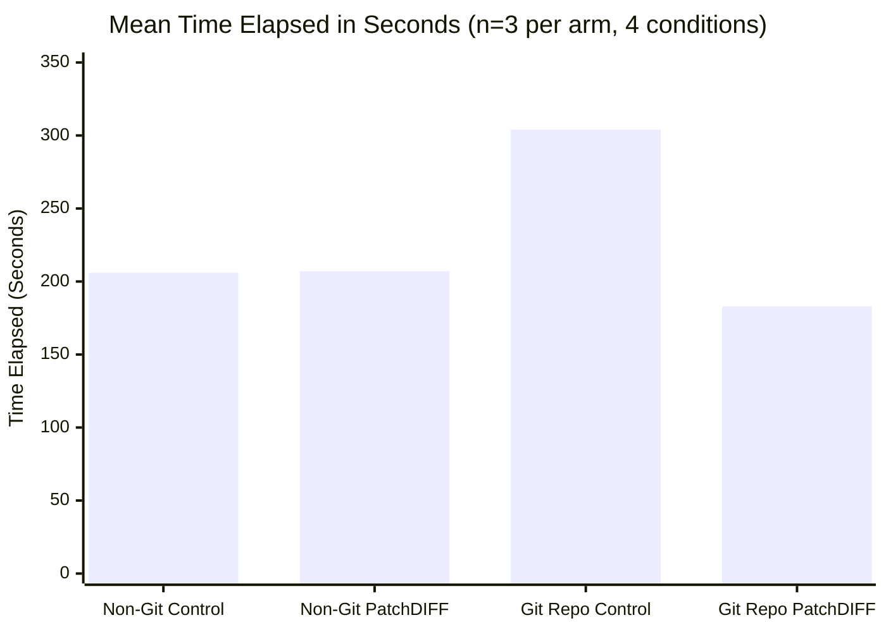

# PatchDIFF

[](https://github.com/paragon-ux/Patch-DIFF/actions/workflows/ci.yml)
[](https://paragon-ux.github.io/Patch-DIFF/)
[-blue)](https://www.python.org/)
[](https://hub.docker.com/_/postgres)
[](https://modelcontextprotocol.io/)
[](LICENSE)

**Transactional document-editing service for MCP-connected agents.**

PatchDIFF turns model-generated document edits into **explicitly preconditioned, atomic, auditable, and deterministically replayable PostgreSQL transactions** over the Model Context Protocol (MCP).

## Quickstart

Follow the [workspace quickstart](docs/guides/workspace-quickstart.md) to
install the wheel, connect to PostgreSQL 16 and configure your MCP host.
Open your project and ask the host to edit a file and save it to disk. The
workspace profile imports the file, reads or searches the working copy,
submits guarded edits and publishes with explicit SAVE.

[Claude Desktop setup](docs/guides/claude-desktop-setup.md) ·
[Workspace requests and receipts](docs/spec/profiles/workspace-profile.md)

## Structural editing benchmark

| ⚡ Time Elapsed (Git) | ⏱️ Turnaround Predictability | 📉 Context Window Burn | 🎯 Byte Accuracy |
| :---: | :---: | :---: | :---: |
| **1.66× Faster** | **4.7× Tighter** | **-64.8%** | **100.0%** |
| *(3m 03s vs. 5m 04s in Git)* | *(±20s vs. ±96s variance)* | *(1.61M tokens saved/task)* | *(0 diffs across all runs)* |



> **Evaluation Disclaimer**: Measured in the Google Antigravity agent runtime ($n=3$ per arm across 4 experimental conditions, Gemini 3.8 Flash High) comparing Modernized PatchDIFF (`observed_v2`) against the native Antigravity file-editing control baseline on a standardized 5-file, 21-edit canary task. Transcripts, seeds, and evaluation methodology are published in the [Modernized Benchmark Report](docs/benchmarks/modernized-benchmark-report.md). The earlier baseline evaluation is separated in [Legacy Benchmark Report](https://github.com/paragon-ux/Patch-DIFF/blob/56d3545d9f4369bc1e57f593dbb71bbd37128b9e/docs/legacy/git_benchmark_report.md) due to prompt confounds in early iterations.

### How Validated Hypotheses and Operational Mechanisms Drive Faster Time Elapsed

In this five-file benchmark, the Git arm averaged **3m 03s with `observed_v2` versus 5m 04s for the control**. The measurements below apply to that workflow. The single-file `workspace` profile has separate functional verification.

1. **Decoding & Context Reduction (`H1`)**: Emitting targeted patches instead of full-file rewrites cuts total context tokens by **-64.8%** (876K vs. 2.49M, saving 1.61M tokens/task, Welch $t=10.292, \text{df}=7.17, p < 0.00002$), drastically reducing model prefill and generation overhead.
2. **Reliability & Turnaround Predictability (`H7`)**: The model reliably generated valid declarative transactions, achieving **100.0% full-byte accuracy** against the oracle reference (0 byte diffs across all 12 runs × 5 canary files = 60 targets evaluated; 240/240 test assertions passed) with zero rejections, collapsing Time Elapsed standard deviation from $\pm 96.0\text{s}$ down to **$\pm 20.3\text{s}$** ($\pm 14\text{s}$ in Git).
3. **Structural Batching (Operational Finding)**: Submitting multi-scope edits in a single atomic bundle (`observed_v2`) rather than sequential roundtrips cuts interaction steps by **-55.8%** (24.2 vs. 54.8 turns, $p < 0.00001$) and tool invocations by **-57.8%** (22.7 vs. 53.8 calls, $p < 0.00001$).
4. **Authoritative State Confirmation (Operational Finding)**: Receiving cryptographic receipts (`after_hash`) under PostgreSQL row locks confirms atomic transaction application directly to the agent, eliminating the **10.0 exploratory `git diff` / `git status` commands** per task observed in the control baseline canary. Independent semantic and task validation remain host responsibilities.

| Operating Environment | Paradigm ($n=3$ per cell) | Mean Time Elapsed | Mean Steps | Mean Tool Calls | Git Commands | Mean Context Tokens | Full-Byte Match |
| :--- | :--- | :---: | :---: | :---: | :---: | :---: | :---: |
| **Non-Git Workspace** | Control Baseline | 3m 26s ± 1m 11s | 53.0 ± 3.6 | 52.0 ± 3.6 | N/A | 2,451,605 ± 507,644 | 100% (0 diffs) |
| **Non-Git Workspace** | Modernized PatchDIFF | **3m 27s ± 21s** | **26.7 ± 2.5** | **24.7 ± 4.2** | N/A | **1,001,039 ± 143,395** | **100% (0 diffs)** |
| **Git Repository** | Control Baseline | 5m 04s ± 1m 44s | 56.7 ± 6.1 | 55.7 ± 6.1 | 10.0 ± 0.0 | 2,529,918 ± 196,075 | 100% (0 diffs) |
| **Git Repository** | Modernized PatchDIFF | **3m 03s ± 14s** | **21.7 ± 1.2** | **20.7 ± 1.2** | **0.0 ± 0.0** | **750,230 ± 30,670** | **100% (0 diffs)** |

---

## System Architecture

```text
PatchDIFF server = deterministic transaction runtime + authoritative read and edit service
MCP              = transport/interface (stdio JSON-RPC / internal registry)
Host / Model     = planning, context selection, proposal generator, retry owner
PostgreSQL 16+   = canonical working copy and audit history
Workspace file   = source bytes and explicit SAVE publication destination
```

> For interactive visual flowcharts of the host transaction lifecycle and 5-stage validation pipeline, see the **[Visual Architecture & Flow](https://paragon-ux.github.io/Patch-DIFF/architecture/)** guide.

---

## Why PatchDIFF?

| Editing Problem | Conventional Approach | What PatchDIFF Provides Directly |
| --- | --- | --- |
| **Small edit in large file** | Full regeneration emits complete replacement document | `patchdiff-tx/1` and `tx/2` emit only matched/replaced spans |
| **Repeated identical text** | `str_replace` requires expanding `old_str` with surrounding lines | Explicit `occurrence_index`, `anchor_before` / `anchor_after`, or code-point spans |
| **Line-diff grammars (`diff -u`)** | Requires line-prefixed diff syntax or numeric hunk headers | Structured JSON fields (`edits[]` / `operations[]`); no delimiter collisions |
| **Coordinate & state drift** | Line-based edits assume positions remain unchanged | Required `expected_target_version` / `expected_current_hash` under `SELECT ... FOR UPDATE` |
| **Multiple changes in one file** | Single-replacement requires $N$ calls with partial failure risks | Single submission simulated sequentially in memory and applied atomically all-or-nothing |
| **Missing or ambiguous match** | Basic interfaces return uninformative error strings | Bounded diagnostics: `failure_context`, `exact_candidates`, and Levenshtein `near_misses` |
| **Lost submission response** | Host must re-read to guess if a timed-out write succeeded | Resubmitting with the same `client_request_id` returns recorded outcome (`deduplicated: true`) |
| **Audit & session history** | Host must maintain custom logging and verification | Append-only attempt log, audit ledger with runtime-derived facts, `save` & `replay` |

---

## Transaction Formats

PatchDIFF supports three structured transaction input formats (pure declarative data, no executable code):

- **`patchdiff-tx/1` (`patchdiff_submit_edits`)**: Ordered exact `MATCH/REPLACE` edits with optional `occurrence_index`, `anchor_before`, or `anchor_after` disambiguation.
- **`patchdiff-tx/2` (`patchdiff_submit_operations`)**: Ordered exact match and `[start, end)` code-point span operations with `expected_text` and optional adjacency guards.
- **`patchdiff-tx/3` (`patchdiff_submit_replacement`)**: Sole explicit whole-document replacement (`<= 1,000,000` code points and `<= 1,048,576` UTF-8 bytes).

All formats require `expected_target_version` and/or `expected_current_hash` and are processed by the same deterministic core engine. See [Transaction formats](docs/spec/transaction-formats.md) and [Host Integration Guide](docs/guides/host-integration-guide.md) for full request schemas and examples.

---

## MCP Profiles & Tool Surface

Set `PATCHDIFF_MCP_PROFILE` before starting the server. The default
`editor` profile exposes seven tools for an existing target. Choose
[`workspace`](docs/spec/profiles/workspace-profile.md) for 5-tool exact text file import and publication,
[`observed_workspace`](docs/spec/profiles/workspace-profile.md) for 7-tool structural AST observation with direct publication,
[`observed_v2`](docs/spec/profiles/observed-editor-v2.md) for structural editing
with explicit snapshots, or `full` for the 17-tool trusted lifecycle catalog. The
[profile catalog](docs/spec/profiles/index.md) lists every tool set.

---

## Documentation

Full documentation is available on the **[Zensical Documentation Site](https://paragon-ux.github.io/Patch-DIFF/)**:

- **Visual Architecture**: [Visual Architecture & Transaction Lifecycle](docs/architecture.md)
- **Specifications**: [Core Runtime](docs/spec/core-runtime.md) | [MCP Tools](docs/spec/mcp-tools.md) | [Data Model](docs/spec/data-model.md) | [Transaction Formats](docs/spec/transaction-formats.md) | [Batch Editing](docs/spec/structural-batch-editing.md)
- **MCP Profiles**: [Profile Catalog](docs/spec/profiles/index.md) | [Workspace](docs/spec/profiles/workspace-profile.md) | [Observed Editor v2](docs/spec/profiles/observed-editor-v2.md)
- **Guides**: [Host Integration Guide](docs/guides/host-integration-guide.md) | [Claude Desktop Setup](docs/guides/claude-desktop-setup.md) | [Workspace Editing](docs/guides/workspace-quickstart.md) | [Observed Workflow](docs/guides/observed-editor-workflow.md)
- **Whitepapers**: [Concept Paper v6](docs/papers/concept-paper-v6.md) | [Modernization Architecture](docs/papers/modernization-architecture.md)
- **Benchmarks**: [Modernized Benchmark](docs/benchmarks/modernized-benchmark-report.md) | [Test Matrix](docs/benchmarks/test-matrix.md)
- **Standards**: [PR Review Standard](docs/standards/pr-review-standard.md) | [Release Readiness](docs/standards/release-readiness.md)

---

## License

[MIT](LICENSE)
