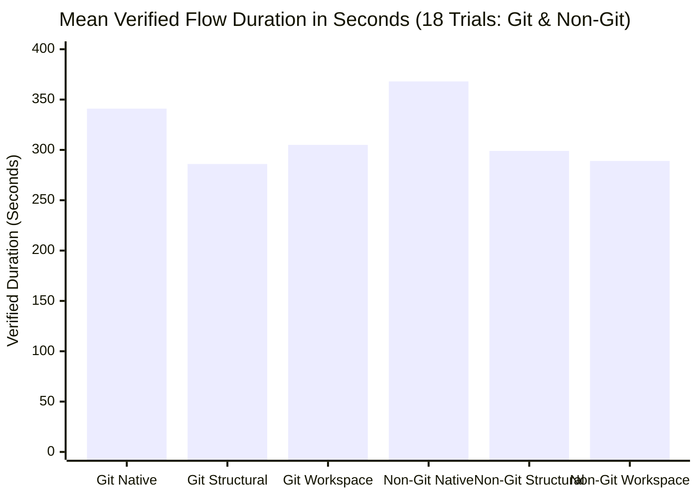

# PatchDIFF

[](https://github.com/paragon-ux/Patch-DIFF/actions/workflows/ci.yml)
[](https://paragon-ux.github.io/Patch-DIFF/)
[-blue)](https://www.python.org/)
[](https://hub.docker.com/_/postgres)
[](https://modelcontextprotocol.io/)
[](LICENSE)

**Transactional document-editing service for MCP-connected agents.**

PatchDIFF turns model-generated document edits into **explicitly preconditioned, atomic, auditable, and deterministically replayable PostgreSQL transactions** over the Model Context Protocol (MCP).

## Quickstart

Follow the [workspace quickstart](docs/guides/workspace-quickstart.md) to
install the wheel, connect to PostgreSQL 16 and configure your MCP host.
Open your project and ask the host to edit a file and save it to disk. The
workspace profile imports the file, reads or searches the working copy,
submits guarded edits and publishes with explicit SAVE.

[Claude Desktop setup](docs/guides/claude-desktop-setup.md) ·
[Workspace requests and receipts](docs/spec/profiles/workspace-profile.md)

## Workspace editing benchmark

| ⚡ Verified Flow Duration | 📉 Editor Tool Invocations | 🔄 Host Lifecycle Calls | 🎯 Full-Byte Accuracy |
| :---: | :---: | :---: | :---: |
| **16.2% Faster** | **-42.7% Calls** | **0 Separate Calls** | **100.0%** |
| *(296.7s vs. 354.2s pooled)* | *(32.0 vs. 55.8 calls/task)* | *(Agent-owned SAVE vs. 20 host calls)* | *(90/90 files, 360/360 checks)* |



> **Evaluation Disclaimer**: Measured in Google Antigravity ($n=3$ per cell across 6 conditions, 18 total trials, operator-attested Gemini 3.8 Flash High) comparing agent-owned Workspace (`observed_workspace`), host-orchestrated structural editing (`observed_v2`), and native file editing on a standardized 5-file, 21-edit canary task. Preparation and owner connector handoffs are excluded from the verified flow interval and recorded separately as setup overhead. The [Workspace Benchmark Report](docs/benchmarks/workspace-e2e-benchmark.md) publishes the methodology and sanitized per-trial metrics and hashes. Raw transcripts and full receipts remain in the private capture packet.

### Measured Workspace Execution and Host Lifecycle

Across all 18 trials, agent-owned Workspace averaged **296.7s vs. 354.2s for Native (16.2% faster pooled; up to 28.3% faster in Non-Git median)** while reducing editor tool calls from **55.8 down to 32.0 (-42.7%)**:

1. **Context-Gathering Reduction**: Workspace averaged 6 `list_scopes`, 5 `observe_scopes` and 1.67 exact-search calls per trial; Native averaged 34.83 `read_file` calls. This workflow comparison does not isolate indexing from prompt policy, context acquisition or batching.
2. **Self-Contained Agent Lifecycle (`observed_workspace`)**: The editing agent imports files (`initialize_target`), submits guarded multi-scope bundles (`commit_bundle`), and publishes directly to project files (`save` with `sync_workspace: true`) through its own 7 MCP tools. This eliminates the **20 separate host lifecycle calls and 5 host file writes per trial** required by standalone structural mode.
3. **Turnaround Consistency & Zero Retries**: All 18 trials achieved **100.0% full-byte accuracy** against the independent oracle across all 90 target files (0 byte diffs) and passed **360/360 behavioral assertions**, with 0 MCP errors, 0 rejections, and 0 native retries.
4. **Dominant Paired Performance**: Workspace finished faster than its same-block Native control in **all 6 paired comparisons** across both Git and Non-Git environments.

| Environment | Arm | Mean Verified Flow s | Median Verified s | Mean Steps | Mean Editor Calls | Separate Host Calls / Writes | Full-Byte Match | Behavioral Suite |
| :--- | :--- | :---: | :---: | :---: | :---: | :---: | :---: | :---: |
| **Git Repository** | Native Baseline | 340.94s | 330.32s | 52.67 | 52.00 | 0 / 0 | 100% (15/15) | 60/60 (100%) |
| **Git Repository** | Structural / `observed_v2` | **286.14s** | **299.42s** | **30.00** | **29.00** | 20 / 5 | 100% (15/15) | 60/60 (100%) |
| **Git Repository** | Workspace / `observed_workspace` | **304.65s** | **307.74s** | **31.67** | **30.67** | **0 / 0** | 100% (15/15) | 60/60 (100%) |
| **Non-Git Workspace** | Native Baseline | 367.53s | 398.03s | 60.67 | 59.67 | 0 / 0 | 100% (15/15) | 60/60 (100%) |
| **Non-Git Workspace** | Structural / `observed_v2` | **299.34s** | **281.28s** | **35.33** | **34.33** | 20 / 5 | 100% (15/15) | 60/60 (100%) |
| **Non-Git Workspace** | Workspace / `observed_workspace` | **288.84s** | **285.55s** | **34.33** | **33.33** | **0 / 0** | 100% (15/15) | 60/60 (100%) |
| **Pooled (Git + Non-Git)** | Native Baseline | 354.23s | 364.17s | 56.67 | 55.83 | 0 / 0 | 100% (30/30) | 120/120 (100%) |
| **Pooled (Git + Non-Git)** | Structural / `observed_v2` | 292.74s | 290.35s | 32.67 | 31.67 | 20 / 5 | 100% (30/30) | 120/120 (100%) |
| **Pooled (Git + Non-Git)** | Workspace / `observed_workspace` | **296.74s** | **296.54s** | **33.00** | **32.00** | **0 / 0** | 100% (30/30) | 120/120 (100%) |

---

## System Architecture

```text
PatchDIFF server = deterministic transaction runtime + authoritative read and edit service
MCP              = transport/interface (stdio JSON-RPC / internal registry)
Host / Model     = planning, context selection, proposal generator, retry owner
PostgreSQL 16+   = canonical working copy and audit history
Workspace file   = source bytes and explicit SAVE publication destination
```

> For interactive visual flowcharts of the host transaction lifecycle and 5-stage validation pipeline, see the **[Visual Architecture & Flow](https://paragon-ux.github.io/Patch-DIFF/architecture/)** guide.

---

## Why PatchDIFF?

| Editing Problem | Conventional Approach | What PatchDIFF Provides Directly |
| --- | --- | --- |
| **Small edit in large file** | Full regeneration emits complete replacement document | `patchdiff-tx/1` and `tx/2` emit only matched/replaced spans |
| **Repeated identical text** | `str_replace` requires expanding `old_str` with surrounding lines | Explicit `occurrence_index`, `anchor_before` / `anchor_after`, or code-point spans |
| **Line-diff grammars (`diff -u`)** | Requires line-prefixed diff syntax or numeric hunk headers | Structured JSON fields (`edits[]` / `operations[]`); no delimiter collisions |
| **Coordinate & state drift** | Line-based edits assume positions remain unchanged | Required `expected_target_version` / `expected_current_hash` under `SELECT ... FOR UPDATE` |
| **Multiple changes in one file** | Single-replacement requires $N$ calls with partial failure risks | Single submission simulated sequentially in memory and applied atomically all-or-nothing |
| **Missing or ambiguous match** | Basic interfaces return uninformative error strings | Bounded diagnostics: `failure_context`, `exact_candidates`, and Levenshtein `near_misses` |
| **Lost submission response** | Host must re-read to guess if a timed-out write succeeded | Resubmitting with the same `client_request_id` returns recorded outcome (`deduplicated: true`) |
| **Audit & session history** | Host must maintain custom logging and verification | Append-only attempt log, audit ledger with runtime-derived facts, `save` & `replay` |

---

## Transaction Formats

PatchDIFF supports three structured transaction input formats (pure declarative data, no executable code):

- **`patchdiff-tx/1` (`patchdiff_submit_edits`)**: Ordered exact `MATCH/REPLACE` edits with optional `occurrence_index`, `anchor_before`, or `anchor_after` disambiguation.
- **`patchdiff-tx/2` (`patchdiff_submit_operations`)**: Ordered exact match and `[start, end)` code-point span operations with `expected_text` and optional adjacency guards.
- **`patchdiff-tx/3` (`patchdiff_submit_replacement`)**: Sole explicit whole-document replacement (`<= 1,000,000` code points and `<= 1,048,576` UTF-8 bytes).

All formats require `expected_target_version` and/or `expected_current_hash` and are processed by the same deterministic core engine. See [Transaction formats](docs/spec/transaction-formats.md) and [Host Integration Guide](docs/guides/host-integration-guide.md) for full request schemas and examples.

---

## MCP Profiles & Tool Surface

Set `PATCHDIFF_MCP_PROFILE` before starting the server. The default
`editor` profile exposes seven tools for an existing target. Choose
[`workspace`](docs/spec/profiles/workspace-profile.md) for 5-tool exact text file import and publication,
[`observed_workspace`](docs/spec/profiles/workspace-profile.md) for 7-tool structural AST observation with direct publication,
[`observed_v2`](docs/spec/profiles/observed-editor-v2.md) for structural editing
with explicit snapshots, or `full` for the 17-tool trusted lifecycle catalog. The
[profile catalog](docs/spec/profiles/index.md) lists every tool set.

---

## Documentation

Full documentation is available on the **[Zensical Documentation Site](https://paragon-ux.github.io/Patch-DIFF/)**:

- **Visual Architecture**: [Visual Architecture & Transaction Lifecycle](docs/architecture.md)
- **Specifications**: [Core Runtime](docs/spec/core-runtime.md) | [MCP Tools](docs/spec/mcp-tools.md) | [Data Model](docs/spec/data-model.md) | [Transaction Formats](docs/spec/transaction-formats.md) | [Batch Editing](docs/spec/structural-batch-editing.md)
- **MCP Profiles**: [Profile Catalog](docs/spec/profiles/index.md) | [Workspace](docs/spec/profiles/workspace-profile.md) | [Observed Editor v2](docs/spec/profiles/observed-editor-v2.md)
- **Guides**: [Host Integration Guide](docs/guides/host-integration-guide.md) | [Claude Desktop Setup](docs/guides/claude-desktop-setup.md) | [Workspace Editing](docs/guides/workspace-quickstart.md) | [Observed Workflow](docs/guides/observed-editor-workflow.md)
- **Whitepapers**: [Concept Paper v6](docs/papers/concept-paper-v6.md) | [Modernization Architecture](docs/papers/modernization-architecture.md)
- **Benchmarks**: [Workspace Benchmark](docs/benchmarks/workspace-e2e-benchmark.md) | [Test Matrix](docs/benchmarks/test-matrix.md)
- **Standards**: [PR Review Standard](docs/standards/pr-review-standard.md) | [Release Readiness](docs/standards/release-readiness.md)

---

## License

[MIT](LICENSE)
