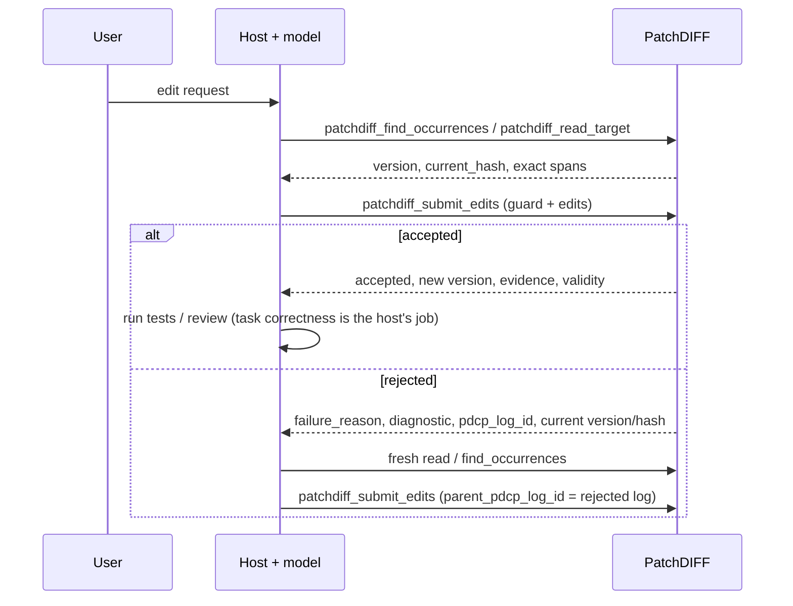

# PatchDIFF Host Integration Guide

Audience: the host that talks to the model (chat client, agent loop, skill author). This is where the instructions live that the server used to inject through `patchdiff_build_prompt_context` and the regeneration prompts.

Why this document exists: the server is a transaction service; the host owns planning, wording, retry and compaction ([MODERNIZATION_ARCHITECTURE.md](MODERNIZATION_ARCHITECTURE.md), A1). If the host's behavior is only specified in server-built prompt strings, it cannot be versioned, reviewed or adapted per host. Here it can. Contract details are in [MCP_TOOLS.md](MCP_TOOLS.md); this guide says how to *use* them.

## Goal F Pass B contract

The [Pass B decision](usability/PASS-B-decision.md) defines F09/F10/F11/F12 before implementation. New patchdiff_submit_replacement records guarded tx/3 sole replace_all on immutable0.4.0 through the existing locked pipeline; tx/2/0.3.0 remain unchanged. Fresh replacement raw/result limits are1,000,000 code points and1,048,576 UTF-8 bytes each (inclusive). Invalid Unicode keeps audited classification; existing-key recovery/conflict precedes fresh admission. Oversized valid fresh replacements return pre-admission invalid_argument/replacement_too_large without writes; replay bypasses admission limits. Empty replacement is valid; one typed ledger row records full original span and operation=replace_all.

patchdiff_read_lines uses one ordinary column observation under no_autoflush, one-based inclusive LF-only line ranges, trailing newline inclusion and final empty line, range-relative offset continuation, default4000/cap8000 code points. It never edits or flushes local state. patchdiff_preview uses the same fresh read-only guard/decode/apply evaluator as submit with coherent ordinary observation, explicit format and pending-local-target rejection. Preview has no request-key/audit/lineage parameter, writes/locks/commit/rollback; accepted previews return facts/hash, rejected previews no partial facts. It never invokes post-commit near misses. Submission always re-locks/rechecks.

Discovery publishes bounded schema-conforming examples, copied per result, at most65,536 compact ASCII-escaped JSON bytes overall and8192 for the complete examples map. Every advertised(tool,index) is bound to real returned IDs/guards/parents/cursors and executed over stdio/PostgreSQL, including exact dedup and complete attempt-descending/ledger-page-ascending traversal. No migration, optional typed guards, normalized identity, editing adapter, model-success or representative production-performance claim. V02/V04 remain limited to local synthetic evidence because no representative sanitized dataset/benchmark threshold was supplied.


## Goal F Pass A contract

### Executable discovery example sequence

`tools/list` includes 13 illustrative `inputSchema.examples` across nine tools. They are arguments, not pre-existing resources. Initialize `alpha alpha\n🌟 中\n`, bind its real UUID and observed guard, then execute: read; find; typed example0 (second occurrence); resend those exact bound arguments for dedup; typed example1 (intentional missing match); typed example2 with the returned rejection UUID as parent and version1; span example at version2; sole replacement at version3; line read; preview at version4. The replacement leaves `Final text\n`; accepted preview proposes `Reviewed text\n` but does not commit it. Keep the original rejection diagnostic immutable and expect four accepted facts/five attempts. Never substitute the new version into the original keyed proposal when recovering it.

Execute each history tool's first example, bind its returned `next_sequence` into the continuation example, and repeat until `has_more=false`. Attempts display descending sequences; ledger displays ascending sequences within each newest page. A cursor is exclusive in both tools. `docs/usability/PASS-B-live-verify.py` executes every advertised pair through real stdio with schema validation, nonvacuous paging and independent SQL assertions. This is executable API coverage, not a model success-rate measurement.

Line-range continuation uses the same selected line range plus `next_offset`; a later call observes a fresh version/hash and can change under concurrent edits. Preview uses no retry key and never reserves one; use a version guard when submitting after preview. A content hash alone cannot detect intervening no-op or ABA changes. Whole-target replacement requires explicit user/host intent through its separate tool and a guard; the ordinary match/span tools keep their existing formats.

The normative [Pass A decision](usability/PASS-A-decision.md) defines F03/F05/F06/F07 fields, bounds, omission states, ownership and compatibility before implementation. `include_correlation_id=false` is a boolean response option on submissions; true emits a fresh UUIDv4 even on exact recovery. Invalid types return pre-admission invalid_argument with no attempt. Correlation never enters durable records, request keys or fingerprints.

New applicability ambiguity/selector failures retain at most five exact candidates (20 code points each side,64 match preview;8192 compact ASCII-escaped JSON bytes including wrapper), stage/prior-change/observed identity and explicit truncation; no cursor or selection. Absent/sequential failures retain at most 64 code points of immutable query evidence (1024 wrapper bytes). Response-only near misses compare only the original at-most-256-point failure prefix after actual successful service-owned commit/lock release; caller-owned transactions omit with caller_transaction. Work is at most 1,000,000 Levenshtein cells, windows query length±1, distance threshold min(4,max(1,length//4)), at most three candidates ranked distance/start/end,16-point context each side and8192 wrapper bytes. Exhaustion/oversize/historical inputs have explicit omission; unexpected post-commit errors propagate without claiming rollback. Original diagnostics stay immutable on recovery. New enrichment fields combined are at most18432 compact ASCII-escaped JSON bytes; this excludes preexisting arbitrary evidence.

`patchdiff_submit_operations` records `patchdiff-tx/2`: intent, mandatory guard and ordered explicit match/span operations. Span start/end are non-bool integers 0..2^63-1, end exclusive and end>=start; expected_text/replace are required strings. Coordinates describe each sequential canonical buffer; exact canonical expected text must equal that span. Empty-span insertion is allowed with empty expected text; selectors on span and unknown fields/operations reject. Mixed match/span edits are atomic. Applicability errors are span_out_of_bounds and span_expected_text_mismatch. Both forms use the existing locked submit/rejection/ledger path. New records use immutable patchdiff-mvp-0.3.0 enabling span operations; old forms keep 0.2.2 and unchanged records/fingerprints/profiles. Replay refuses unsupported profile/operation pairs. Span facts include operation=span and existing runtime-derived hashes/spans/counts; ledger origin remains typed. No migration or replace_all in 0.3.0. Discovery advertises operation schema and x-patchdiff-capabilities; worked discovery examples remain Pass B.


## 0. Stdio transport and host refresh

Send newline-delimited JSON-RPC as UTF-8. The external process entry point configures stdin/stdout as UTF-8 with strict errors, including on Windows; it does not rely on the ambient pipe code page. Malformed wire bytes are not repaired. Valid JSON escapes remain decoded proposal data, so escaped surrogate/NUL strings retain their documented domain rejection and audit behavior below.

For older adapter revisions, set PYTHONIOENCODING=utf-8 in the server environment. Literal Unicode can otherwise be misdecoded and persisted even when the call succeeds; an ASCII-escaped request alone does not test this path. This setting remains compatible with the fixed adapter.

After changing a server command or environment, use the host-supported server refresh or application restart and verify its active tool connection. Refresh behavior depends on the host; do not assume an existing process adopted new configuration. The reported Antigravity process-kill failure remains unverified here.

## 1. What PatchDIFF does and does not do for you

| PatchDIFF guarantees | PatchDIFF does not do |
| --- | --- |
| Exact, case- and whitespace-sensitive matching against canonical (LF) text | Fuzzy, semantic or language-aware matching; automatic repair |
| Rejects a proposal made against stale state (version/hash guard) | Merge concurrent edits |
| All edits in one submission apply, or none do (per target) | Atomicity across several targets |
| Durable log of accepted **and** rejected attempts with failure labels and lineage | Judge whether an edit achieves the user's goal |
| Deterministic replay from initial content plus accepted history | Track edits made to an exported copy outside PatchDIFF |

Accepted means *protocol-valid and transaction-valid*. `validity.task_correct` and `validity.semantic` are always `"not_evaluated"`. Run tests, linters and review in the host.

## 2. The standard loop



1. **Read first.** Use `patchdiff_read_target` for a region (by code-point offset) or `patchdiff_find_occurrences` to locate a string. Both return `version` and `current_hash`. Do not copy from a stale summary or a cached earlier read.
2. **Submit with a guard.** Pass `expected_target_version` and/or `expected_current_hash` from the read you based the edit on. Typed submissions without a guard are rejected (`context_missing`).
3. **On rejection, re-read, don't guess.** Match the label to the action:

| `failure_reason` | Meaning | Host action |
| --- | --- | --- |
| `target_version_mismatch`, `target_hash_mismatch`, `target_diverged` | Target changed since your read | Re-read, re-derive the edit from fresh text |
| `match_absent` | Text not present (exactly) | Re-read the region; check case, whitespace, line endings |
| `sequential_match_invalid` | Later edit matched the original but not the progressively edited text | Rewrite later edits against the result of earlier ones |
| `match_ambiguous` | More than one exact span; `diagnostic.occurrence_count` says how many | Lengthen `match`, or add `occurrence_index` / `anchor_before` / `anchor_after` (indexes from `find_occurrences`) |
| `disambiguation_invalid` | Selector did not isolate one span | Use `find_occurrences` and pick a valid `occurrence_index` |
| `manifest_*`, `block_malformed`, `context_*` | Malformed typed input | Fix the request shape |

4. **Link retries.** Set `parent_pdcp_log_id` to the rejected attempt and `attempt` to your own counter. The rejected row stays in the log. Retry limits are your policy; the server enforces none.
5. **Do not ask the server for a regeneration prompt.** Those tools are deprecated.

## 3. Typed submission

```json
{
  "target_file_id": "…",
  "expected_target_version": 3,
  "intent": "Rename the product in the introduction.",
  "edits": [
    {"match": "Acme Widget", "replace": "Acme Gadget",
     "rationale": "Product was renamed.", "occurrence_index": 1}
  ],
  "parent_pdcp_log_id": "…optional, on retries…",
  "attempt": 2
}
```

- `match` and `replace` are exact strings. Quotes, backslashes, and delimiter-looking lines are fine because they are JSON fields, not a text envelope.
- `match` must be non-empty. Empty `replace` deletes.
- Edits apply **sequentially**: edit 2 sees the text after edit 1.
- `intent`, `rationale` and `risk` are **advisory claims**. They are recorded but never used for matching, and the ledger never presents them as verified meaning.
- What the runtime derived (spans, lengths, payload hashes) comes back under `evidence.changes[]` and is stored in the ledger's `derived` field. Trust that, not the prose, when reviewing.

### Selector constraints on a single occurrence

Current submissions use runtime 0.2.2. Every supplied selector must hold, even if the match occurs only once. Anchors mean anywhere before or after the match, not necessarily adjacent. For target text hello, this typed request rejects with disambiguation_invalid and leaves the target unchanged:

```json
{"target_file_id":"11111111-1111-1111-1111-111111111111","expected_target_version":0,"intent":"Replace greeting","edits":[{"match":"hello","replace":"goodbye","occurrence_index":2}]}
```

The equivalent legacy proposal also rejects when submitted with the same target/version guard:

```json
{
  "target_file_id": "11111111-1111-1111-1111-111111111111",
  "expected_target_version": 0,
  "pdcp_content": "PDCP 0.2.3\ntarget_file_id: 11111111-1111-1111-1111-111111111111\ntarget_type: text/plain\n\n# MANIFEST\n# change_id: greeting\n# intent: Replace greeting.\n# input_state: hello exists.\n# output_state: goodbye should exist.\n# affected_region: greeting\n# user_visible_change: Greeting changes.\n# risk: low\n# occurrence_index: 2\n\n<<<<<<< MATCH\nhello\n=======\ngoodbye\n>>>>>>> REPLACE"
}
```

Use occurrence_index 1, omit selectors for a unique match, or supply anchors that actually hold. An index and anchors are combined constraints. Historical accepted logs recorded under 0.1.0, 0.2.0 or 0.2.1 retain their ignored-singleton-selector behavior on replay; resubmitting them as new proposals uses the current behavior.

### Invalid text and safe rejected evidence

Send valid Unicode text. An escaped lone surrogate in JSON is not a valid text character; NUL also cannot be stored in PostgreSQL text. A known-target proposal containing these values receives target_encoding_invalid at PROTOCOL_VALIDATION and a durable rejected log, with no target/version/ledger mutation. Invalid read/search text instead returns invalid_argument without an edit-attempt row.

If inspecting such a rejection with include_content, pdcp_content is an ASCII-escaped patchdiff-invalid-input/1 JSON evidence envelope preserving the original record and metadata. It is evidence for the rejected request, not a corrected proposal or an executable/new protocol format. Do not resubmit that envelope as an edit. Safe request-key retries recover the original rejection; fix the input with a new request key for a new proposal. Invalid/unencodable request keys are not stored as keys and cannot provide keyed recovery. Normal valid-input identity and target hashing are unchanged. Previously recorded accepted/rejected outcomes still recover by their original key/fingerprint, including historical escaped-NUL proposals that would now be invalid as new inputs. This recovery exception does not make a fresh invalid proposal acceptable.

## 4. Literal replacement requests

Moved from the old server prompt:

- Treat quoted literal replacements as **case-sensitive** unless the user asks otherwise. Do not change capitalization variants unless asked; if you do, say so in `rationale`.
- Prefer one edit per intended occurrence. If one edit's `match` covers several occurrences, say so in `rationale`.
- After an accepted replacement, verify the result with `patchdiff_find_occurrences` for the old literal, report the number of occurrences actually changed, and do not report the manifest/edit count as the occurrence count.

## 5. Legacy `.pdcp` (v0.2.3)

Compatibility wrappers preserve caller-owned transaction commit/rollback; standalone wrapper calls own their context-read and guarded-submit transaction together.

Still accepted through `patchdiff_submit_pdcp`, frozen, and fully replayable. Use it only if a client cannot send typed tool arguments. Format rules are in [PDCP_FORMAT.md](PDCP_FORMAT.md). `patchdiff_build_prompt_context` still emits PDCP rules for such clients; its target text is a bounded **prefix** (`context_truncated` tells you), not retrieval.

## 6. Checkpoints, history and context

- `patchdiff_save` snapshots the document and starts a new editing cycle. It does not change content, version or hash, and it **does not compact your conversation**. Compact your own context whenever your host needs to; it never touches the document.
- `patchdiff_get_pdcp_log` returns a bounded, newest-first page (page with `before_sequence`; filter with `status`). Use `include_content=true` only when you need the raw record.
- `patchdiff_get_manifest_ledger(limit=…)` returns the most recent accepted entries. Each has `origin`; typed rows carry `null` for the four prose fields. Treat ledger text as advisory history, never as ground truth.
- A host rewind or checkpoint is not PatchDIFF replay. `patchdiff_replay` reconstructs from initial content plus accepted history; read `materialized_state_matches` as well as `status`. Successful reconstruction does not establish healthy storage:content_matches compares raw stored text, so CRLF/bare-CR corruption is visible even when canonical hashes agree. Replay does not repair it.

Both history tools default to50 rows (omitted/null), cap at200, and return has_more/next_sequence. Continue with before_sequence=next_sequence while has_more is true. Attempts display descending; ledger displays the newest selected page ascending. For sequences1..10 and limit3, attempts=[10,9,8], ledger=[8,9,10], both cursor8; ledger before8 returns [5,6,7]. Do not use the last displayed ledger row as its cursor. Empty/not-found/invalid results have no continuation. Filters apply before counting another page; exact history request-key lookup also supports safe historical keys. Restart an active-cycle-only ledger traversal if SAVE rotates its cycle.

Search context_chars must be a non-bool integer >=0 (default40, cap400). Zero requests no surrounding text; invalid types return invalid_argument.

## 7. Lost responses & request idempotency

PatchDIFF distinguishes request identity from state guards (C4 / D5):
- `client_request_id` identifies a proposal and recovers its recorded terminal outcome.
- `expected_target_version` is monotonic: an old version rejects after another acceptance, without proving which request committed.
- `expected_current_hash` checks state, not request identity. A no-op edit keeps the hash; an ABA sequence restores it. An unkeyed hash-only retry can therefore apply again.

### Inspect rejection context

`diagnostic.failure_context` describes the original failure; `current_context` separately describes the current locked canonical target. Both are bounded prefixes (at most 256 code points; 4,096 compact ASCII-escaped JSON bytes each, 8,192 combined with wrapper keys), not a guarantee that the failed match lies in the snippet. Read/search for additional context. See MCP_TOOLS for fields and unavailable reasons.

A later sequential failure can name `intermediate_buffer` with `prior_changes > 0`: earlier edits were simulated, not committed. Its observed hash/version still name transaction-start state. Current context always names canonical state. Do not apply intermediate indices to committed content. On exact keyed recovery after later edits, failure context and the entire original diagnostic stay unchanged while current context can differ. Old outcomes may lack failure context. Explicit unavailable state covers malformed/missing targets and pending local ORM modifications; empty text with `available: true` is a real empty target. Caller-owned transaction observations may remain provisional until commit.

### Preserve the original proposal for recovery (C4 / D01)

Keep the decoded proposal structure and original guards when retrying a lost response. The fingerprint includes the full canonical typed record, including intent, ordered raw edits, selectors and advisory fields, plus the protocol/target/content-hash/guard/parent envelope. Equivalent wire JSON whitespace, object-key order or Unicode escape spelling is harmless. Rewording intent or rationale, changing risk/selectors/guards, reordering edits, replacing an omitted optional edit field with null, or supplying an otherwise default change_id creates a different proposal even if the resulting text would match. Omitted/null top-level guards both become null.

LF and CRLF inside typed match/replace/anchor/prose values produce different escaped JSON strings and different identities; the runtime may still normalize them for matching. Legacy raw PDCP content hashes instead normalize actual line endings. This release preserves both existing rules. Do not regenerate a supposedly equivalent proposal to recover an earlier response; resend the original structure with its original key. Normal submission source/attempt metadata is outside ordinary fingerprint identity; invalid-text evidence has its separately documented identity domain.

For parent_pdcp_log_id, an eligible same-target rejected parent UUID canonicalizes. A missing, accepted, cross-target or malformed parent is rejected and retains its original spelling in identity. Retrying such a rejection with changed UUID casing can conflict; preserve the supplied spelling. DEV-SVC-002 broader parent normalization is deliberately not adopted here because existing rejected fingerprints must remain recoverable.

### Keyed recovery (recommended)

Choose a distinct `client_request_id`: 1–128 printable ASCII characters without whitespace, such as `req-001`. A UUID is an allowed choice, not a requirement.

If a response is lost, resend the identical proposal with the same request ID and original guards. Under the target lock, the service returns the recorded outcome with `deduplicated: true`, without reapplying it, even if target state has since advanced. Reusing that ID for different proposal content rejects with `failure_reason: "context_invalid"` and `diagnostic.existing_pdcp_log_id`; it does not overwrite the original attempt.

A conflicting reuse returns a newly persisted rejection log ID. Its row has a NULL client key, links the original log, and retains the submitted fingerprint. Repeating the conflict creates another rejected attempt; it never replaces the original keyed result. Use the exact original proposal/key to recover that original outcome. The submitted-key diagnostic is a bounded preview, not a new normalized identity.

Database integrations must preserve transaction ownership: an outcome inside an outer transaction is provisional until that owner commits; rollback removes it and releases its target lock. Supported lock/recovery behavior is verified at READ COMMITTED. Stronger-isolation retry/error handling belongs to the outer owner, not a hidden retry inside PatchDIFF.


### Unkeyed recovery

Typed submission requires a version and/or hash guard. Legacy `patchdiff_submit_pdcp` keeps guards optional for compatibility; an unguarded retry has no state-guard protection. Prefer a request ID for both formats.

After an unkeyed timeout:

1. Query `patchdiff_get_pdcp_log`, using `content_hash` when available and `include_content: true` when needed. Compare the original payload, guards and lineage. Page backward with the oldest returned `log_sequence` as `before_sequence` until the relevant history is examined; an empty page ends traversal. A five-entry sample or a one-version advance is not proof of request identity.
2. Absence from one page does not mean the request never arrived. Even after traversal, a still-running original call may commit later; identical unkeyed proposals may be indistinguishable. Treat an ambiguous outcome as unknown. Read current state authoritatively and reconcile the requested effect before generating another proposal; do not infer permission to reapply from missing history alone.
3. When a replacement proposal is warranted, derive it from a fresh read, assign a new request ID, and link `parent_pdcp_log_id` only to a known rejected attempt. If the earlier attempt is known accepted, continue from its result.

## 8. What is outside the guarantee

PatchDIFF's guarantees cover the managed target in Postgres. An exported file edited elsewhere, a shell, another database writer, or another editor can change content PatchDIFF never sees. A skill or instruction asking the model to "use PatchDIFF" is guidance, not enforcement. Re-importing an edited export is a **new upload and a new target**; nothing is merged or synchronized.

## 9. Host skill checklist

A host skill or system prompt for PatchDIFF should say, at minimum: read before editing; always pass a guard; on rejection re-read before retrying; set `parent_pdcp_log_id` on retries; treat `intent`/`rationale` as claims; never describe an accepted edit as correct, only as applied; run task validators outside PatchDIFF; do not treat a local copy as authoritative.
