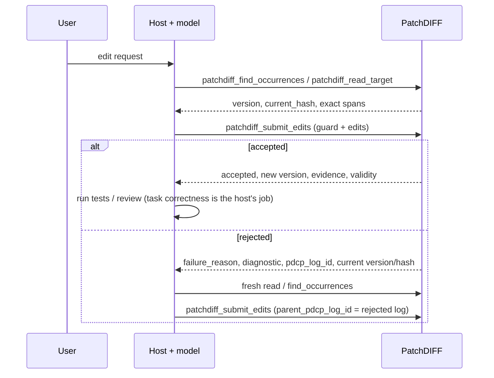

# PatchDIFF Host Integration Guide

Audience: the host that talks to the model (chat client, agent loop, skill author). This is where the instructions live that the server used to inject through `patchdiff_build_prompt_context` and the regeneration prompts.

Why this document exists: the server is a transaction service; the host owns planning, wording, retry and compaction ([MODERNIZATION_ARCHITECTURE.md](MODERNIZATION_ARCHITECTURE.md), A1). If the host's behavior is only specified in server-built prompt strings, it cannot be versioned, reviewed or adapted per host. Here it can. Contract details are in [MCP_TOOLS.md](MCP_TOOLS.md); this guide says how to *use* them.

## 1. What PatchDIFF does and does not do for you

| PatchDIFF guarantees | PatchDIFF does not do |
| --- | --- |
| Exact, case- and whitespace-sensitive matching against canonical (LF) text | Fuzzy, semantic or language-aware matching; automatic repair |
| Rejects a proposal made against stale state (version/hash guard) | Merge concurrent edits |
| All edits in one submission apply, or none do (per target) | Atomicity across several targets |
| Durable log of accepted **and** rejected attempts with failure labels and lineage | Judge whether an edit achieves the user's goal |
| Deterministic replay from initial content plus accepted history | Track edits made to an exported copy outside PatchDIFF |

Accepted means *protocol-valid and transaction-valid*. `validity.task_correct` and `validity.semantic` are always `"not_evaluated"`. Run tests, linters and review in the host.

## 2. The standard loop



1. **Read first.** Use `patchdiff_read_target` for a region (by code-point offset) or `patchdiff_find_occurrences` to locate a string. Both return `version` and `current_hash`. Do not copy from a stale summary or a cached earlier read.
2. **Submit with a guard.** Pass `expected_target_version` and/or `expected_current_hash` from the read you based the edit on. Typed submissions without a guard are rejected (`context_missing`).
3. **On rejection, re-read, don't guess.** Match the label to the action:

| `failure_reason` | Meaning | Host action |
| --- | --- | --- |
| `target_version_mismatch`, `target_hash_mismatch`, `target_diverged` | Target changed since your read | Re-read, re-derive the edit from fresh text |
| `match_absent` | Text not present (exactly) | Re-read the region; check case, whitespace, line endings |
| `sequential_match_invalid` | Later edit matched the original but not the progressively edited text | Rewrite later edits against the result of earlier ones |
| `match_ambiguous` | More than one exact span; `diagnostic.occurrence_count` says how many | Lengthen `match`, or add `occurrence_index` / `anchor_before` / `anchor_after` (indexes from `find_occurrences`) |
| `disambiguation_invalid` | Selector did not isolate one span | Use `find_occurrences` and pick a valid `occurrence_index` |
| `manifest_*`, `block_malformed`, `context_*` | Malformed typed input | Fix the request shape |

4. **Link retries.** Set `parent_pdcp_log_id` to the rejected attempt and `attempt` to your own counter. The rejected row stays in the log. Retry limits are your policy; the server enforces none.
5. **Do not ask the server for a regeneration prompt.** Those tools are deprecated.

## 3. Typed submission

```json
{
  "target_file_id": "…",
  "expected_target_version": 3,
  "intent": "Rename the product in the introduction.",
  "edits": [
    {"match": "Acme Widget", "replace": "Acme Gadget",
     "rationale": "Product was renamed.", "occurrence_index": 1}
  ],
  "parent_pdcp_log_id": "…optional, on retries…",
  "attempt": 2
}
```

- `match` and `replace` are exact strings. Quotes, backslashes, and delimiter-looking lines are fine because they are JSON fields, not a text envelope.
- `match` must be non-empty. Empty `replace` deletes.
- Edits apply **sequentially**: edit 2 sees the text after edit 1.
- `intent`, `rationale` and `risk` are **advisory claims**. They are recorded but never used for matching, and the ledger never presents them as verified meaning.
- What the runtime derived (spans, lengths, payload hashes) comes back under `evidence.changes[]` and is stored in the ledger's `derived` field. Trust that, not the prose, when reviewing.

### Selector constraints on a single occurrence

Current submissions use runtime 0.2.2. Every supplied selector must hold, even if the match occurs only once. Anchors mean anywhere before or after the match, not necessarily adjacent. For target text hello, this typed request rejects with disambiguation_invalid and leaves the target unchanged:

```json
{"target_file_id":"11111111-1111-1111-1111-111111111111","expected_target_version":0,"intent":"Replace greeting","edits":[{"match":"hello","replace":"goodbye","occurrence_index":2}]}
```

The equivalent legacy proposal also rejects when submitted with the same target/version guard:

```json
{
  "target_file_id": "11111111-1111-1111-1111-111111111111",
  "expected_target_version": 0,
  "pdcp_content": "PDCP 0.2.3\ntarget_file_id: 11111111-1111-1111-1111-111111111111\ntarget_type: text/plain\n\n# MANIFEST\n# change_id: greeting\n# intent: Replace greeting.\n# input_state: hello exists.\n# output_state: goodbye should exist.\n# affected_region: greeting\n# user_visible_change: Greeting changes.\n# risk: low\n# occurrence_index: 2\n\n<<<<<<< MATCH\nhello\n=======\ngoodbye\n>>>>>>> REPLACE"
}
```

Use occurrence_index 1, omit selectors for a unique match, or supply anchors that actually hold. An index and anchors are combined constraints. Historical accepted logs recorded under 0.1.0, 0.2.0 or 0.2.1 retain their ignored-singleton-selector behavior on replay; resubmitting them as new proposals uses the current behavior.

## 4. Literal replacement requests

Moved from the old server prompt:

- Treat quoted literal replacements as **case-sensitive** unless the user asks otherwise. Do not change capitalization variants unless asked; if you do, say so in `rationale`.
- Prefer one edit per intended occurrence. If one edit's `match` covers several occurrences, say so in `rationale`.
- After an accepted replacement, verify the result with `patchdiff_find_occurrences` for the old literal, report the number of occurrences actually changed, and do not report the manifest/edit count as the occurrence count.

## 5. Legacy `.pdcp` (v0.2.3)

Still accepted through `patchdiff_submit_pdcp`, frozen, and fully replayable. Use it only if a client cannot send typed tool arguments. Format rules are in [PDCP_FORMAT.md](PDCP_FORMAT.md). `patchdiff_build_prompt_context` still emits PDCP rules for such clients; its target text is a bounded **prefix** (`context_truncated` tells you), not retrieval.

## 6. Checkpoints, history and context

- `patchdiff_save` snapshots the document and starts a new editing cycle. It does not change content, version or hash, and it **does not compact your conversation**. Compact your own context whenever your host needs to; it never touches the document.
- `patchdiff_get_pdcp_log` returns a bounded, newest-first page (page with `before_sequence`; filter with `status`). Use `include_content=true` only when you need the raw record.
- `patchdiff_get_manifest_ledger(limit=…)` returns the most recent accepted entries. Each has `origin`; typed rows carry `null` for the four prose fields. Treat ledger text as advisory history, never as ground truth.
- A host rewind or checkpoint is not PatchDIFF replay. `patchdiff_replay` reconstructs from initial content plus accepted history; read `materialized_state_matches` as well as `status`.

## 7. Lost responses & request idempotency

PatchDIFF distinguishes request identity from state guards (C4 / D5):
- `client_request_id` identifies a proposal and recovers its recorded terminal outcome.
- `expected_target_version` is monotonic: an old version rejects after another acceptance, without proving which request committed.
- `expected_current_hash` checks state, not request identity. A no-op edit keeps the hash; an ABA sequence restores it. An unkeyed hash-only retry can therefore apply again.

### Keyed recovery (recommended)

Choose a distinct `client_request_id`: 1–128 printable ASCII characters without whitespace, such as `req-001`. A UUID is an allowed choice, not a requirement.

If a response is lost, resend the identical proposal with the same request ID and original guards. Under the target lock, the service returns the recorded outcome with `deduplicated: true`, without reapplying it, even if target state has since advanced. Reusing that ID for different proposal content rejects with `failure_reason: "context_invalid"` and `diagnostic.existing_pdcp_log_id`; it does not overwrite the original attempt.

### Unkeyed recovery

Typed submission requires a version and/or hash guard. Legacy `patchdiff_submit_pdcp` keeps guards optional for compatibility; an unguarded retry has no state-guard protection. Prefer a request ID for both formats.

After an unkeyed timeout:

1. Query `patchdiff_get_pdcp_log`, using `content_hash` when available and `include_content: true` when needed. Compare the original payload, guards and lineage. Page backward with the oldest returned `log_sequence` as `before_sequence` until the relevant history is examined; an empty page ends traversal. A five-entry sample or a one-version advance is not proof of request identity.
2. Absence from one page does not mean the request never arrived. Even after traversal, a still-running original call may commit later; identical unkeyed proposals may be indistinguishable. Treat an ambiguous outcome as unknown. Read current state authoritatively and reconcile the requested effect before generating another proposal; do not infer permission to reapply from missing history alone.
3. When a replacement proposal is warranted, derive it from a fresh read, assign a new request ID, and link `parent_pdcp_log_id` only to a known rejected attempt. If the earlier attempt is known accepted, continue from its result.

## 8. What is outside the guarantee

PatchDIFF's guarantees cover the managed target in Postgres. An exported file edited elsewhere, a shell, another database writer, or another editor can change content PatchDIFF never sees. A skill or instruction asking the model to "use PatchDIFF" is guidance, not enforcement. Re-importing an edited export is a **new upload and a new target**; nothing is merged or synchronized.

## 9. Host skill checklist

A host skill or system prompt for PatchDIFF should say, at minimum: read before editing; always pass a guard; on rejection re-read before retrying; set `parent_pdcp_log_id` on retries; treat `intent`/`rationale` as claims; never describe an accepted edit as correct, only as applied; run task validators outside PatchDIFF; do not treat a local copy as authoritative.
