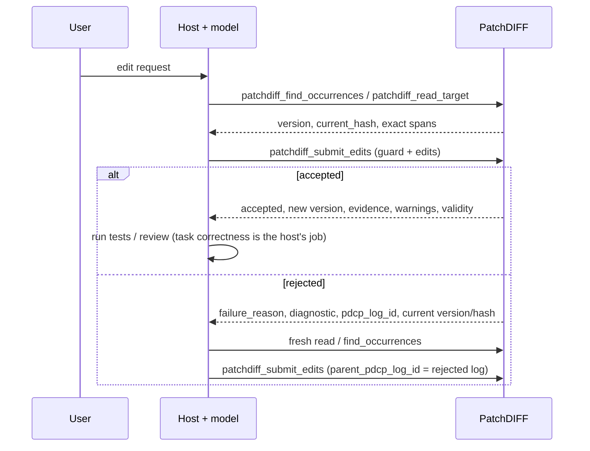

# PatchDIFF Host Integration Guide

Audience: host and client developers integrating model proposals with the PatchDIFF transaction service.

Why this document exists: the server is a transaction service; the host owns planning, wording, retry and compaction ([MODERNIZATION_ARCHITECTURE.md](MODERNIZATION_ARCHITECTURE.md), A1). If the host's behavior is only specified in server-built prompt strings, it cannot be versioned, reviewed or adapted per host. Here it can. Contract details are in [MCP_TOOLS.md](MCP_TOOLS.md); this guide says how to *use* them.

## 0. Stdio transport and host refresh

Choose the immutable server profile before starting a session with
`PATCHDIFF_MCP_PROFILE`: `editor` (default, 7 tools), `unobserved` (5), `observed`
(6), `observed_editor` (4), or `full` (22). Use `observed_editor` for delegated
editing when the host owns lifecycle work; it rejects SAVE/replay as well as
other excluded tools before dispatch. Older integrations and trusted
initialization/export/audit
operators must explicitly opt into `full`. Excluded tools are uncallable as well
as unadvertised. An agent cannot override a profile per request.
[Exact profile lists and batch examples](STRUCTURAL_BATCH_EDITING.md).

Send newline-delimited JSON-RPC as UTF-8. The external process entry point configures stdin/stdout as UTF-8 with strict errors, including on Windows; it does not rely on the ambient pipe code page. Malformed wire bytes are not repaired. Valid JSON escapes remain decoded proposal data, so escaped surrogate/NUL strings retain their documented domain rejection and audit behavior below. Response lines are pure ASCII: the JSON-RPC envelope escapes every non-ASCII character, so a host that decodes stdout with a locale code page cannot corrupt text, and U+2028, U+2029 or U+0085 cannot split a line. The tool-result text inside the envelope is literal, so once the envelope is parsed the model sees `🌍` and `中`, not `\ud83c\udf0d` escapes.

For older adapter revisions, set PYTHONIOENCODING=utf-8 in the server environment. Literal Unicode can otherwise be misdecoded and persisted even when the call succeeds; an ASCII-escaped request alone does not test this path. This setting remains compatible with the fixed adapter.

After changing a server command or environment, use the host-supported server refresh or application restart and verify its active tool connection. Refresh behavior depends on the host; do not assume an existing process adopted new configuration. Process-management behavior varies by host and is not certified across every host by these checks.

## 1. What PatchDIFF does and does not do for you

| PatchDIFF guarantees | PatchDIFF does not do |
| --- | --- |
| Exact, case- and whitespace-sensitive matching against canonical (LF) text | Fuzzy, semantic or language-aware matching; automatic repair |
| Rejects a proposal made against stale state (version/hash guard) | Merge concurrent edits |
| All edits in one submission apply, or none do (per target) | Atomicity across several targets |
| Durable log of accepted **and** rejected attempts with failure labels and lineage | Judge whether an edit achieves the user's goal |
| Deterministic replay from initial content plus accepted history | Track edits made to an exported copy outside PatchDIFF |

Accepted means *protocol-valid and transaction-valid*. `validity.task_correct` and `validity.semantic` are always `"not_evaluated"`. Run tests, linters and review in the host. Read `warnings` on every acceptance: each reports a fact about a well-formed edit (an unchanged replacement, a shifted index basis, a split grapheme cluster) to compare with what you meant.

## 2. The standard loop



1. **Read first.** Use `patchdiff_read_target` for a region (by code-point offset), `patchdiff_read_lines` for a line range, or `patchdiff_find_occurrences` to locate a string. All return `version` and `current_hash`. Do not copy from a stale summary or a cached earlier read. Offsets are Unicode code points: a JavaScript or TypeScript host must convert UTF-16 string indexes before sending them.
2. **Submit with a guard.** Pass `expected_target_version` and/or `expected_current_hash` from the read you based the edit on. Typed submissions without a guard are rejected (`context_missing`).
3. **On rejection, re-read, don't guess.** `diagnostic.retryable: true` means a new proposal derived from a fresh read can succeed; resending the same request will not. Match the label to the action:

| `failure_reason` | Meaning | Host action |
| --- | --- | --- |
| `target_version_mismatch`, `target_hash_mismatch`, `target_diverged` | Target changed since your read | Re-read, re-derive the edit from fresh text |
| `match_absent` | Text not present (exactly) | Check `near_misses`; re-read the region; check case, whitespace, line endings |
| `sequential_match_invalid` | An earlier edit in the same transaction consumed this text; `diagnostic.original_occurrences` names the change | Rewrite later edits against the result of earlier ones, or merge them |
| `match_ambiguous` | More than one exact span; `diagnostic.occurrence_count` says how many | Lengthen `match`, or add `anchor_before` / `anchor_after`, or `occurrence_index` counted in the buffer that edit sees (see §3) |
| `disambiguation_invalid` | Selector did not isolate one span | Recount: indexes after earlier edits are renumbered. For several same-string edits, use descending tx/2 spans |
| `span_out_of_bounds`, `span_expected_text_mismatch` | A span does not fit, or its `expected_text` or context differs from the text in the sequential buffer; `diagnostic.span_check` says which check and `actual_text` shows what is there | Re-read, recompute offsets against the text after earlier operations, copy `expected_text` exactly |
| `context_invalid` with `diagnostic.code: "request_key_conflict"` | The `client_request_id` was already used for a different proposal; `differing_fields` names what changed | Resend the original proposal unchanged to recover it, or use a new key for the new proposal (§7) |
| `context_invalid` with `diagnostic.code: "invalid_client_request_id"` | The key is not 1–128 printable ASCII characters without whitespace | Fix the key |
| `manifest_*`, `block_malformed`, other `context_*` | Malformed typed input | Fix the request shape |

4. **Link retries.** Set `parent_pdcp_log_id` to the rejected attempt and `attempt` to your own counter. The rejected row stays in the log. Retry limits are your policy; the server enforces none.
5. **Do not ask the server for a regeneration prompt.** Those tools are deprecated.

## 3. Typed submission

```json
{
  "target_file_id": "…",
  "expected_target_version": 3,
  "intent": "Rename the product in the introduction.",
  "edits": [
    {"match": "Acme Widget", "replace": "Acme Gadget",
     "rationale": "Product was renamed.", "occurrence_index": 1}
  ],
  "parent_pdcp_log_id": "…optional, on retries…",
  "attempt": 2
}
```

- `match` and `replace` are exact strings. Quotes, backslashes, and delimiter-looking lines are fine because they are JSON fields, not a text envelope.
- `match` must be non-empty. Empty `replace` deletes.
- Edits apply **sequentially**: edit 2 sees the text after edit 1.
- `intent`, `rationale` and `risk` are **advisory claims**. They are recorded but never used for matching, and the ledger never presents them as verified meaning.
- What the runtime derived (spans, lengths, payload hashes) comes back under `evidence.changes[]` and is stored in the ledger's `derived` field. Trust that, not the prose, when reviewing.

### `occurrence_index` counts the buffer each edit sees

An `occurrence_index` selects among the exact occurrences in the text that edit sees, which is the text after every earlier edit in the same transaction. Indexes from `patchdiff_find_occurrences` or `exact_candidates` describe the target before the transaction, so they are only valid for the first edit, or when each transaction has one edit.

Example: a README contains `Calcly` six times and the user wants the first three renamed. Sending three edits with `occurrence_index` 1, 2 and 3 renames originals 1, 3 and 5: after the first rename only five remain, and index 2 now means original 3. The transaction is accepted, because each instruction is well formed, but it carries `occurrence_index_basis_shift` warnings such as "chg_002 occurrence_index 2 selected the occurrence that was index 3 at transaction start". The warning reports the basis difference; it cannot know which basis you meant. If you meant each index to count after the earlier edits, the edit is what you asked for. If you took the indexes from `patchdiff_find_occurrences` or `exact_candidates`, a different occurrence was edited: compare `transaction_start_occurrence_index` with the index you read, and correct it with a follow-up proposal.

To edit several occurrences of the same text, prefer one of:

- tx/2 spans from one read, in descending `start` order, so earlier offsets stay valid;
- one edit per transaction, each re-read;
- matches long enough, or anchors, that select each occurrence without an index.

### Selector constraints on a single occurrence

Typed-match (`patchdiff-tx/1`) and legacy PDCP submissions use runtime `patchdiff-mvp-0.2.2`. Guarded match/span operations (`patchdiff-tx/2`) use immutable `patchdiff-mvp-0.3.0`, or immutable `patchdiff-mvp-0.5.0` when a span uses context guards; sole whole-target replacement (`patchdiff-tx/3`) uses immutable `patchdiff-mvp-0.4.0`. Every supplied selector must hold, even if the match occurs only once. Anchors mean anywhere before or after the match, not necessarily adjacent. For target text hello, this typed request rejects with disambiguation_invalid and leaves the target unchanged:

```json
{"target_file_id":"11111111-1111-4111-8111-111111111111","expected_target_version":0,"intent":"Replace greeting","edits":[{"match":"hello","replace":"goodbye","occurrence_index":2}]}
```

Use `occurrence_index` 1, omit selectors for a unique match, or supply anchors that actually hold. An index and anchors are combined constraints. (For legacy `.pdcp` v0.2.3 singleton-selector behavior and historical `0.1.0`–`0.2.1` replay profiles, see [LEGACY_COMPATIBILITY.md](LEGACY_COMPATIBILITY.md).)

### Invalid text and safe rejected evidence

Send valid Unicode text. An escaped lone surrogate in JSON is not a valid text character; NUL also cannot be stored in PostgreSQL text. A known-target proposal containing these values receives target_encoding_invalid at PROTOCOL_VALIDATION and a durable rejected log, with no target/version/ledger mutation. Invalid read/search text instead returns invalid_argument without an edit-attempt row.

If inspecting such a rejection with include_content, pdcp_content is an ASCII-escaped patchdiff-invalid-input/1 JSON evidence envelope preserving the original record and metadata. It is evidence for the rejected request, not a corrected proposal or an executable/new protocol format. Do not resubmit that envelope as an edit. Safe request-key retries recover the original rejection; fix the input with a new request key for a new proposal. Invalid/unencodable request keys are not stored as keys and cannot provide keyed recovery. Normal valid-input identity and target hashing are unchanged. Previously recorded accepted/rejected outcomes still recover by their original key/fingerprint, including historical escaped-NUL proposals that would now be invalid as new inputs. This recovery exception does not make a fresh invalid proposal acceptable.

### Guarded operations, replacement, line reads and preview

The full contract is in [MCP_TOOLS.md](MCP_TOOLS.md#guarded-editing-reads-preview-and-diagnostics); this section covers how to use it.

- **Choose the narrowest tool.** Use `patchdiff_submit_edits` for exact text matches. Use `patchdiff_submit_operations` when you already hold code-point offsets from `patchdiff_read_target`, `patchdiff_read_lines` or `patchdiff_find_occurrences`: each span carries the exact `expected_text`, and `start == end` with empty `expected_text` inserts. Span coordinates refer to the text after earlier operations in the same transaction, so send several spans from one read in descending `start` order. Use `patchdiff_submit_replacement` only when the user explicitly asked to replace the whole document.
- **Verify insertions.** An insertion has no `expected_text` to check, so an off-by-N offset (a UTF-16 index, a miscounted line, a stale read) would otherwise commit silently. Add `expected_before` and/or `expected_after`: the exact text immediately before `start` and after `end`, such as the end of the previous line and the start of the next. A mismatch rejects with `span_expected_text_mismatch` and shows the actual adjacent text. A `grapheme_boundary_split` warning on an accepted span means the offset landed inside a character cluster such as an emoji or a combining sequence.
- **Read by line.** `patchdiff_read_lines` continues within the same selected line range through `next_offset`, or through the absolute `next_start`, which you can pass to `patchdiff_read_target`. Never pass `next_offset` as an absolute offset. `include_line_starts: true` returns the absolute start of each selected line on the page, so line 25's offset is one call away. Every page is a new observation and can see a newer version/hash under concurrent edits.
- **Preview before submitting.** `patchdiff_preview` evaluates a proposal without writing, locking or reserving a request key, and returns the same warnings and near misses a submission would. Its evidence can be truncated or omitted to fit a 32,768-byte budget, so check `total_change_count`, `returned_fact_count`, `change_facts_truncated` and `evidence_omissions` before treating facts as complete. Verdict, stage, observed version/hash and `after_hash` are always kept. Submit afterwards with a version guard: a hash alone cannot detect intervening no-op or ABA changes.
- **Replacement limits.** A fresh replacement over 1,000,000 code points or 1,048,576 UTF-8 bytes returns `invalid_argument` with `code: "replacement_too_large"` and writes nothing. The diagnostic gives `actual`, `limit` and `canonical_would_fit`; when that is `true`, the text only failed because of CRLF or CR line endings, so send it with LF. The limit applies to whole-document replacement only. If the change is really a set of edits, send them as edits or operations; do not split a rewrite to avoid the limit.
- **Correlation.** Pass `include_correlation_id: true` to receive a fresh per-call UUID for your own logs. It is never a retry key; use `client_request_id` for that.
- **Diagnostics.** See [Inspect rejection context](#inspect-rejection-context). Ambiguity failures list up to five exact candidates; when more exist, `next_occurrence_index` continues the list through `patchdiff_find_occurrences`. A candidate's `occurrence_index` can be used directly only when the failing edit is the first one (`prior_changes: 0`). Absent-match failures can include up to three `near_misses` at distinct locations, scanned over up to the first 65,536 code points of the failing buffer (`1.7 ms` median on 64K varied prose; `41.9 ms` median on 64K repetitive logs); `scanned_start`/`scanned_end` and `scope_truncated` say what was searched, and an empty list carries a `hint`. Treat near misses as hints to re-read, never as edits to apply blindly.

### Discovery example sequence

`tools/list` includes 13 illustrative `inputSchema.examples` across nine tools. They are arguments, not pre-existing resources. To execute them:

1. Initialize `alpha alpha\n🌟 中\n`, then bind its real UUID and the observed version guard into every example.
2. Read the target, then find `alpha`.
3. Submit typed example 0, which renames the second occurrence.
4. Resend those exact bound arguments and expect `deduplicated: true`.
5. Submit typed example 1, an intentional missing match, and keep its rejection UUID.
6. Submit typed example 2 with that rejection UUID as parent and version 1.
7. Submit the span example at version 2.
8. Submit the sole replacement at version 3. The target becomes `Final text\n`.
9. Read line 1.
10. Preview at version 4. The accepted preview proposes `Reviewed text\n` but does not commit it.

Expect four accepted facts and five attempts, and keep the original rejection diagnostic immutable. Never substitute the new version into the original keyed proposal when recovering it.

Then execute each history tool's first example, bind its returned `next_sequence` into the continuation example, and repeat until `has_more=false`. Attempts display descending sequences; ledger displays ascending sequences within each newest page. A cursor is exclusive in both tools. The discovery examples are covered by real stdio tests with schema validation, nonvacuous paging and independent SQL assertions. This is executable API coverage, not a model success-rate measurement.

## 4. Literal replacement requests

Moved from the old server prompt:

- Treat quoted literal replacements as **case-sensitive** unless the user asks otherwise. Do not change capitalization variants unless asked; if you do, say so in `rationale`.
- Prefer one edit per intended occurrence. If one edit's `match` covers several occurrences, say so in `rationale`.
- After an accepted replacement, verify the result with `patchdiff_find_occurrences` for the old literal, report the number of occurrences actually changed, and do not report the manifest/edit count as the occurrence count.

## 5. Legacy Compatibility (`.pdcp` v0.2.3 & Deprecated Wrappers)

Frozen `.pdcp` v0.2.3 (`patchdiff_submit_pdcp`), `patchdiff_build_prompt_context`, and the deprecated regeneration wrappers remain supported for backward compatibility and historical replay. All legacy format rules, wrapper contracts, and historical replay profiles (`0.1.0`–`0.2.1`) are documented in [LEGACY_COMPATIBILITY.md](LEGACY_COMPATIBILITY.md).

## 6. Checkpoints, history and context

- `patchdiff_save` snapshots the document and starts a new editing cycle. It does not change content, version or hash, and it **does not compact your conversation**. Compact your own context whenever your host needs to; it never touches the document. Pass `expected_target_version` (and optionally `expected_current_hash`) so the snapshot is of the state you reviewed.
- `patchdiff_get_pdcp_log` returns a bounded, newest-first page (page with `before_sequence`; filter with `status`). Each entry carries its transaction `intent` (bounded) and `attempt`. Use `include_content=true` only when you need the raw record: a page returns at most about 1 MB of content, and later rows say `pdcp_content_omitted: "page_byte_budget"`; fetch one of those with `limit: 1`.
- `patchdiff_get_manifest_ledger(limit=…)` returns the most recent accepted entries of the **active editing cycle**. After a SAVE that cycle starts empty, so pass `include_previous_cycles: true` to see earlier work. Each entry has `origin`, its attempt's `pdcp_log_id`, `log_sequence` and `before_version`/`after_version`, and for typed rows the `transaction_intent` and per-edit `rationale`; typed rows carry `null` for the four prose fields. Join attempts and ledger rows by `pdcp_log_id`, not by intent text. Treat ledger text as advisory history, never as ground truth.
- A host rewind or checkpoint is not PatchDIFF replay. `patchdiff_replay` reconstructs from initial content plus accepted history; read `materialized_state_matches` as well as `status`. Successful reconstruction does not establish healthy storage: content_matches compares raw stored text, so CRLF/bare-CR corruption is visible even when canonical hashes agree. Replay does not repair it.

Both history tools default to 50 rows (omitted/null), cap at 200, and return has_more/next_sequence. Continue with before_sequence=next_sequence while has_more is true. Attempts display descending; ledger displays the newest selected page ascending. For sequences 1..10 and limit 3, attempts=[10,9,8], ledger=[8,9,10], both cursor 8; ledger before 8 returns [5,6,7]. Do not use the last displayed ledger row as its cursor. Sequences are global across all targets, so one target's sequences have gaps. Empty/not-found/invalid results have no continuation. Filters apply before counting another page; exact history request-key lookup also supports safe historical keys. Restart an active-cycle-only ledger traversal if SAVE rotates its cycle.

Search context_chars must be a non-bool integer >= 0 (default 40, cap 400). Zero requests no surrounding text; invalid types return invalid_argument.

## 7. Lost responses & request idempotency

PatchDIFF distinguishes request identity from state guards (C4 / D5):
- `client_request_id` identifies a proposal and recovers its recorded terminal outcome.
- `expected_target_version` is monotonic: an old version rejects after another acceptance, without proving which request committed.
- `expected_current_hash` checks state, not request identity. A no-op edit keeps the hash; an ABA sequence restores it. An unkeyed hash-only retry can therefore apply again. PatchDIFF flags an accepted no-op with `no_op_change`/`no_op_transaction` warnings.

### Inspect rejection context

`diagnostic.failure_context` describes the original failure; `current_context` separately describes the current locked canonical target. Both are bounded (at most 256 code points; 4,096 compact ASCII-escaped JSON bytes each, 8,192 combined with wrapper keys). When the failure location is known and lies beyond the start of the text, `failure_context` is a window around it (`selection: "failure_window"`, real `start`/`end`); otherwise both are prefixes. When the two would be identical, the MCP response returns `current_context` as unavailable with `unavailable_reason: "same_as_failure_context"`: read `diagnostic.failure_context` instead. Read/search for additional context. See MCP_TOOLS for fields and unavailable reasons.

A later sequential failure can name `intermediate_buffer` with `prior_changes > 0`: earlier edits were simulated, not committed. Its observed hash/version still name transaction-start state. Current context always names canonical state. Do not apply intermediate indices to committed content. On exact keyed recovery after later edits, failure context and the entire original diagnostic stay unchanged while current context can differ. Old outcomes may lack failure context. Explicit unavailable state covers malformed/missing targets and pending local ORM modifications; empty text with `available: true` is a real empty target. Caller-owned transaction observations may remain provisional until commit.

### Preserve the original proposal for recovery

Keep the decoded proposal structure and original guards when retrying a lost response. The fingerprint includes the full canonical typed record, including intent, ordered raw edits, selectors and advisory fields, plus the protocol/target/content-hash/guard/parent envelope. Equivalent wire JSON whitespace, object-key order or Unicode escape spelling is harmless. Rewording intent or rationale, changing risk/selectors/guards, reordering edits, replacing an omitted optional edit field with null, or supplying an otherwise default change_id creates a different proposal even if the resulting text would match. If your SDK fills omitted optional fields with null, keep doing so on retries too. Omitted/null top-level guards both become null.

LF and CRLF inside typed match/replace/anchor/prose values produce different escaped JSON strings and different identities; the runtime may still normalize them for matching. Legacy raw PDCP content hashes instead normalize actual line endings. This release preserves both existing rules. Do not regenerate a supposedly equivalent proposal to recover an earlier response; resend the original structure with its original key. Normal submission source/attempt metadata is outside ordinary fingerprint identity; invalid-text evidence has its separately documented identity domain.

For parent_pdcp_log_id, an eligible same-target rejected parent UUID canonicalizes. A missing, accepted, cross-target or malformed parent is rejected and retains its original spelling in identity. Retrying such a rejection with changed UUID casing can conflict; preserve the supplied spelling. Broader parent normalization is deliberately not adopted here because existing rejected fingerprints must remain recoverable.

### Keyed recovery (recommended)

Choose a distinct `client_request_id`: 1–128 printable ASCII characters without whitespace, such as `req-001`. A UUID is an allowed choice, not a requirement.

If a response is lost, resend the identical proposal with the same request ID and original guards. Under the target lock, the service returns the recorded outcome with `deduplicated: true`, without reapplying it, even if target state has since advanced. Its `version`/`after_hash` describe that recorded outcome, and `current_version`/`current_hash` describe the target now; continue from the current pair. Reusing that ID for different proposal content rejects with `failure_reason: "context_invalid"`, `diagnostic.code: "request_key_conflict"` and `diagnostic.existing_pdcp_log_id`; it does not overwrite the original attempt. `differing_components` and `differing_fields` (such as `edits[0].rationale`) show what changed. To inspect the original without resending, call `patchdiff_get_pdcp_log(client_request_id=…)`.

A conflicting reuse returns a newly persisted rejection log ID. Its row has a NULL client key, links the original log, and retains the submitted fingerprint. Repeating the conflict creates another rejected attempt; it never replaces the original keyed result. Use the exact original proposal/key to recover that original outcome. The submitted-key diagnostic is a bounded preview, not a new normalized identity.

Database integrations must preserve transaction ownership: an outcome inside an outer transaction is provisional until that owner commits; rollback removes it and releases its target lock. Supported lock/recovery behavior is verified at READ COMMITTED. Stronger-isolation retry/error handling belongs to the outer owner, not a hidden retry inside PatchDIFF.


### Unkeyed recovery

Typed submission requires a version and/or hash guard. Legacy `patchdiff_submit_pdcp` keeps guards optional for compatibility; an unguarded retry has no state-guard protection. Prefer a request ID for both formats.

After an unkeyed timeout:

1. Query `patchdiff_get_pdcp_log`, using `content_hash` when available and `include_content: true` when needed. Compare the original payload, guards and lineage. Page backward with the oldest returned `log_sequence` as `before_sequence` until the relevant history is examined; an empty page ends traversal. A five-entry sample or a one-version advance is not proof of request identity.
2. Absence from one page does not mean the request never arrived. Even after traversal, a still-running original call may commit later; identical unkeyed proposals may be indistinguishable. Treat an ambiguous outcome as unknown. Read current state authoritatively and reconcile the requested effect before generating another proposal; do not infer permission to reapply from missing history alone.
3. When a replacement proposal is warranted, derive it from a fresh read, assign a new request ID, and link `parent_pdcp_log_id` only to a known rejected attempt. If the earlier attempt is known accepted, continue from its result.

## 8. Round-tripping to files

PatchDIFF stores canonical LF text and hashes it that way. Line endings in the uploaded file are recorded, not kept, so writing an export back to a Windows or CRLF repository needs one decision from the host:

1. On upload, keep `source_line_endings` from the `patchdiff_initialize_target` response. `style` is `none`, `lf`, `crlf`, `cr` or `mixed`, and `source_sha256` is the SHA-256 of the exact bytes you uploaded, so you can confirm that your local file is the one PatchDIFF saw without canonicalizing it.
2. To write back, export with `format: "original_eol"`. It restores a uniform recorded style for the whole file, including lines added by edits. Compare `content_sha256` with your own hash of the bytes you are about to write.
3. For `mixed` uploads, `original_eol` is refused (`original_eol_unrecoverable`) because per-line endings were never stored. Choose `canonical_lf` or `crlf` explicitly, or restore line endings from version control in the host. Targets created before line endings were recorded return `source_line_endings: null`; `original_eol` is refused for them with `source_line_endings_unknown`.
4. The default `format: "original_text"` returns canonical LF text, as it always has. Despite its name it never meant the original bytes.

With `core.autocrlf=true`, git converts line endings on checkout and on commit, so writing LF back to a file stored with LF in the repository still shows only the edited lines in `git diff`. A file stored with CRLF in the repository (for example under a `-text` attribute) and any tool that compares working-tree bytes see every line change. Exporting with `original_eol` keeps the original style, so only the edited lines differ in every case.

## 9. What is outside the guarantee

PatchDIFF's guarantees cover the managed target in Postgres. An exported file edited elsewhere, a shell, another database writer, or another editor can change content PatchDIFF never sees. A skill or instruction asking the model to "use PatchDIFF" is guidance, not enforcement. Re-importing an edited export is a **new upload and a new target**; nothing is merged or synchronized.

## 10. Host skill checklist

For observed operations, keep nonempty edits within the observed scope. Insert only strictly inside the current sequential scope; never insert at either boundary. Supply both nonempty `expected_before` and `expected_after`, matching immediately adjacent text entirely inside that scope. Earlier operations can move the scope end and change those neighbors, so derive later guards from the intermediate buffer. On `OBSERVED_INSERTION_GUARDS_REQUIRED`, mismatching adjacency, or `OPERATION_OUTSIDE_OBSERVED_SCOPE`, re-read and correct the proposal; do not bypass strict admission. SAVE closes the observation's editing cycle, so obtain a fresh observation before paging or submitting again.

A host skill or system prompt for PatchDIFF should say, at minimum: read before editing; always pass a guard; send code-point offsets; on rejection re-read before retrying; set `parent_pdcp_log_id` on retries; check each accepted-edit warning against what you meant before continuing; do not reuse `find_occurrences` indexes for several same-string edits in one transaction; treat `intent`/`rationale` as claims; never describe an accepted edit as correct, only as applied; run task validators outside PatchDIFF; export with `original_eol` when writing back to the original file; do not treat a local copy as authoritative.


## 11. Waymark structural observation workflow (`waymark-engine@4.1.0`)

For multiple independent structures, prefer one `patchdiff_observe_scope` call
with exact `selections`, followed by one `patchdiff_submit_observed_operations`
call with `observation_bundle_id`, `groups`, both observed target guards and a
mandatory `client_request_id`. Each group's match indexes, anchors and sequential
span offsets use that group's local slice, starting at zero. Submit all groups
in one target transaction; any failure rejects the whole request, and success
increments version once. Re-read stale bundles; repeat an identical keyed request
to recover a lost committed response. SAVE closes the original editing cycle.
See [limits, errors, replay guarantees and complete Python/JSON/Markdown recipes](STRUCTURAL_BATCH_EDITING.md).

The existing single-scope workflow below remains available, with absolute span
coordinates and its historical record/replay behavior.

For structured code, configuration, and documentation targets (`.py`, `.ts`, `.js`, `.json`, `.md`, `.yaml`, `.toml`, `.sh`), prefer structural observation and scoped submission:

1. Call `patchdiff_observe_scope(target_file_id, query=..., kind=...)` to list candidate symbols, or call `patchdiff_observe_scope(target_file_id, symbol_name=..., kind=...)` directly when the exact symbol identity is known (`FRAME_SYNC_STREAM`, `tenants[ten_013]`, `row:CHK-14-C`, `fence:L7`).
2. Inspect the returned `observation_id`, `target_version`, `target_current_hash`, `scope_start`, `scope_end`, and canonical slice `text` (paging with `observation_id` and `next_offset` if `truncated: true`).
3. Submit edits restricted to that scope via `patchdiff_submit_observed_operations(target_file_id, observation_id, intent, operations, expected_target_version, expected_current_hash, client_request_id=...)`.
   - `match` operations inside `patchdiff_submit_observed_operations` search only within `[scope_start, scope_end)`, automatically disambiguating strings that repeat in other symbols/objects outside the observed scope.
   - `span` operations use absolute canonical LF code-point offsets (`[start, end)`) that must lie within `[scope_start, scope_end)`.
4. Enable `PATCHDIFF_STRICT_OBSERVATION_MODE=1` when the host wants the server to enforce that every edit is backed by a verified structural observation (`OBSERVATION_REQUIRED` on all unobserved write tools).

## Trusted scalar finalization

Before finalization, establish terminal editor status, close its editing
connection, and reconcile unresolved editing RPCs. Preserve accepted receipt
guards; a fresh read must not refill them. Full transcript export can proceed
independently of checkpointing a known accepted state. Record transcript evidence
as pending, clipped or parse-valid, and record coverage through a known terminal
record separately. Literal clipping-marker text or source pagination does not
prove transcript clipping. Attach a later export as a new hashed addendum without
overwriting the initial result or uncertain SAVE receipts. A parent cannot export
its own future terminal response; the operator can attach it afterward.
The trusted host performs independent final verification and renders receipt
tables. The editor may read/search to resolve editing uncertainty, then sends one
terminal status identifying completed targets and unresolved issues; that message
need not reproduce hashes or lifecycle tables. Public tool discovery supplies operation
contracts; a host handoff need not repeat a separate tool tutorial.


[Observed editor workflow v1](OBSERVED_EDITOR_WORKFLOW.md) assigns editing to the
model and scalar SAVE/REPLAY/export to the trusted host. The backend contracts do
not change and targets need not share a project. This removes model-managed
lifecycle turns, not backend calls or the need for independent task verification.

Start the editor with resident/observed/strict observation and optional compact
responses as specified in that brief. `PATCHDIFF_MCP_RESPONSE_MODE` defaults to
`detailed`; only compact successful observed results omit supplementary evidence
or duplicate metadata. Warnings, guards, exact source, failure diagnostics and
stored facts remain authoritative. The existing oneshot default remains intact.
Verify the actual serving process and tools/list after restart. Host schema
preloading/output limits are integration-specific; retain ordinary help lookup,
existing observation paging and authorized spill-file retrieval as fallbacks.

The small standard-library recipe in `examples/host_finalize.py` accepts an
existing synchronous MCP caller with a finite deadline. The trusted manifest
contains `filename`, `target_file_id`, `expected_target_version`,
`expected_current_hash` and `accepted_pdcp_log_id` from the mapping and actual last
accepted MCP receipt. Do not derive it from model prose or refresh guards to make
stale work pass. Run it after editing ends, with the editor no longer writing.

For an operator using a repository checkout, reuse the existing verification
stdio client in a separate detailed/full session. This is an operator/test recipe,
not a production transport dependency or an agent-launch controller:

```python
import json
import os
from pathlib import Path
from backend.tests.verification.structural_batch.verify import MCP
from examples.host_finalize import finalize_targets

targets = json.loads(Path("private/accepted-targets.json").read_text(encoding="utf-8"))
with MCP("full", os.environ["PATCHDIFF_DATABASE_URL"], response_mode="detailed",
         rpc_timeout_seconds=30) as operator:
    result = finalize_targets(operator.call, targets, "private/new-finalization")
if result["status"] != "complete":
    raise SystemExit(result)
```

The client bounds RPC write/read time, reaps a failed peer and never resends a
timed-out call. The finalizer preflights all target names/identities, requires a
fresh output directory, and writes root-level manifest/events/results separately
from `exports/`. SAVE carries both original guards. Replay must verify all four
materialized-state components and expected versions/hashes; export bytes are
independently hashed and written as canonical LF. Complete receipts/exports are
flushed/fsynced locally before success; this is not universal power-loss durability.

SAVE rotates cycles without changing target hash/version. Those guards therefore
do not make SAVE idempotent. A lost/malformed SAVE response or inability to persist
its receipt is `save_uncertain`: stop, preserve `save_pending`, and do not retry
SAVE, continue dependent verification, or automatically rerun in a fresh directory.
An explicit rejection fails that target. Other domain failures may leave partial
per-target completion; infrastructure/evidence failures stop subsequent calls.
If the disk fails, results.json is best-effort and the returned incomplete outcome
is authoritative about that failure. The operator reconciles uncertain snapshot/
cycle records manually; no automatic repair or cross-target rollback is provided.

An independent evaluator checks task correctness after exports. Keep gold data,
full transcripts, actual wire calls, manifests, exports and verification artifacts
outside the editing model's context and under a private ignored capture directory.

## Purpose-specific observed interface

For the opt-in five-tool `observed_v2` connection, use [MCP_EDITOR_V2.md](MCP_EDITOR_V2.md). Set profile/strict/resident configuration on the actual process; initialize/finalize via a separate trusted full-profile connection. Selection returns the explicit snapshot accepted by commit. Receipt transaction state and current state can differ on recovery. Ordinary task use needs no additional schema-discovery or verification coaching.
