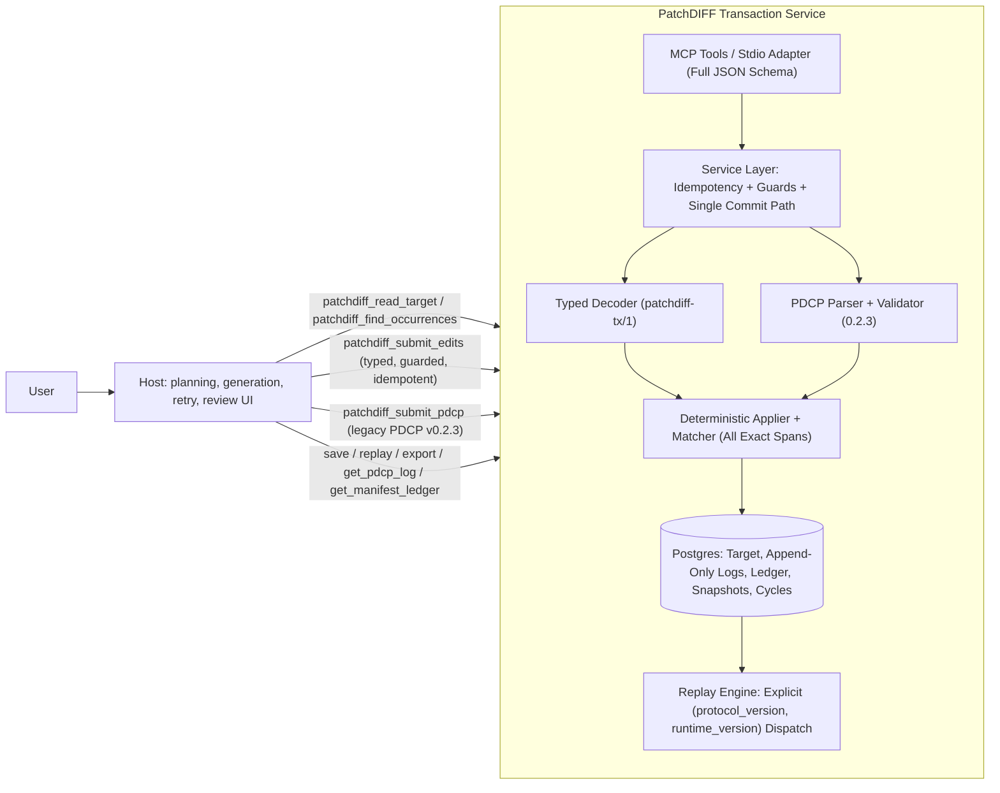

# PatchDIFF Modernization Architecture

Current architecture and compatibility contracts for the MCP transaction service.

The as-built record, compatibility details and verification scope are in [MODERNIZATION_CHANGE_DOC.md](MODERNIZATION_CHANGE_DOC.md).

## Guarded replacement, line reads and preview

The advisory preview evidence projection caps complete compact ASCII-escaped payload32768bytes, accepted prefix32whole facts/perfact2048/wrappedfacts16384bytes, textual evidence1024code points/8192wrapper bytes and diagnostic wrapper16384bytes. Explicit counts/truncation/omission metadata preserve verdict/stage/observed UUID/version/hash/afterhash without changing shared submit/core/history facts or identity. Oversized change identities are omitted, never truncated. [MCP_TOOLS.md](MCP_TOOLS.md) specifies deterministic whole-payload fallback and safe retained context.

New patchdiff_submit_replacement records guarded tx/3 sole replace_all on immutable0.4.0 through the existing locked pipeline; tx/2/0.3.0 remain unchanged. Fresh replacement raw/result limits are1,000,000 code points and1,048,576 UTF-8 bytes each (inclusive). Invalid Unicode keeps audited classification; existing-key recovery/conflict precedes fresh admission. Oversized valid fresh replacements return pre-admission invalid_argument/replacement_too_large without writes; replay bypasses admission limits. Empty replacement is valid; one typed ledger row records full original span and operation=replace_all.

patchdiff_read_lines uses one ordinary column observation under no_autoflush, one-based inclusive LF-only line ranges, trailing newline inclusion and final empty line, range-relative offset continuation, default4000/cap8000 code points. It never edits or flushes local state. patchdiff_preview uses the same fresh read-only guard/decode/apply evaluator as submit with coherent ordinary observation, explicit format and pending-local-target rejection. Preview has no request-key/audit/lineage parameter, writes/locks/commit/rollback; accepted previews return facts/hash, rejected previews no partial facts. It never invokes post-commit near misses. Submission always re-locks/rechecks.

Discovery publishes bounded schema-conforming examples, copied per result, at most65,536 compact ASCII-escaped JSON bytes overall and8192 for the complete examples map. Every advertised(tool,index) is bound to real returned IDs/guards/parents/cursors and executed over stdio/PostgreSQL, including exact dedup and complete attempt-descending/ledger-page-ascending traversal. No migration, optional typed guards, normalized identity, editing adapter, model-success or representative production-performance claim. Dataset and performance evidence is limited to local synthetic cases because no representative sanitized dataset or production benchmark threshold was supplied.

## Guarded operations and bounded diagnostics

`include_correlation_id=false` is a boolean response option on submissions; true emits a fresh UUIDv4 even on exact recovery. Invalid types return pre-admission invalid_argument with no attempt. Correlation never enters durable records, request keys or fingerprints.

New applicability ambiguity/selector failures retain at most five exact candidates (20 code points each side,64 match preview;8192 compact ASCII-escaped JSON bytes including wrapper), stage/prior-change/observed identity and explicit truncation; no cursor or selection. Absent/sequential failures retain at most 64 code points of immutable query evidence (1024 wrapper bytes). Response-only near misses compare only the original at-most-256-point failure prefix after actual successful service-owned commit/lock release; caller-owned transactions omit with caller_transaction. Work is at most 1,000,000 Levenshtein cells, windows query length±1, distance threshold min(4,max(1,length//4)), at most three candidates ranked distance/start/end,16-point context each side and8192 wrapper bytes. Exhaustion/oversize/historical inputs have explicit omission; unexpected post-commit errors propagate without claiming rollback. Original diagnostics stay immutable on recovery. New enrichment fields combined are at most18432 compact ASCII-escaped JSON bytes; this excludes preexisting arbitrary evidence.

`patchdiff_submit_operations` records `patchdiff-tx/2`: intent, mandatory guard and ordered explicit match/span operations. Span start/end are non-bool integers 0..2^63-1, end exclusive and end>=start; expected_text/replace are required strings. Coordinates describe each sequential canonical buffer; exact canonical expected text must equal that span. Empty-span insertion is allowed with empty expected text; selectors on span and unknown fields/operations reject. Mixed match/span edits are atomic. Applicability errors are span_out_of_bounds and span_expected_text_mismatch. Both forms use the existing locked submit/rejection/ledger path. New records use immutable patchdiff-mvp-0.3.0 enabling span operations; old forms keep 0.2.2 and unchanged records/fingerprints/profiles. Replay refuses unsupported profile/operation pairs. Span facts include operation=span and existing runtime-derived hashes/spans/counts; ledger origin remains typed. No migration or replace_all in 0.3.0. Discovery advertises operation schema and x-patchdiff-capabilities. Discovery also provides bounded argument examples.

## 0. Reading guide and evidence limits

- **Design thesis** = `docs/PatchDIFF-Concept-Paper-5.md` (the paper, "P1"). Historical protocol/implementation freezes = `docs/PatchDIFF-Protocol-Spec-v0.2.3.md` and `docs/PatchDIFF-Implementation-Spec-v0.2.3.md`. These historical documents are preserved untouched as historical design artifacts.
- **Active implementation contract** = `docs/MCP_FIRST_MVP.md`, `docs/PATCHDIFF_CORE_SPEC.md`, `docs/MCP_TOOLS.md`, `docs/DATA_MODEL.md`, `docs/PDCP_FORMAT.md`, `docs/TEST_MATRIX.md`, `docs/CODEX_BUILD_PLAN.md`, `docs/HOST_INTEGRATION_GUIDE.md`, `docs/CLAUDE_DESKTOP_SETUP.md`, `README.md`, `README_INTERNAL_MCP.md`. Active documents state the current modernized system coherently in their main body rather than contradicting themselves via tacked-on footers.
- **Primary external evidence (E1–E8)** was fetched and verified directly from the primary vendor documentation pages and release endpoints on `2026-10-20` (Section 3.1).
- **No live-model or third-party benchmark claims**: Deterministic guarantees, live Postgres persistence, migrations, and stdio MCP subprocess workflows are verified locally (`pytest`). Offline byte/verdict accounting is verified (`evaluation/offline_eval.py`). Live-model/live-host comparative token and validity-rate trials have **not** been run and are labelled accordingly.

## 1. The thesis, restated

From `docs/PatchDIFF-Concept-Paper-5.md` (abstract, Section 4, Section 9): PatchDIFF's core contribution is not textual diff syntax by itself, but *"the runtime and lifecycle semantics that make model-generated textual deltas safe to apply repeatedly to one cached authoritative document."*

| Category | Items |
| --- | --- |
| **Properties worth preserving** | Explicit target authority in Postgres; checked state transitions (`expected_target_version` / `expected_current_hash`); all-or-nothing per-target atomic commit; durable append-only audit log of **both accepted and rejected** attempts with retry lineage (`parent_pdcp_log_id`) and idempotent request recovery (`client_request_id`); accepted-only manifest ledger; deterministic replay from initial snapshot + ordered accepted logs; non-executable declarative core; explicit separation of validity levels (`protocol_valid`, `transaction_valid`, `task_correct`, `semantic`). |
| **Mechanisms reassessed** | Raw textual `.pdcp` as the sole model-facing input -> superseded as primary by typed `patchdiff_submit_edits` (`patchdiff-tx/1`), with `.pdcp` v0.2.3 retained and frozen as legacy/import; 7 mandatory prose manifest fields per edit -> simplified on the typed path to required transaction `intent` + optional per-edit `rationale`/`risk` + runtime-derived `derived_json` facts; server-mediated regeneration -> deprecated in favor of host-owned retry loops backed by authoritative read/search tools (`patchdiff_read_target`, `patchdiff_find_occurrences`). |
| **Implementation defects remediated** | Overlapping-match enumeration bug (`matcher.py`); explicit replay profile dispatch (`protocol_version` + `runtime_version`) and component-level `materialized_state_checks`; stage-accurate `validity` reporting (`ValidationStage`); complete `TYPED_EDIT_JSON_SCHEMA` advertised in MCP `tools/list`; `client_request_id` idempotency and lost-response recovery; safe UUID and parent-lineage validation; stdio MCP adapter resilience against non-object `params`. |

## 2. Responsibility map (modernized state)

| Responsibility | Owner | Implementation / Contract |
| --- | --- | --- |
| User intent, planning, model selection, conversation compaction | **Host** | Host/client loop (`HOST_INTEGRATION_GUIDE.md`). PatchDIFF never calls an LLM or holds model credentials. |
| Authoritative target reads and exact occurrence search | **PatchDIFF** | `patchdiff_read_target` (`start`, `length`, `next_start`, `truncated`) and `patchdiff_find_occurrences` (`text`, `context_chars`, `start_occurrence`, `max_results`, `next_occurrence_index`). |
| Proposal generation & retry loop | **Host / Model** | Model emits typed `patchdiff_submit_edits` (preferred) or legacy `patchdiff_submit_pdcp`. On rejection, host inspects diagnostics, re-reads via `patchdiff_read_target` / `patchdiff_find_occurrences`, and resubmits with `parent_pdcp_log_id` and `attempt`. |
| Convenience prompt-context / legacy regeneration wrappers | **PatchDIFF (Compatibility)** | `patchdiff_build_prompt_context` (labelled convenience prefix with `context_truncated`); `patchdiff_get_regeneration_context`, `patchdiff_build_regeneration_prompt`, `patchdiff_request_regeneration` (deprecated wrappers). |
| Precondition guards, applicability validation, sequential simulation | **PatchDIFF Core & Service** | `submit_edits` / `submit_pdcp` in `pdcp_service.py`; `apply_pdcp_transaction` in `pdcp/applier.py`. |
| Request idempotency & lost-response outcome recovery | **PatchDIFF Service & DB** | `client_request_id` + `request_fingerprint` on `append_only_pdcp_logs` (`uq_pdcp_logs_target_client_request_id`). |
| Atomic persistence & append-only audit | **PatchDIFF Storage (Postgres)** | Row-locked `cloud_target_files`, `append_only_pdcp_logs`, `append_only_manifest_ledger`, `target_snapshots`, `editing_cycles`. |
| Deterministic replay & materialized-state verification | **PatchDIFF Replay Service** | `replay_target` dispatches on `(protocol_version, runtime_version)` and reports `materialized_state_matches` and `materialized_state_checks`. |

## 3. Primary external evidence (E1–E8, verified 2026-10-20)

All eight external sources were fetched directly from their primary vendor pages on `2026-10-20`:

| ID | Primary Source URL (Verified 2026-10-20) | Version / Identifier | Verified Capabilities & Guarantees | Relevance to PatchDIFF |
| --- | --- | --- | --- | --- |
| **E1** | `https://platform.claude.com/docs/en/agents-and-tools/tool-use/text-editor-tool` | `text_editor_20250728` (`str_replace_based_edit_tool`); legacy `text_editor_20250124`, `text_editor_20250429` | Built-in schema tool with commands `view` (supports `view_range`), `str_replace` (`old_str`, `new_str`), `create`, `insert` (`insert_line`). Requires exact unique match for `old_str`; returns tool error (`is_error: true`) when 0 or multiple matches exist. Client harness executes file I/O and backup/undo. | Confirms modern tool-use models natively emit structured JSON exact-string replacements (`old_str`/`new_str`) without bespoke text delimiters, and rely on bounded range reads (`view_range`) to recover from ambiguity. |
| **E2** | `https://developers.openai.com/api/docs/guides/tools-apply-patch` | Responses API built-in tool `{"type": "apply_patch"}` (GA since GPT-5.1); `@openai/agents` `applyDiff` | Model emits `apply_patch_call` with `operation` (`create_file`, `update_file`, `delete_file`), `path`, and V4A diff hunks. Harness returns `apply_patch_call_output` with `status: "completed" \| "failed"` and `output`. Docs state atomicity and path-traversal validation must be implemented by the caller's harness. | Shows that even when a model emits structured tool calls, multi-edit atomicity, state precondition guards, and durable rejected-attempt logs are not provided by the model API—they must be enforced by the state authority. |
| **E3** | `https://code.claude.com/docs/en/checkpointing` | Claude Code Checkpointing (`/rewind`, `Esc+Esc`, `cleanupPeriodDays=30`, max 100 checkpoints) | Tracks direct file edits made through Claude's editing tools per user prompt. Explicitly documented limitations: **Bash command changes (`rm`, `mv`, `cp`, scripts) are not tracked**; background subagent changes are not tracked; external concurrent changes are not tracked; symlinks/hard links are not followed; documented as *"not a replacement for version control"*. | Proves local IDE/CLI checkpointing is a convenience undo over direct tool writes, not an authoritative transactional ledger or deterministic replay engine. |
| **E4** | `https://code.claude.com/docs/en/memory` | Claude Code Memory (`CLAUDE.md`, `.claude/rules/`, `AGENTS.md`, `MEMORY.md` first 200 lines / 25 KB) | Instruction files and auto-memory are loaded into the model context window. Vendor docs state explicitly: *"CLAUDE.md files are context, not enforced configuration... instructions in CLAUDE.md are advisory."* | Confirms that safety and state invariants cannot rely on prompt rules or `AGENTS.md` alone; invariants must be enforced deterministically by the server/runtime. |
| **E5** | `https://code.claude.com/docs/en/hooks` | Claude Code Hooks (`PreToolUse`, `PostToolUse`, `PermissionRequest`, `Stop`, `UserPromptSubmit`) | Deterministic lifecycle hooks. `PreToolUse` can `allow`, `deny`, `ask`, `defer`, or rewrite `updatedInput` before a tool runs. `PostToolUse` runs *after* a tool has already executed and **cannot undo** a completed write. | Confirms pre-commit validation (`PreToolUse` / transaction pre-check) is the only point that can prevent partial or invalid mutation; post-hoc checks can only report or trigger follow-up turns. |
| **E6** | `https://antigravity.google/docs/ide/review-changes-editor` | Google Antigravity IDE Review Changes Editor | Native IDE review pane presenting per-file diffs, inline comment threads, and accept/reject controls over workspace changes before or after agent turns. | Shows modern hosts already provide rich human diff-review UIs; PatchDIFF should supply machine-readable span/hash evidence (`evidence.changes`) rather than building a UI. |
| **E7** | `https://antigravity.google/docs/mcp` | Google Antigravity MCP Integration (`mcp_config.json`, MCP 2.0) | Native MCP client supporting local `stdio` (`command`, `args`, `env`) and remote HTTP/SSE (`serverUrl`) MCP servers, exposing discovered tools and `inputSchema` directly to the agent loop. | Confirms `tools/list` JSON Schema is the primary contract discovered by the host agent—every required/optional field of `patchdiff_submit_edits` must be advertised in `inputSchema`. |
| **E8** | `https://api.github.com/repos/modelcontextprotocol/python-sdk/releases/latest` | Official `modelcontextprotocol/python-sdk` `v2.3.0` (released `2026-10-02T22:02:27Z`) | Provides typed tool registration, JSON Schema generation from Pydantic/typed models, and stdio/SSE/StreamableHTTP transports. | PatchDIFF's thin stdio JSON-RPC adapter (`external_adapter.py`) explicitly advertises complete JSON Schemas (`TYPED_EDIT_JSON_SCHEMA`) and validates JSON-RPC `params` types without requiring an extra runtime dependency. |

### 3.1 Where PatchDIFF provides distinct guarantees

1. **Checked state transitions on a single authoritative target**: `expected_target_version` and/or `expected_current_hash` verified under Postgres `SELECT ... FOR UPDATE`, plus a post-simulation `TARGET_DIVERGED` guard.
2. **All-or-nothing multi-edit atomicity per target**: Sequential in-memory simulation of `edits[]`; if edit $k$ fails, zero edits are committed.
3. **Durable append-only history of both accepted and rejected attempts**: Every rejected attempt is persisted with its exact payload, hash, `failure_reason`, `diagnostic_json`, retry lineage (`parent_pdcp_log_id`), and `client_request_id`.
4. **Idempotent submission & lost-response outcome recovery**: Retrying a request with the same `(target_file_id, client_request_id)` returns the recorded terminal outcome (`deduplicated: true`) even after the target has advanced or returned to an earlier hash.
5. **Deterministic replay & component-level materialized-state verification**: Reconstructs target state from `initial_upload` snapshot + ordered accepted logs, dispatching on `(protocol_version, runtime_version)` and verifying `content_matches`, `stored_hash_matches`, `recomputed_hash_matches`, and `version_matches`.

## 4. Architecture Decisions (A1–A8) and Contract Specifications (C1–C6)

### Summary of Decisions A1–A8

| Decision | Summary |
| --- | --- |
| **A1: Server Role & Host-Owned Retry** | PatchDIFF is a deterministic transaction service with authoritative read/search tools (`patchdiff_read_target`, `patchdiff_find_occurrences`). Planning and retry loops belong to the host. `patchdiff_build_prompt_context` is retained as a labelled convenience (`context_truncated`); `patchdiff_get_regeneration_context`, `patchdiff_build_regeneration_prompt`, and `patchdiff_request_regeneration` are deprecated compatibility wrappers. |
| **A2: Typed Input Primary; PDCP v0.2.3 Frozen Legacy** | `patchdiff_submit_edits` accepts structured `edits[]` and persists canonical JSON records with `protocol_version = "patchdiff-tx/1"`. `patchdiff_submit_pdcp` accepts `.pdcp` v0.2.3 (`protocol_version = "0.2.3"`). Guarded operations add `patchdiff_submit_operations` / `patchdiff-tx/2` with explicit match/span edits. Sole replacement adds `patchdiff_submit_replacement` / `patchdiff-tx/3`. All four lower into `ParsedPDCP` and execute through `apply_pdcp_transaction`. |
| **A3: Asserted vs. Derived Metadata** | Typed submissions require top-level `intent` and allow optional per-edit `change_id`, `rationale`, `risk`. The runtime computes `derived_json` (`span_start`, `span_end`, `matched_chars`, `replacement_chars`, `matched_sha256`, `replacement_sha256`) for **both** typed (`origin='typed'`) and PDCP (`origin='pdcp_manifest'`) accepted ledger entries. |
| **A4: Managed Postgres Target Authority** | Canonical target state lives in Postgres (`cloud_target_files`) guarded by row-level locks (`SELECT ... FOR UPDATE` with `execution_options(populate_existing=True)`). Evaluates state guards against freshly loaded database state after acquiring the lock. Rejects pending direct in-memory mutations on the target before autoflush/refresh. The service does not commit caller-owned outer transactions. |
| **A5: SAVE Checkpointing & Bounded History** | `patchdiff_save` creates a `save_checkpoint` snapshot and rotates the active editing cycle. Both `patchdiff_get_pdcp_log` and `patchdiff_get_manifest_ledger` provide bounded pagination (default 50, maximum 200, exclusive `before_sequence` over `log_sequence` / `ledger_sequence`, returning `has_more` and `next_sequence`). Omitted limit selects bounded default 50. |
| **A6: Per-Target Atomicity, Required Guards & Idempotency** | `patchdiff_submit_edits` requires at least one of `expected_target_version` (`0..2^63-1`) or `expected_current_hash` (64 hex lowercase). Optional `client_request_id` provides deterministic deduplication and lost-response outcome recovery. A reused `client_request_id` recovers recorded outcome; a monotonic version guard prevents stale acceptance; a hash-only guard does not identify a request and can repeat across no-op or ABA histories. |
| **A7: Stage-Based Validity & Evidence** | Submit responses include `validity` (`protocol_valid`, `transaction_valid`, `task_correct: "not_evaluated"`, `semantic: "not_evaluated"`) computed from the actual `ValidationStage` reached, plus `evidence.changes` on acceptance. |
| **A8: Honest Evaluation Boundary** | `evaluation/offline_eval.py` measures deterministic UTF-8 byte counts (separating framing overhead from reduced-manifest savings and persisted record vs. MCP request payload) and applier verdict equivalence. Live-model benchmarks are designed but not run. |

### Detailed Contract Specifications (C1–C6)

#### C1. Typed Transaction Contract (`patchdiff_submit_edits` / `patchdiff-tx/1`)

- **Discovery Schema (`tools/list`)**: `external_adapter.py` advertises `TYPED_EDIT_JSON_SCHEMA` from `app.pdcp.typed` on `patchdiff_submit_edits.inputSchema.properties.edits`:
  - Top-level properties: `target_file_id` (required `string`), `intent` (required non-blank `string`), `edits` (required `array`, `minItems: 1`), `expected_target_version` (`integer | null`, bounded `0..2^63-1`), `expected_current_hash` (`string | null`, 64-char lowercase hex), `source` (`string`, default `"model_response"`), `parent_pdcp_log_id` (`string | null`), `attempt` (`integer | null`, bounded `1..2^31-1`), `client_request_id` (`string | null`, `1..128` printable ASCII).
  - Precondition rule: At least one of `expected_target_version` or `expected_current_hash` must be non-null; omitting both or supplying both as null rejects with `FailureReason.CONTEXT_MISSING`. An `anyOf` in the discovery schema reflects this requirement.
  - Per-edit item schema (`additionalProperties: false`):
    - Required: `match` (non-empty `string`), `replace` (`string`, empty string `""` deletes the matched span).
    - Optional: `change_id` (`string | null`; defaults to `chg_001`, `chg_002`, ... by 1-based index when omitted or `null`; validated against `^[A-Za-z0-9_.:-]{1,64}$` and per-transaction uniqueness), `rationale` (`string | null`, non-blank if provided), `risk` (`"low" | "medium" | "high" | null`), `occurrence_index` (`integer >= 1 | null`), `anchor_before` (`string | null`, non-empty if provided), `anchor_after` (`string | null`, non-empty if provided).
    - `region_hint` is **not** part of `patchdiff-tx/1` and is rejected as an unknown edit field (`FailureReason.MANIFEST_INVALID`); it remains supported on legacy PDCP v0.2.3.
- **Canonical Persisted Record (ordinary input; invalid-text evidence exception below)**: Stored in `append_only_pdcp_logs.pdcp_content` with `protocol_version = "patchdiff-tx/1"`, serialized via `json.dumps(..., ensure_ascii=False, separators=(",", ":"), sort_keys=True)` over the submitted record with raw decoded string values preserved. Canonical JSON normalizes object-key order and serialization, not newlines inside string values; runtime matching separately canonicalizes text. This follows the request identity contract and existing build_record/canonical_record_json behavior; it does not introduce a new normalized-identity alternative.

Rejection context: newly recorded rejections persist immutable `diagnostic.failure_context`; rejected submission responses also return separate response-only `current_context` from the refreshed locked canonical target. The full representation and numeric budgets are specified in MCP_TOOLS. Applicability failures capture only a bounded prefix of the actual failing buffer, labeled `canonical_target` or `intermediate_buffer` with `prior_changes`. Observed version/hash always identify transaction-start canonical state, never an uncommitted intermediate hash. Unknown/malformed targets and pending caller-local dirty state return explicit unavailable contexts. Acceptance, exact matching, request identity and replay profiles are unchanged.

#### C2. Validation Stage Model, Failure Mapping, and Format-Specific Diagnostics

- **Validation Stages (`ValidationStage`)**:
  1. `PRECONDITION_GUARD`: Target lookup (`TARGET_NOT_FOUND`), malformed target UUID (`CONTEXT_INVALID`), `client_request_id` conflict (`CONTEXT_INVALID`), or pre-parse `expected_target_version` / `expected_current_hash` mismatch against database (`TARGET_VERSION_MISMATCH`, `TARGET_HASH_MISMATCH`). Reports `protocol_valid: null, transaction_valid: null`.
  2. `PROTOCOL_VALIDATION`: Structural/schema validation of the submitted format (`MANIFEST_MISSING`, `MANIFEST_INVALID`, `BLOCK_MALFORMED`, `CONTEXT_MISSING`, `CONTEXT_INVALID`, `DISAMBIGUATION_INVALID`, `EXECUTABLE_LOGIC_DETECTED`, and internal PDCP header vs manifest `TARGET_HASH_MISMATCH`). Reports `protocol_valid: false, transaction_valid: null`.
  3. `TRANSACTION_APPLICABILITY`: Core applicability simulation (`MATCH_ABSENT`, `MATCH_AMBIGUOUS`, `DISAMBIGUATION_INVALID`, `SEQUENTIAL_MATCH_INVALID`, and post-validation PDCP header `target_hash` vs current database target hash `TARGET_HASH_MISMATCH`). Reports `protocol_valid: true, transaction_valid: false`.
  4. `COMMIT_GUARD`: Post-simulation re-check of `target.version` and `target.current_hash` (`TARGET_DIVERGED`). Reports `protocol_valid: true, transaction_valid: true`.
  5. `ACCEPTED`: Transaction committed. Reports `protocol_valid: true, transaction_valid: true`.
- **Format-Specific Diagnostics**:
  - Durably recorded rejection diagnostics include `"format"` (`"patchdiff-tx/1"`, `"patchdiff-tx/2"`, `"patchdiff-tx/3"` or `"0.2.3"`), `"retryable"`, `"requires_new_submission": true`, and `"validation_stage"`. Unlinked precondition rejections (malformed/missing target or pending local direct modifications, with `pdcp_log_id: null`) retain their existing minimal diagnostic fields plus explicit unavailable failure context; their public validity fields still report the reached precondition stage.
  - Typed (`patchdiff-tx/1`) rejections never include PDCP-only keys (`requires_new_pdcp`, `missing_fields`, `invalid_fields`, `unknown_fields`, `allowed_manifest_fields`, `required_manifest_fields`, `manifest_line_format`). On `MANIFEST_INVALID` / `MANIFEST_MISSING`, typed rejections report `allowed_edit_fields`, `required_edit_fields`, and `valid_risk_values`.
  - Legacy PDCP (`0.2.3`) rejections include `"requires_new_pdcp": true` alongside `"requires_new_submission": true` and the PDCP manifest field lists.
- **Lineage & UUID Safety**:
  - Malformed `target_file_id` returns a clean rejection (`CONTEXT_INVALID`, `pdcp_log_id: null`) without DB crash.
  - Nonexistent `target_file_id` returns `TARGET_NOT_FOUND` (`pdcp_log_id: null`).
  - `parent_pdcp_log_id` must reference an existing attempt belonging to the same target with `parent.status == "rejected"`. An accepted parent, nonexistent parent, or cross-target parent produces a durable `CONTEXT_INVALID` rejection on the target with `parent_pdcp_log_id = null` on the log row to prevent DB FK violations.
- **Safe Persistence Representation**:
  - Malformed or out-of-range typed metadata (`expected_target_version`, `expected_current_hash`, `attempt`) are set to `NULL` in the constrained DB columns before flushing.
  - Raw unvalidated input values are preserved in `diagnostic_json` (`raw_expected_target_version`, `raw_expected_current_hash`, `raw_attempt`) and in the canonical request record.

#### Invalid Unicode input and rejected-attempt evidence

Edit submissions and metadata must be representable as UTF-8/PostgreSQL text before normal hashing and binding. Unpaired surrogate code points and NUL are rejected, never repaired. For a known target, the shared locked submit path persists target_encoding_invalid at PROTOCOL_VALIDATION with no target/version/accepted-ledger mutation. Exact safe-key outcome recovery remains before state-guard checks; a conflicting existing key follows the fingerprint-conflict contract.

The smallest safe representation uses existing fields: pdcp_content contains deterministic ASCII-escaped JSON with evidence_format=patchdiff-invalid-input/1 and the complete original inputs. Decoding this TEXT envelope reversibly recovers the invalid strings. PostgreSQL JSONB receives only safe marker/path/preview strings, never the decoded surrogate/NUL. The rejected envelope is evidence, not an accepted transaction format, and is never applied or replayed as accepted history. No schema migration, new runtime profile, or no-log exception is introduced.

Valid input uses unchanged canonical serialization, hashing and fingerprints. Invalid-input fingerprints have an explicit evidence domain plus the safe evidence hash; otherwise-valid keys recover the original rejection without another row. Invalid/unencodable keys are not queried or stored as keys: their rejected row uses NULL and retains the submitted key in safe evidence. Any unpersistable metadata is represented in evidence rather than written raw to constrained TEXT/JSONB columns.

Previously persisted non-evidence outcomes keep recovery compatibility: under the target lock, compare the original representable record and legacy fingerprint for that existing key before rejecting a new-input encoding violation. This lookup-only fallback can recover an old accepted/rejected escaped-NUL record or invalid-parent rejection; it does not admit a fresh invalid proposal, replace the keyed row, or rewrite historical fingerprints. The explicit invalid-evidence identity remains the rule for new invalid outcomes.

Read/search string arguments return invalid_argument with safely serialized details and no edit-attempt row. Domain errors remain distinct from malformed JSON-RPC envelopes. Database/infrastructure errors are not converted to validation rejections.

#### C3. Replay Contract, Runtime Profiles, and Materialized-State Verification

- **Replay Observation Boundary**:
  - Replay acquires and refreshes the target under `SELECT ... FOR UPDATE` with `execution_options(populate_existing=True)`.
  - While holding that row lock, it reads the initial snapshot and all accepted history rows using fresh scalar projections / explicitly refreshed reads.
  - Because all application mutation paths serialize through `select_target_for_update`, this establishes a point-in-time observation boundary relative to participating writers without phantom divergence.
  - Caller transaction ownership is preserved: in a caller-owned transaction, the row lock remains held until that transaction ends.
- **Explicit Profile Dispatch**:
  - `protocol_version`: `"0.2.3"` (parsed via `parse_pdcp` + `validate_pdcp`) or `"patchdiff-tx/1"` (decoded via `decode_record` + `to_parsed_transaction`). `"patchdiff-tx/2"` dispatches `decode_operations_record` + `to_parsed_operations` and requires a span-capable recorded profile. `"patchdiff-tx/3"` dispatches `decode_replacement_record` + `to_parsed_replacement` and requires replacement-capable0.4.0; replay does not apply fresh size-admission limits. Any other value fails replay with `FailureReason.REPLAY_PROTOCOL_INVALID`.
  - Runtime profiles are immutable execution settings, with separate overlap and singleton-selector flags:

    | Runtime | Overlapping matches | Enforce singleton selectors | Typed change IDs |
    | --- | --- | --- | --- |
    | patchdiff-mvp-0.1.0 | false | false | Historical grammar |
    | patchdiff-mvp-0.2.0 | true | false | Historical grammar |
    | patchdiff-mvp-0.2.1 | true | false | Strict grammar |
    | patchdiff-mvp-0.2.2 (tx/1 and legacy submissions) | true | true | Strict grammar; match only |
    | patchdiff-mvp-0.3.0 (tx/2 operations) | true | true | Strict grammar; explicit match/span |
    | patchdiff-mvp-0.4.0 (tx/3 sole replacement) | true | true | Strict grammar; prior capabilities plus sole replace_all |

    Profile 0.2.2 enforces all supplied match selectors. Immutable 0.3.0 adds explicit guarded spans without replace_all. Separate immutable 0.4.0 supports tx/3 sole replacement. Submission and replay explicitly resolve all profile settings. Unknown or missing versions fail with UnsupportedRuntimeVersionError / REPLAY_PROTOCOL_INVALID. Never redefine a profile after it writes durable history.
- **Typed decoder compatibility**: Current typed-match and legacy submissions record runtime version patchdiff-mvp-0.2.2 and use strict full-string ID validation. Guarded operations use 0.3.0; sole replacement uses 0.4.0. Recorded patchdiff-mvp-0.2.0 keeps overlapping matches and its original permissive change-ID grammar during replay only; supported 0.1.0 history also retains its old ID decoding and non-overlapping matching. Unknown runtime profiles fail explicitly. Legacy ID text is preserved byte-for-byte, never trimmed, and historical logs are not rewritten.
- **Persisted request-key compatibility**: Under the target lock, exact existing string keys are looked up before enforcing new-key syntax. Only an already-persisted key can recover its recorded outcome or receive a fingerprint-conflict response. Fresh invalid keys reject; recovery does not normalize a legacy newline key.
- **Integrity Checks per Replay Step**:
  1. Initial snapshot exists, belongs to `target.target_file_id`, and `canonical_sha256(canonicalize_text(initial_snapshot.content)) == initial_snapshot.content_hash`.
  2. Each accepted log row belongs to `target.target_file_id`, decodes cleanly under its recorded `protocol_version`, has a supported `runtime_version`, satisfies `before_version == expected_version` and `after_version == expected_version + 1`, and satisfies `before_hash == canonical_sha256(buffer)`.
  3. `apply_pdcp_transaction` succeeds under the resolved `overlapping_matches` profile, `canonical_sha256(log.pdcp_content) == log.pdcp_content_hash`, and `result.after_hash == log.after_hash`.
- **Materialized-State Health**:
  - `materialized_state_checks` reports four booleans: `content_matches`, `stored_hash_matches`, `recomputed_hash_matches`, and `version_matches`.
  - `materialized_state_matches` is `True` if and only if all four component checks are `True`.
  - Materialized-state comparison: content_matches compares raw stored target.current_content directly with the reconstructed canonical buffer; do not normalize storage before this check. stored_hash_matches compares stored current_hash with reconstructed_hash; recomputed_hash_matches retains canonical_sha256(target.current_content) == reconstructed_hash; version_matches compares stored and reconstructed versions.
  - A reconstructed history can return status=success with materialized_state_matches=false. Replay reports storage divergence without repairing or rewriting target/history. CRLF or bare CR corruption fails content_matches even when canonical hashes still agree.

The lock-then-read outcome-recovery guarantee is supported and verified at PostgreSQL READ COMMITTED. A caller choosing stronger isolation may receive serialization/deadlock errors and owns any whole-transaction retry. The service never retries or commits an outer transaction or masks infrastructure errors. Concurrent tests must prove actual lock blocking and committed visibility using independent connections, not sequential calls or sleeps alone.

#### C4. Request Idempotency and Lost-Response Recovery (`client_request_id`)

- `patchdiff_submit_edits` and `patchdiff_submit_pdcp` accept optional `client_request_id` (`^[\x21-\x7E]{1,128}$`).
- `append_only_pdcp_logs` stores `client_request_id` and `request_fingerprint` (SHA-256 over canonical JSON of `{protocol_version, target_file_id, pdcp_content_hash, expected_target_version, expected_current_hash, parent_pdcp_log_id}`), enforced by partial unique index `uq_pdcp_logs_target_client_request_id ON append_only_pdcp_logs(target_file_id, client_request_id) WHERE client_request_id IS NOT NULL`.
- Under the target's `FOR UPDATE` lock, **before** evaluating version/hash preconditions:
  - If `(target_file_id, client_request_id)` exists with the **same** `request_fingerprint`, the service returns the recorded terminal outcome (`status: "accepted" | "rejected"`, `deduplicated: true`, original `pdcp_log_id`, `before_hash`, `after_hash`, `version`, `validity`, `evidence` / `diagnostic`) without re-applying the edit or inserting a new log row. This safely handles lost responses even after subsequent edits, no-op edits, or ABA hash transitions.
  - If `(target_file_id, client_request_id)` exists with a **different** `request_fingerprint`, the service rejects with `FailureReason.CONTEXT_INVALID` (`deduplicated: false`, `diagnostic.existing_pdcp_log_id`) without mutating target state or overwriting the original log row. The same locked rejection path appends a separate rejected attempt with client_request_id=NULL and request_fingerprint equal to this submitted attempt's fingerprint. It returns the new pdcp_log_id; diagnostics link existing_pdcp_log_id and submitted_client_request_id (preview capped at256 characters with an explicit truncation flag). The original keyed row remains unchanged and recovers its original outcome. Every separately admitted conflict, including repeated identical conflicts, creates a distinct immutable row; no collapse, cap, counter update or deletion.
- `patchdiff_get_pdcp_log` supports filtering by `client_request_id` and `content_hash`.

Parent identity: retain existing parent identity. Only a same-target rejected parent that passes lineage resolves to canonical UUID spelling; other supplied parent strings remain raw identity on rejection. Broader syntactic UUID normalization is not adopted; it would need separate historical-fingerprint compatibility. Request identity details are in DATA_MODEL and HOST_INTEGRATION_GUIDE.

For rejected exact recovery, the complete stored diagnostic (including original `failure_context`, when present) remains unchanged. Only top-level `current_context` and existing current identity fields reflect the newly locked target. Older rows without failure context are returned without retrofitting evidence. Context is cheap bounded capture inside the existing transaction; caller-owned locks and commit/rollback ownership are preserved.

#### C5. Ledger and Schema Contract (Migration `20261020_0002`)

- `append_only_manifest_ledger`:
  - `origin`: `TEXT NOT NULL DEFAULT 'pdcp_manifest'` (`'pdcp_manifest'` or `'typed'`).
  - `derived_json`: `JSONB NULL` (`span_start`, `span_end`, `matched_chars`, `replacement_chars`, `matched_sha256`, `replacement_sha256`), populated on **all** new accepted rows (both `'typed'` and `'pdcp_manifest'`).
  - `change_id`, `intent`: `TEXT NOT NULL` (for `'typed'`, `intent = edit.rationale or tx.intent`).
  - `input_state`, `output_state`, `affected_region`, `user_visible_change`, `risk`: nullable `TEXT` (populated for `'pdcp_manifest'`; `NULL` for `'typed'` except `risk` when supplied).
- `append_only_pdcp_logs`:
  - `client_request_id`: `TEXT NULL`.
  - `request_fingerprint`: `VARCHAR(64) NULL`.
  - Partial unique index `uq_pdcp_logs_target_client_request_id`.
- Downgrade `20261020_0002 -> 20260510_0001` checks `IF EXISTS (SELECT 1 FROM append_only_manifest_ledger WHERE origin <> 'pdcp_manifest')` and raises an exception rather than silently corrupting typed ledger rows.

#### C6. Read, Search, and History Pagination Contract

- `patchdiff_read_target(target_file_id, start=0, length=None)`:
  - Validates `target_file_id` (UUID), `start >= 0`, `length >= 1` (when provided); returns `status: "invalid_argument"` on invalid inputs and `status: "not_found"` on unknown target.
  - Defaults `length` to `DEFAULT_READ_CHARS = 4000` when omitted or `None`; clamps `length` to `MAX_READ_CHARS = 8000`.
  - Returns `status: "ok"`, `target_file_id`, `version`, `current_hash`, `start`, `end`, `text`, `total_chars`, `truncated`, and `next_start` (`end` when `truncated` is `True`, else `None`).
- `patchdiff_find_occurrences(target_file_id, text, context_chars=40, start_occurrence=1, max_results=200)`:
  - Validates `target_file_id` (UUID), non-empty `text`, `context_chars` as a non-bool integer >=0 (default40, clamped to400), `start_occurrence >= 1`, `max_results >= 1`.
  - Enumerates all exact occurrences (overlapping counted) over canonical content; returns `status: "ok"`, `target_file_id`, `version`, `current_hash`, `occurrence_count`, `returned_count`, `start_occurrence`, `occurrences` (each `{occurrence_index, start, end, before, after}`), `truncated`, and `next_occurrence_index` (`slice_end + 1` when `truncated` is `True`, else `None`).
- Submission prefix context is diagnostic evidence, not a read/search cursor or a claim to locate an absent match. Fresh context describes the locked transaction view; caller-owned transactions can remain provisional until commit. Original failure context remains available in attempt history; history never adds a fresh target context to old diagnostics.

- `patchdiff_get_pdcp_log(target_file_id, limit=50, before_sequence=None, status=None, content_hash=None, client_request_id=None, include_content=False)`:
  - Validates target UUID, optional before_sequence as a positive non-bool integer and limit as a positive non-bool integer or null. Omitted/null limit selects50; values above200 clamp to200. Both history tools reject invalid argument types with entries=[], has_more=false and next_sequence=null; unknown targets return not_found with the same empty continuation fields.
  - Returns newest-first `entries` including `pdcp_log_id`, `log_sequence`, `status`, `failure_reason`, `failure_detail`, `failed_change_id`, `before_hash`, `after_hash`, `before_version`, `after_version`, `pdcp_content_hash`, `protocol_version`, `runtime_version`, `submission_source`, `parent_pdcp_log_id`, `regeneration_attempt`, `regeneration_source`, `client_request_id`, `request_fingerprint`, `diagnostic`, `created_at`, and optional `pdcp_content`.
  - Fetch limit+1 after target/status/content-hash/exact-request-key/exclusive-cursor filters, trim to limit and expose has_more and next_sequence (smallest returned sequence only when more rows exist; otherwise null). status is accepted/rejected/null, hash/key filters are safe strings or null, and include_content is boolean. History key filters retain exact safe legacy strings rather than imposing new-submission key syntax.
- `patchdiff_get_manifest_ledger(target_file_id, include_previous_cycles=False, limit=50, before_sequence=None)`:
  - Validates target UUID, optional before_sequence as a positive non-bool integer and limit as a positive non-bool integer or null. Omitted/null limit selects50; values above200 clamp to200. Both history tools reject invalid argument types with entries=[], has_more=false and next_sequence=null; unknown targets return not_found with the same empty continuation fields.
  - Filters `AppendOnlyManifestLedger.ledger_sequence < before_sequence` when `before_sequence` is supplied.
  - Queries newest eligible entries up to `limit + 1` to compute `has_more = len(rows) > limit`, trims to `limit`, and presents oldest-first.
  - Returns `entries` (including `ledger_sequence`), `has_more: bool`, and `next_sequence: int | None` (the smallest `ledger_sequence` in the returned page when `has_more` is `True`, else `None`).
  - Caller note: Traversal must restart if `patchdiff_save` rotates the active editing cycle during an active-cycle-only traversal.
  - include_previous_cycles must be boolean. Attempts remain newest-first; ledger selects the newest eligible page then renders it oldest-first. With sequences1..10 and limit3, attempts=[10,9,8], ledger=[8,9,10], both next_sequence=8; ledger before_sequence=8 gives [5,6,7]. Newer inserts do not enter a traversal continuing below its exclusive cursor.

## 5. Documentation Architecture and Precedence (Section 10)

### 5.1 Documentation Layers

| Layer | Files | Role & Maintenance Rule |
| --- | --- | --- |
| **1. Historical Thesis & Frozen Specs** | `docs/PatchDIFF-Concept-Paper-5.md`, `docs/PatchDIFF-Protocol-Spec-v0.2.3.md`, `docs/PatchDIFF-Implementation-Spec-v0.2.3.md`, `docs/PatchDIFF-Snapshot.md`, `docs/phase_prompts/*`, `docs/Archive/*` | Preserved untouched as historical design records. Never edited to hide historical evolution. |
| **2. Architecture & Change Record** | `docs/MODERNIZATION_ARCHITECTURE.md`, `docs/MODERNIZATION_CHANGE_DOC.md` | Authoritative record of modernization decisions (A1–A8), contracts (C1–C6), primary evidence (E1–E8), compatibility details and verification scope. |
| **3. Active System Specifications** | `docs/MCP_FIRST_MVP.md`, `docs/PATCHDIFF_CORE_SPEC.md`, `docs/MCP_TOOLS.md`, `docs/DATA_MODEL.md`, `docs/PDCP_FORMAT.md`, `docs/TEST_MATRIX.md`, `docs/CODEX_BUILD_PLAN.md` | Coherent active specifications describing the current system (`patchdiff-tx/1` primary, PDCP v0.2.3 frozen legacy, host-owned retry, migration `0002`, stage validity, explicit replay profiles). **Rewrite coherently when active contracts change; do not append contradictory footers.** |
| **4. Host & Operator Guides** | `docs/HOST_INTEGRATION_GUIDE.md`, `docs/CLAUDE_DESKTOP_SETUP.md`, `README.md`, `README_INTERNAL_MCP.md` | Operational and host-facing instructions aligned with Layer 3. |

### 5.2 Precedence Order

1. Locked invariants in `AGENTS.md` (deterministic non-executable core, per-target atomic commit, append-only history, accepted-only ledger, Postgres authority, deterministic replay).
2. `docs/MODERNIZATION_ARCHITECTURE.md` and `docs/MODERNIZATION_CHANGE_DOC.md`.
3. Active contract documents (`docs/MCP_TOOLS.md`, `docs/PATCHDIFF_CORE_SPEC.md`, `docs/DATA_MODEL.md`, `docs/PDCP_FORMAT.md`, `docs/MCP_FIRST_MVP.md`, `docs/TEST_MATRIX.md`).
4. Frozen v0.2.3 specifications for legacy `.pdcp` wire syntax details.
5. Host guides and READMEs.

## 6. Verification Summary

[MODERNIZATION_CHANGE_DOC.md](MODERNIZATION_CHANGE_DOC.md) records product behavior and verification scope. [TEST_MATRIX.md](TEST_MATRIX.md) maps unit, live PostgreSQL, real stdio subprocess and isolated populated migration preservation/refusal coverage. Test and CI results must identify the executed revision; historical suite totals do not certify later changes.

No live-model comparative study or external Desktop-host performance claim is established by these deterministic tests.
