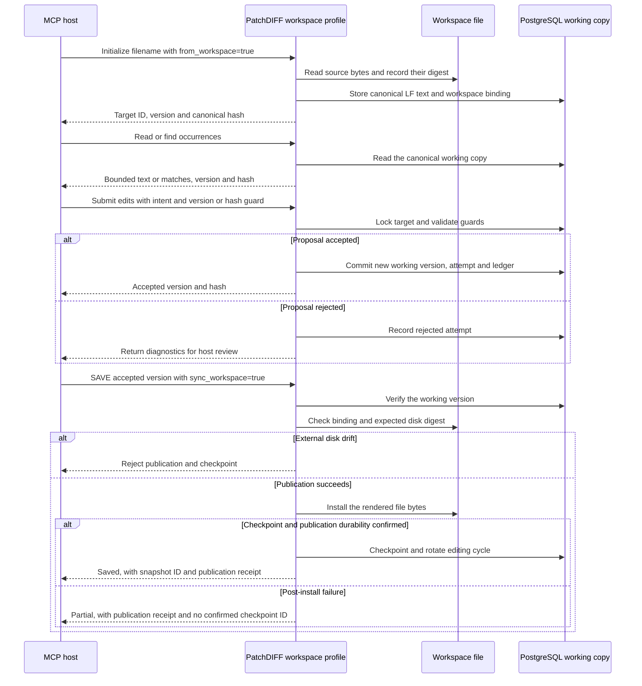
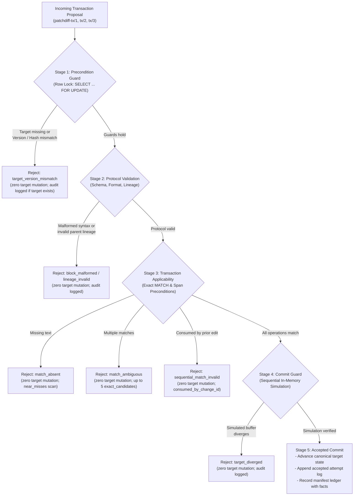
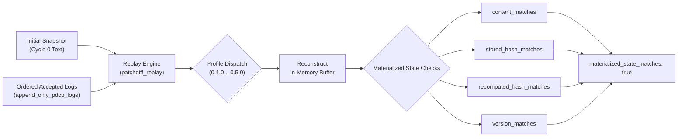

# Visual Architecture & Transaction Lifecycle

Follow an edit from the host's initial read through validation, commit
and replay. See the [profile catalog](spec/profiles/index.md) to choose
which tools the host can call.

---

## 1. End-to-End Transaction Sequence

The workspace file supplies the starting bytes and receives an explicit
publication. PostgreSQL holds the canonical LF working copy, version and
audit history. The host owns edit intent, context selection and retries.



With `sync_workspace: false`, SAVE checkpoints the database without
publishing a file. When SAVE returns `partial`, inspect the file and
checkpoint separately. See the [workspace contract](spec/profiles/workspace-profile.md).

## 2. Core Validation Stages & State Transition Flowchart

PatchDIFF evaluates proposals against five distinct `ValidationStage` boundaries, ensuring that invalid transactions fail closed before any state mutation can occur:



---

## 3. Four-Tier Architecture

PatchDIFF enforces a strict separation of concerns across four distinct operational tiers:

```text
┌─────────────────────────────────────────────────────────────┐
│                      Tier 1: MCP Host                       │
│     (Claude Desktop / Agentic Host / IDE Workflow)          │
│  - Reads context slices & searches exact occurrences        │
│  - Formulates declarative transaction proposals             │
│  - Owns retries, recovery lineage, and completion evaluation│
└──────────────────────────────┬──────────────────────────────┘
                               │ JSON-RPC (stdio transport)
┌──────────────────────────────▼──────────────────────────────┐
│                  Tier 2: MCP Transport Layer                │
│     (backend/app/mcp/external_adapter.py, tools.py)         │
│  - Exposes immutable workspace, editing and lifecycle profiles   │
│  - Enforces strict input schema validation & request limits │
│  - Formats bounded machine-readable responses & receipts    │
└──────────────────────────────┬──────────────────────────────┘
                               │ Internal service calls
┌──────────────────────────────▼──────────────────────────────┐
│             Tier 3: Transaction Service Layer               │
│     (backend/app/services/)                                 │
│  - Owns SQLAlchemy session, per-target row lock & retry key │
│  - Invokes Pure Core Runtime for in-memory simulation       │
│  - Atomically commits accepted mutations or logs rejections │
│  - Manages file import, SAVE publication, checkpoints and replay     │
└──────────────┬───────────────────────────────▲──────────────┘
               │                               │ Pure in-memory
               │ SELECT ... FOR UPDATE         │ evaluation (no I/O)
               │ atomic commit/audit           │
┌──────────────▼──────────────┐ ┌──────────────┴──────────────┐
│ Tier 4: PostgreSQL Substrate│ │ Pure Deterministic Core     │
│ (backend/app/storage/)      │ │ (backend/app/core/, pdcp/)  │
│ - cloud_target_files        │ │ - Exact match enumerator    │
│ - append_only_pdcp_logs     │ │ - Sequential tx applier     │
│ - append_only_manifest_ledger│ │ - Change facts & validity   │
│ - client_request_id recovery│ │ - Zero DB/network/LLM I/O   │
└─────────────────────────────┘ └─────────────────────────────┘
```

---

## 4. Deterministic Profile-Dispatched Replay Flowchart

State reconstruction in PatchDIFF is deterministic and profile-dispatched, replaying every transaction under its recorded `(protocol_version, runtime_version)`:


