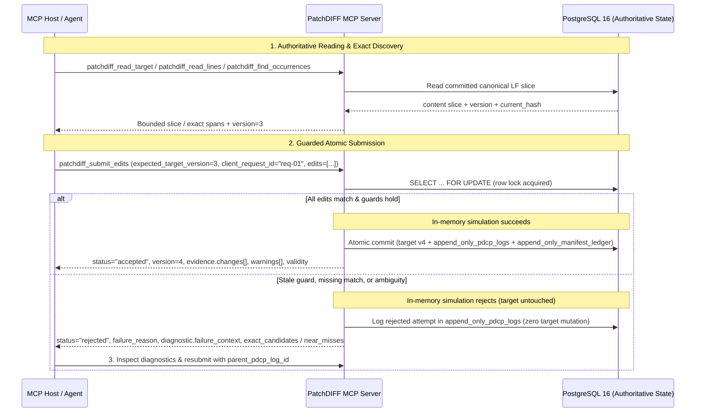
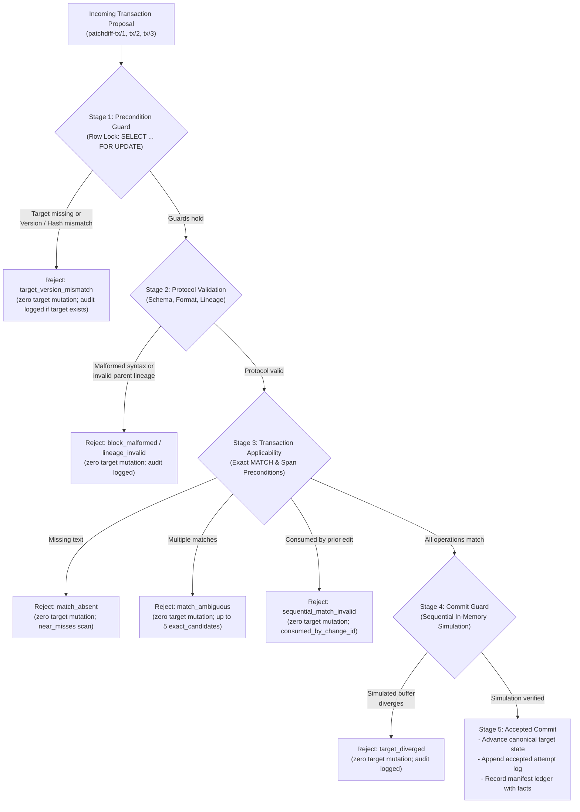
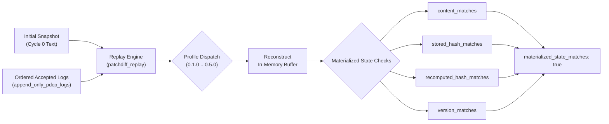

# Visual Architecture & Transaction Lifecycle

This document provides visual diagrams and state transition flowcharts for PatchDIFF's deterministic document transaction service.

---

## 1. End-to-End Transaction Sequence

The sequence diagram below illustrates the complete lifecycle of a document edit proposal, from authoritative read through optimistic locking, sequential simulation, and atomic commit or bounded rejection:



---

## 2. Core Validation Stages & State Transition Flowchart

PatchDIFF evaluates proposals against five distinct `ValidationStage` boundaries, ensuring that invalid transactions fail closed before any state mutation can occur:



---

## 3. Four-Tier Architecture

PatchDIFF enforces a strict separation of concerns across four distinct operational tiers:

```text
┌─────────────────────────────────────────────────────────────┐
│                      Tier 1: MCP Host                       │
│     (Claude Desktop / Agentic Host / IDE Workflow)          │
│  - Reads context slices & searches exact occurrences        │
│  - Formulates declarative transaction proposals             │
│  - Owns retries, recovery lineage, and completion evaluation│
└──────────────────────────────┬──────────────────────────────┘
                               │ JSON-RPC (stdio transport)
┌──────────────────────────────▼──────────────────────────────┐
│                  Tier 2: MCP Transport Layer                │
│     (backend/app/mcp/external_adapter.py, tools.py)         │
│  - Exposes immutable profiles (editor, observed_v2, full)   │
│  - Enforces strict input schema validation & request limits │
│  - Formats bounded machine-readable responses & receipts    │
└──────────────────────────────┬──────────────────────────────┘
                               │ Internal service calls
┌──────────────────────────────▼──────────────────────────────┐
│             Tier 3: Pure Deterministic Core Runtime         │
│     (backend/app/core/, backend/app/pdcp/)                  │
│  - Parsers (tx/1, tx/2, tx/3, legacy .pdcp v0.2.3)          │
│  - Overlapping match enumerator & disambiguator             │
│  - In-memory sequential applier & change_facts calculator   │
│  - Zero LLM calls, zero network I/O, zero fuzzy guessing    │
└──────────────────────────────┬──────────────────────────────┘
                               │ SELECT ... FOR UPDATE
┌──────────────────────────────▼──────────────────────────────┐
│           Tier 4: PostgreSQL Canonical Substrate            │
│     (backend/app/storage/, migrations 0001–0005)            │
│  - cloud_target_files (authoritative canonical LF text)     │
│  - append_only_pdcp_logs (all accepted & rejected attempts) │
│  - append_only_manifest_ledger (derived span/hash facts)    │
│  - client_request_id idempotency & retry lineage            │
└─────────────────────────────────────────────────────────────┘
```

---

## 4. Deterministic Profile-Dispatched Replay Flowchart

State reconstruction in PatchDIFF is deterministic and profile-dispatched, replaying every transaction under its recorded `(protocol_version, runtime_version)`:


