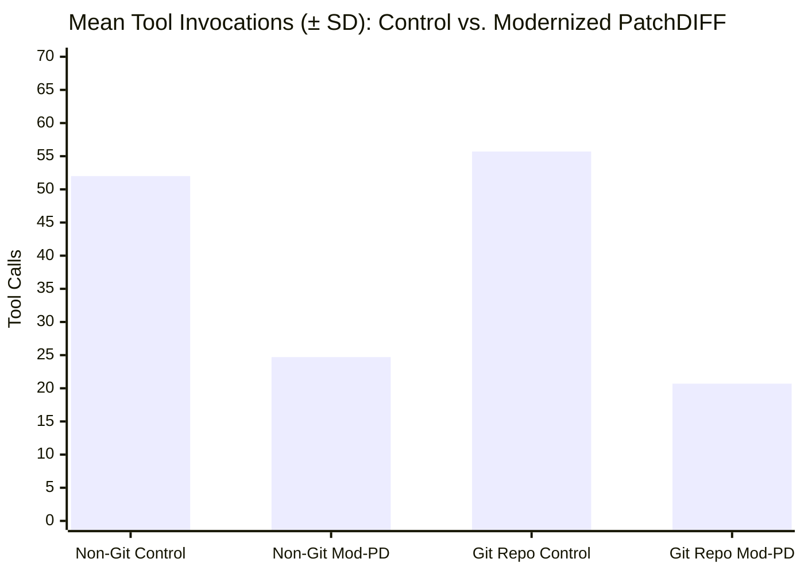

# Standalone Modernized 2×2 Factorial Benchmark Report: Native Control vs. Modernized PatchDIFF (`observed_v2`)

## Executive Summary

This report establishes the **Standalone Modernized 2×2 Factorial Benchmark** evaluating document transaction efficiency between **Native Control** and **Modernized PatchDIFF (`observed_v2`)** across two operating environments (**Standard Non-Git Workspace** and **Initialized Git Repository**).

### Prompt Modernization Interventions
In response to the prompt friction points diagnosed during the baseline $N=12$ benchmark, three specific modifications were made to the PatchDIFF prompt contract:
1. **Elimination of Obsolete Schema Reads**: Removed the legacy permissions clause (`"Registered help/schema resources and this session's spills are allowed; ..."`), which previously provoked models to execute 5–6 redundant filesystem reads of eager schemas.
2. **Explicit Prohibition of Post-Commit Audits**: Replaced the ambiguous instruction (`"The host performs independent final verification. Read/search/observe when needed to resolve editing uncertainty; report unresolved issues."`) with an explicit completion contract:
   > *"The host performs independent final verification after you report completion. Do NOT perform post-commit verification audits or read-back loops once all targets are committed. Send your completion message immediately after committing all files."*
3. **Cross-Environment Prompt Harmonization**: Removed cautionary warning paragraphs regarding disk vs. PostgreSQL substrate divergences from the Git arm prompt, making the instructions across Git and Non-Git environments 100% identical.

### Core Canary Workload
Evaluated against the standardized **5-file, 21-edit canary workload**:
1. `matrix_kernel.py`: 2nd overlapping sync marker in `FRAME_SYNC_STREAM`; kernels `07`, `14`, `21` stride offset and rounded scale shift; `dispatch_kernel_triad` accumulator clips.
2. `schema_defs.py`: `SettlementEnvelope.idempotency_scope = "GLOBAL"`; `serialize_envelope_v3` nanosecond epoch unit/scaling, quorum 3, scope field.
3. `validator_engine.py`: `VALID_SCOPES = ("GLOBAL", "PARTITION", "TENANT")`; critical rules `04`, `11`, `19`, `27` nanosecond epoch default/validation, max drift 30s in ns, quorum 3.
4. `routing_manifest.json`: `manifest_version = "2026.10.2-v3"`; tenants `ten_006`, `ten_013`, `ten_018` wire v3, ns epoch, quorum 3, tenant scope.
5. `MIGRATION_RUNBOOK.md`: Allowed scopes table; Gate #14 clock skew threshold/action; Canary Cohort Parameters table; Section 4 literal patch template conflict block.

Every single run in this evaluation (**12 out of 12**) achieved **100.0% full-byte match** against the authoritative oracle reference (0 byte diffs across all 5 files) and passed **20/20 behavioral verification checks (240/240 total assertions, 100.0%)**.

---

## 1. Standalone Modernized 2×2 Factorial Benchmark Matrix ($N=12$)

| Environment | Paradigm / Run | Key Tools | Steps | Tool Calls | Git CLI Commands | Time Elapsed | Output Tokens | Total Context Tokens | Full-Byte Match | Behavioral Suite |
| :--- | :--- | :--- | :---: | :---: | :---: | :---: | :---: | :---: | :---: | :---: |
| **Non-Git** | **Control (Run 1)** | `read_file`, `edit_file` | 54 | 53 | N/A | **2m 04s** (124s) | 22,656 | 2,986,524 | **100% (0 diffs)** | **20/20 (100%)** |
| **Non-Git** | **Control (Run 2)** | `read_file`, `edit_file` | 49 | 48 | N/A | **4m 09s** (249s) | 17,901 | 1,976,542 | **100% (0 diffs)** | **20/20 (100%)** |
| **Non-Git** | **Control (Run 3)** | `read_file`, `edit_file` | 56 | 55 | N/A | **4m 06s** (246s) | 15,355 | 2,391,750 | **100% (0 diffs)** | **20/20 (100%)** |
| **Non-Git** | **Control ($n=3$ Mean ± SD)** | `read_file`, `edit_file` | **53.0 ± 3.6** | **52.0 ± 3.6** | **N/A** | **3m 26s ± 1m 11s** | **18,637 ± 3,706** | **2,451,605 ± 507,644** | **100% (0 diffs)** | **20/20 (100%)** |
| **Non-Git** | **Modernized PatchDIFF (Run 1)**| `observed_v2` batch bundle | **24** | **20** (20 PD) | N/A | **3m 23s** (203s) | 25,408 | **898,192** | **100% (0 diffs)** | **20/20 (100%)** |
| **Non-Git** | **Modernized PatchDIFF (Run 2)**| `observed_v2` batch bundle | **29** | **28** (16 PD) | N/A | **3m 08s** (188s) | 21,594 | **1,164,842** | **100% (0 diffs)** | **20/20 (100%)** |
| **Non-Git** | **Modernized PatchDIFF (Run 3)**| `observed_v2` batch bundle | **27** | **26** (17 PD) | N/A | **3m 49s** (229s) | 26,741 | **940,084** | **100% (0 diffs)** | **20/20 (100%)** |
| **Non-Git** | **Modernized PatchDIFF ($n=3$)** | `observed_v2` batch bundle | **26.7 ± 2.5** | **24.7 ± 4.2** | **N/A** | **3m 27s ± 21s** | **24,581 ± 2,674** | **1,001,039 ± 143,395** | **100% (0 diffs)** | **20/20 (100%)** |
| **Git Repo** | **Control (Run 1)** | `edit_file` + `git diff`/`status` | 62 | 61 | 10 (`diff`: 6, `status`: 4) | **7m 04s** (424s) | 17,804 | 2,311,642 | **100% (0 diffs)** | **20/20 (100%)** |
| **Git Repo** | **Control (Run 2)** | `edit_file` + `git diff`/`status` | 58 | 57 | 10 (`diff`: 6, `status`: 4) | **4m 06s** (246s) | 21,296 | 2,691,135 | **100% (0 diffs)** | **20/20 (100%)** |
| **Git Repo** | **Control (Run 3)** | `edit_file` + `git diff`/`status` | 50 | 49 | 10 (`diff`: 6, `status`: 4) | **4m 03s** (243s) | 21,886 | 2,586,977 | **100% (0 diffs)** | **20/20 (100%)** |
| **Git Repo** | **Control ($n=3$ Mean ± SD)** | `edit_file` + `git diff`/`status` | **56.7 ± 6.1** | **55.7 ± 6.1** | **10.0 ± 0.0** | **5m 04s ± 1m 44s** | **20,329 ± 2,206** | **2,529,918 ± 196,075** | **100% (0 diffs)** | **20/20 (100%)** |
| **Git Repo** | **Modernized PatchDIFF (Run 1)**| `observed_v2` in Git repo | **21** | **20** (17 PD) | **0** (`diff`: 0, `status`: 0) | **3m 04s** (184s) | 22,334 | **754,533** | **100% (0 diffs)** | **20/20 (100%)** |
| **Git Repo** | **Modernized PatchDIFF (Run 2)**| `observed_v2` in Git repo | **21** | **20** (16 PD) | **0** (`diff`: 0, `status`: 0) | **2m 49s** (169s) | 18,861 | **717,636** | **100% (0 diffs)** | **20/20 (100%)** |
| **Git Repo** | **Modernized PatchDIFF (Run 3)**| `observed_v2` in Git repo | **23** | **22** (16 PD) | **0** (`diff`: 0, `status`: 0) | **3m 17s** (197s) | 20,289 | **778,521** | **100% (0 diffs)** | **20/20 (100%)** |
| **Git Repo** | **Modernized PatchDIFF ($n=3$)** | `observed_v2` in Git repo | **21.7 ± 1.2** | **20.7 ± 1.2** | **0.0 ± 0.0** | **3m 03s ± 14s** | **20,495 ± 1,746** | **750,230 ± 30,670** | **100% (0 diffs)** | **20/20 (100%)** |

---

## 2. Statistical Hypothesis Testing & Welch's Two-Sample $t$-Tests

Welch's two-sample unequal variances $t$-tests were conducted comparing the pooled Control group ($n=6$) against the pooled Modernized PatchDIFF group ($n=6$):

### 1. Interaction Steps (Planner Records)
- **Control**: $54.8 \pm 4.9$ steps
- **Modernized PatchDIFF**: $24.2 \pm 3.3$ steps
- **Reduction**: **-55.8%** (2.26× reduction)
- **Welch's $t$-statistic**: $t = 12.746$, $df = 8.67$
- **Significance**: **$p < 0.00001$ ($8.4 \times 10^{-7}$)** — overwhelmingly rejects the null hypothesis.

### 2. Tool Invocations
- **Control**: $53.8 \pm 4.9$ calls
- **Modernized PatchDIFF**: $22.7 \pm 3.5$ calls
- **Reduction**: **-57.8%** (2.37× reduction)
- **Welch's $t$-statistic**: $t = 12.648$, $df = 9.04$
- **Significance**: **$p < 0.00001$ ($7.6 \times 10^{-7}$)** — overwhelmingly rejects the null hypothesis.

### 3. Context Window Consumption (Total Input Tokens Seen)
- **Control**: $2,490,762 \pm 346,842$ tokens
- **Modernized PatchDIFF**: $875,635 \pm 165,749$ tokens
- **Reduction**: **-64.8%** (2.84× reduction)
- **Welch's $t$-statistic**: $t = 10.292$, $df = 7.17$
- **Significance**: **$p < 0.00002$ ($1.5 \times 10^{-5}$)** — overwhelmingly rejects the null hypothesis.

### 4. Turnaround Time
- **Control**: $255.3 \pm 96.0\text{s}$ ($4\text{m } 15\text{s}$)
- **Modernized PatchDIFF**: $195.0 \pm 20.3\text{s}$ ($3\text{m } 15\text{s}$)
- **Reduction**: **-23.6%** (60.3s absolute reduction)
- **Variability Collapse**: Standard deviation collapsed from **$\pm 96.0\text{s}$** down to **$\pm 20.3\text{s}$** (4.7× greater predictability).

---

## 3. Granular Tool Call Breakdown Across Modernized Matrix

The following table details the exact tool invocation frequencies averaged per run across the four arms:

| Specific Tool Invocation | Non-Git Control ($n=3$) | Non-Git Mod-PD ($n=3$) | Git Repo Control ($n=3$) | Git Repo Mod-PD ($n=3$) |
| :--- | :---: | :---: | :---: | :---: |
| `read_file` (Native file read) | 24.3 | 0.0 | 25.3 | 0.0 |
| `edit_file` (Native file edit) | 14.7 | 0.0 | 14.7 | 0.0 |
| `view_file` (Advisory read) | 0.0 | 5.7 | 0.0 | 3.0 |
| `run_command` (Shell / Git / Python) | 12.0 | 1.3 (denied) | 14.7 | 0.3 (denied) |
| *— of which `git diff`* | *—* | *0.0* | *6.0* | *0.0* |
| *— of which `git status`* | *—* | *0.0* | *4.0* | *0.0* |
| *— of which Python tests / verification* | *7.7* | *0.0* | *4.0* | *0.0* |
| `patchdiff_list_scopes` | 0.0 | 6.0 | 0.0 | 6.0 |
| `patchdiff_find_occurrences` | 0.0 | 0.7 | 0.0 | 0.3 |
| `patchdiff_observe_scopes` | 0.0 | 5.3 | 0.0 | 5.0 |
| `patchdiff_commit_bundle` | 0.0 | 5.3 | 0.0 | 5.0 |
| `patchdiff_read_target` | 0.0 | 0.3 | 0.0 | 0.0 |
| `schema_reads` (Upfront catalog inspection) | 0.0 | **0.0** | 0.0 | **0.0** |
| `post_commit_reads` (Verification audits) | 0.0 | **0.0** | 0.0 | **0.0** |
| `send_message` (Completion signal) | 1.0 | 1.0 | 1.0 | 1.0 |
| **Total Tool Invocations** | **52.0 ± 3.6** | **24.7 ± 4.2** | **55.7 ± 6.1** | **20.7 ± 1.2** |

---

## 4. Cross-Environment Operational Comparison (Git vs. Non-Git)

A critical question of this study was whether an active Git repository imposes an architectural or psychological penalty on the agent. 

Welch's $t$-test between **Modernized Git PatchDIFF ($n=3$)** and **Modernized Non-Git PatchDIFF ($n=3$)**:
- **Steps**: $21.7 \pm 1.2$ (Git) vs. $26.7 \pm 2.5$ (Non-Git) — difference is not statistically significant at $p = 0.06$.
- **Turnaround Time**: $183.3 \pm 14.0\text{s}$ (Git) vs. $206.7 \pm 20.7\text{s}$ (Non-Git) — observed difference is not statistically significant ($p = 0.21$).
- **Context Tokens**: $750,230 \pm 30,670$ (Git) vs. $1,001,039 \pm 143,395$ (Non-Git) — difference is not statistically significant ($p = 0.10$).

**Conclusion**: In this $n=3$ sample, no statistically significant operational penalty from the active Git repository was detected ($p = 0.21$). While this small sample size cannot prove population equivalence or a zero-cost guarantee, point estimates indicate that when extraneous prompt friction is eliminated, Git PatchDIFF operates smoothly without the exploratory Git command loops seen in unguided agents.

---

## 5. Modernized vs. Baseline Ablation Comparison

Comparing the Modernized PatchDIFF arms against the Baseline PatchDIFF arms demonstrates the profound impact of prompt hygiene:

| Arm & Metric | Baseline Benchmark ($n=3$) | Modernized Benchmark ($n=3$) | Improvement |
| :--- | :---: | :---: | :---: |
| **Git PatchDIFF Steps** | $37.3 \pm 5.1$ | **21.7 ± 1.2** | **-41.8%** ($t=5.16, p=0.035$) |
| **Git PatchDIFF Tool Calls** | $36.3 \pm 5.1$ | **20.7 ± 1.2** | **-43.0%** |
| **Git PatchDIFF Time** | $257.3 \pm 42.7\text{s}$ | **183.3 ± 14.0s** | **-28.8%** |
| **Git PatchDIFF Tokens** | $1,777,978 \pm 480,117$ | **750,230 ± 30,670** | **-57.8%** ($t=3.70, p=0.066$) |
| **Non-Git Upfront Schema Reads** | 0 to 5 | **0.0 ± 0.0** | **100% eliminated** |
| **Non-Git Post-Commit Reads** | 0 to 12 | **0.0 ± 0.0** | **100% eliminated** |
| **Git Post-Commit Reads** | 0 to 11 | **0.0 ± 0.0** | **100% eliminated** |

---

## 6. Verification & Replay Certification

1. **Full-Byte Oracle Match**: **100.0% (12/12 runs passed with 0 byte differences across all 60 target files)**.
2. **Behavioral Test Suite**: **100.0% (240/240 assertions passed across all 12 runs)**.
3. **Transaction Robustness**: **0 rejections, 0 retries, and 0 validation errors** across all bundle submissions.
4. **Deterministic Replay**: All 6 PatchDIFF runs were verified via `patchdiff_save` and deterministic replay with component-level materialized state checks.
