# PR #24 Workspace editing benchmark

| ⚡ Mean Verified Flow (Pooled) | 📉 Editor Tool Invocations | 🔄 Host Lifecycle Overhead | 🎯 Full-Byte Oracle Match |
| :---: | :---: | :---: | :---: |
| **16.2% Faster** | **-42.7% Calls** | **Zero Separate Calls** | **100.0%** |
| *(296.7s Workspace vs. 354.2s Native)* | *(32.00 vs. 55.83 calls/task)* | *(Self-contained agent SAVE)* | *(90/90 files exact, 360/360 checks)* |

On 2026-11-05, 18 Antigravity trials compared native file editing, structural editing with host lifecycle orchestration, and agent-owned Workspace import, guarded editing and SAVE publication. Each arm ran three times in Git and three times in non-Git against the same five-file, 21-edit task.

Workspace (`observed_workspace`) averaged **296.742 seconds** from timed start through verification, compared with **354.234 seconds** for Native, a **16.2% reduction**. It used **32.00 editor calls** per trial versus **55.83**, a **42.7% reduction**. All arms produced exact output. Workspace handled initialization and publication through its seven editor tools. Structural editing required a separate host lifecycle implementation.

The primary comparison runs from the benchmark's timed flow start through publication and verification. Fixture/database preparation and the owner's pre-start workspace/connector handoff are excluded and recorded separately as setup overhead. The editor-only interval and terminal handoff delay are also reported so the timing boundary can be inspected.

## Product workflow and guard boundary

| Arm | Editor owns | Separate host lifecycle per trial |
| --- | --- | --- |
| Native | Read and edit project files through native tools | 0 MCP lifecycle calls, common verifier |
| Structural / `observed_v2` | Discover scopes, observe snapshots, commit guarded bundles | 5 initialize + 5 SAVE + 5 replay + 5 export calls, 5 file writes |
| Workspace / `observed_workspace` | Import files, discover/observe, commit guarded bundles, explicitly SAVE to project files | 0 separate lifecycle calls or file writes, common verifier |

Workspace makes the import-to-publication workflow available to the editing agent through one MCP connection. An integration still supplies the MCP transport, model session and database, but it needs no separate privileged initialization/export routine for the successful editing path. Independent task verification remains useful in every arm.

Both PatchDIFF arms use explicit observed snapshots, exact scope-local operations, version/hash guards and atomic commits per target. Workspace adds the editor-facing file import and SAVE publication tools. Acceptance establishes a validated state transition. The independent byte oracle and behavioral checks establish correctness for this task. A five-file workflow is not one atomic filesystem transaction; SAVE publishes individual files and reports filesystem and database outcomes separately.

## Experimental conditions

- Source commit `41ef0e09f06d86f94324800c4c4858074551df69`. The packaged adapter and installed adapter were compared with that commit.
- Same original fixture bytes, task and byte oracle across all 18 trials. The task covers Python, JSON and Markdown, repeated similar functions/objects, overlapping matches, selected fields and literal conflict delimiters.
- Antigravity sessions were operated with the requested Gemini 3.8 Flash High selection. Recorded model/reasoning and fresh-session fields are operator attestations. Provider confirmation and exact per-trial Antigravity build identification were not captured. `host_build` contains the placeholder `production`.
- Six serial blocks alternate Git and non-Git. Each block contains all three arms. Arm positions rotate within each environment. Each trial has a ten-minute limit.
- PatchDIFF trials use fresh databases in an owned disposable PostgreSQL 16.15 cluster. Resident Waymark 4.1.0 uses Node 22.19.0. Native receives no PatchDIFF tools. Structural exposes five tools and Workspace seven.
- Native uses native file tools. PatchDIFF editors use their advertised catalog, with session help/schema reads allowed. This measures those assigned workflows. It does not measure unrestricted shell, Git CLI or test-running strategies.
- Preparation creates fixture copies, initializes Git where assigned, and creates/migrates a database where assigned. Timed start precedes structural host initialization or Workspace editor import. Prompt submission, editor work, publication, operator terminal handoff and verification occur before the timed end.
- Failures and timeouts would remain in the attempt table. The 18 scheduled attempts all completed successfully. The separate four-trial pilot and unscored smoke checks are excluded.

## Trial outcomes and calls

Editor calls include auxiliary host tools and completion messages. MCP calls count editing-connection `tools/call` requests. Host lifecycle calls and file writes are counted separately. Accuracy is checked against all five original paths, including untouched bytes.

| Trial | Environment | Arm | Verified interval s | Editor steps | Editor calls | Editor MCP calls | Host calls / writes | Exact files / behaviors |
| --- | --- | --- | --- | --- | --- | --- | --- | --- |
| 01 | git | native | 292.730 | 49 | 48 | 0 | 0 / 0 | 5/5; 20/20 |
| 02 | git | structural | 326.392 | 39 | 38 | 31 | 20 / 5 | 5/5; 20/20 |
| 03 | git | workspace | 287.693 | 30 | 29 | 26 | 0 / 0 | 5/5; 20/20 |
| 04 | nongit | native | 425.360 | 70 | 69 | 0 | 0 / 0 | 5/5; 20/20 |
| 05 | nongit | workspace | 285.547 | 41 | 40 | 36 | 0 / 0 | 5/5; 20/20 |
| 06 | nongit | structural | 281.275 | 33 | 32 | 27 | 20 / 5 | 5/5; 20/20 |
| 07 | git | structural | 232.619 | 21 | 20 | 17 | 20 / 5 | 5/5; 20/20 |
| 08 | git | workspace | 307.735 | 35 | 34 | 26 | 0 / 0 | 5/5; 20/20 |
| 09 | git | native | 330.318 | 44 | 44 | 0 | 0 / 0 | 5/5; 20/20 |
| 10 | nongit | workspace | 305.395 | 32 | 31 | 26 | 0 / 0 | 5/5; 20/20 |
| 11 | nongit | structural | 264.028 | 32 | 31 | 28 | 20 / 5 | 5/5; 20/20 |
| 12 | nongit | native | 398.025 | 56 | 55 | 0 | 0 / 0 | 5/5; 20/20 |
| 13 | git | workspace | 318.512 | 30 | 29 | 26 | 0 / 0 | 5/5; 20/20 |
| 14 | git | native | 399.772 | 65 | 64 | 0 | 0 / 0 | 5/5; 20/20 |
| 15 | git | structural | 299.416 | 30 | 29 | 26 | 20 / 5 | 5/5; 20/20 |
| 16 | nongit | structural | 352.717 | 41 | 40 | 33 | 20 / 5 | 5/5; 20/20 |
| 17 | nongit | native | 279.200 | 56 | 55 | 0 | 0 / 0 | 5/5; 20/20 |
| 18 | nongit | workspace | 275.569 | 30 | 29 | 26 | 0 / 0 | 5/5; 20/20 |

All 18 outcomes were `success`. Independent rechecking found **90/90 byte-exact files**, **360/360 behavioral checks**, no captured MCP errors/rejections/partial results and no transcript error records. Native receipts report zero operator-classified retries. No comparative accuracy advantage was observed because every arm passed.

## Timing, calls and tokens by environment

Each environment/arm row contains three trials. Means below use the same three repetitions per cell. The final pooled rows contain six trials per arm. Percentages in the narrative use ratios of arithmetic means.

| Environment | Arm | n | Mean verified s | Median verified s | Range s | Mean editor span s | Mean steps | Mean editor calls | Mean input + cache tokens | Mean output tokens |
| --- | --- | --- | --- | --- | --- | --- | --- | --- | --- | --- |
| git | native | 3 | 340.940 | 330.318 | 292.730–399.772 | 304.3 | 52.67 | 52.00 | 2,148,752 | 23,458 |
| git | structural | 3 | 286.142 | 299.416 | 232.619–326.392 | 245.7 | 30.00 | 29.00 | 1,158,558 | 24,496 |
| git | workspace | 3 | 304.647 | 307.735 | 287.693–318.512 | 273.3 | 31.67 | 30.67 | 1,245,169 | 26,730 |
| nongit | native | 3 | 367.529 | 398.025 | 279.200–425.360 | 333.7 | 60.67 | 59.67 | 2,627,393 | 22,006 |
| nongit | structural | 3 | 299.340 | 281.275 | 264.028–352.717 | 263.7 | 35.33 | 34.33 | 1,398,677 | 25,192 |
| nongit | workspace | 3 | 288.837 | 285.547 | 275.569–305.395 | 252.7 | 34.33 | 33.33 | 1,389,079 | 24,908 |
| pooled | native | 6 | 354.234 | 364.172 | 279.200–425.360 | 319.0 | 56.67 | 55.83 | 2,388,072 | 22,732 |
| pooled | structural | 6 | 292.741 | 290.345 | 232.619–352.717 | 254.7 | 32.67 | 31.67 | 1,278,618 | 24,844 |
| pooled | workspace | 6 | 296.742 | 296.544 | 275.569–318.512 | 263.0 | 33.00 | 32.00 | 1,317,124 | 25,819 |





Workspace’s mean timed interval was **10.6% lower in Git** and **21.4% lower in non-Git** than Native. The corresponding editor-call reductions were **41.0%** and **44.1%**. Workspace had a lower timed interval than its same-block Native control in all six blocks. Structural was faster in four of six paired blocks. These are observations from one task and one requested model setting, with three repetitions per cell. No general performance or statistical-significance claim follows from them.

Token totals sum the transcript’s exported `input_tokens` and `cache_read_tokens` fields across planner records. They measure cumulative exported token accounting, including repeated cached input. They are not unique context size, billed cost or a direct measurement of reasoning. The editor span runs from the first planner record to the terminal transcript record. Inter-call time mixes model, provider, tool and host scheduling.

## Granular tool invocation breakdown

The table below details the exact tool invocation frequencies averaged per run across the experimental matrix. In the native baseline, the agent spent the majority of its calls on iterative file reading (`read_file`) and standard string replacements (`edit_file`). In structural and workspace modes, Waymark AST structural indexing (`list_scopes`, `observe_scopes`) replaced multi-chunk reading with targeted scope observation, while `commit_bundle` and `save` handled atomic execution and file write-back.

| Specific Tool Invocation | Git Native | Git Structural | Git Workspace | Non-Git Native | Non-Git Structural | Non-Git Workspace | Pooled Native | Pooled Structural | Pooled Workspace |
| :--- | :---: | :---: | :---: | :---: | :---: | :---: | :---: | :---: | :---: |
| `read_file` (Native file read) | 31.00 | 0.00 | 0.00 | 38.67 | 0.00 | 0.00 | 34.83 | 0.00 | 0.00 |
| `edit_file` (Native file edit) | 20.00 | 0.00 | 0.00 | 20.00 | 0.00 | 0.00 | 20.00 | 0.00 | 0.00 |
| `view_file` (Advisory read) | 0.00 | 3.33 | 3.67 | 0.00 | 3.67 | 2.33 | 0.00 | 3.50 | 3.00 |
| `patchdiff_initialize_target` | 0.00 | 0.00 | 5.00 | 0.00 | 0.00 | 5.00 | 0.00 | 0.00 | 5.00 |
| `patchdiff_list_scopes` | 0.00 | 6.00 | 6.00 | 0.00 | 6.00 | 6.00 | 0.00 | 6.00 | 6.00 |
| `patchdiff_observe_scopes` | 0.00 | 5.00 | 5.00 | 0.00 | 5.00 | 5.00 | 0.00 | 5.00 | 5.00 |
| `patchdiff_find_occurrences` | 0.00 | 8.33 | 0.00 | 0.00 | 13.00 | 3.33 | 0.00 | 10.67 | 1.67 |
| `patchdiff_read_target` | 0.00 | 0.33 | 0.00 | 0.00 | 0.33 | 0.00 | 0.00 | 0.33 | 0.00 |
| `patchdiff_commit_bundle` | 0.00 | 5.00 | 5.00 | 0.00 | 5.00 | 5.00 | 0.00 | 5.00 | 5.00 |
| `patchdiff_save` | 0.00 | 0.00 | 5.00 | 0.00 | 0.00 | 5.00 | 0.00 | 0.00 | 5.00 |
| `list_resources` (Catalog inspection) | 0.00 | 0.00 | 0.00 | 0.00 | 0.33 | 0.67 | 0.00 | 0.17 | 0.33 |
| `send_message` (Completion signal) | 1.00 | 1.00 | 1.00 | 1.00 | 1.00 | 1.00 | 1.00 | 1.00 | 1.00 |
| **Total Mean Editor Calls** | **52.00** | **29.00** | **30.67** | **59.67** | **34.33** | **33.33** | **55.83** | **31.67** | **32.00** |
| *Separate Host Calls / Writes* | *0 / 0* | *20 / 5* | *0 / 0* | *0 / 0* | *20 / 5* | *0 / 0* | *0 / 0* | *20 / 5* | *0 / 0* |

## Setup, publication and verification

One-time setup phases totaled **33.946 seconds**. The phases were venv creation 9.754, wheel installation 22.229, PostgreSQL package extraction 1.206 and Waymark installation 0.758. This is separate from per-trial preparation and the connector handoff. Runner startup is retained in the packet logs. The runner emits no single bootstrap-duration field.

| Trial | Preparation s | Owner/connector handoff s | Prompt handoff s | Terminal handoff s | MCP tool sum s | Host RPC sum s | Verification s  |
| --- | --- | --- | --- | --- | --- | --- | ---  |
| 01 | 0.039 | 58.327 | 0.465 | 19.403 | 0.000 | 0.000 | 1.096  |
| 02 | 1.261 | 260.859 | 0.101 | 13.216 | 2.050 | 2.009 | 0.781  |
| 03 | 1.333 | 310.623 | 0.113 | 18.896 | 1.648 | 0.000 | 0.786  |
| 04 | 0.019 | 150.957 | 0.115 | 14.425 | 0.000 | 0.000 | 0.787  |
| 05 | 1.550 | 46.990 | 0.111 | 10.742 | 1.693 | 0.000 | 1.212  |
| 06 | 1.306 | 77.578 | 0.106 | 12.439 | 1.307 | 2.616 | 1.092  |
| 07 | 1.159 | 162.573 | 0.110 | 9.251 | 1.457 | 2.010 | 0.780  |
| 08 | 1.534 | 110.676 | 0.123 | 8.616 | 1.945 | 0.000 | 0.836  |
| 09 | 0.032 | 9.532 | 0.123 | 9.085 | 0.000 | 0.000 | 1.327  |
| 10 | 1.273 | 161.739 | 0.150 | 15.902 | 1.791 | 0.000 | 0.782  |
| 11 | 1.113 | 148.180 | 0.127 | 9.313 | 2.192 | 2.386 | 0.776  |
| 12 | 0.016 | 10.426 | 0.107 | 9.554 | 0.000 | 0.000 | 0.778  |
| 13 | 1.090 | 107.130 | 0.121 | 13.015 | 1.686 | 0.000 | 0.828  |
| 14 | 0.039 | 5.908 | 0.160 | 10.599 | 0.000 | 0.000 | 0.779  |
| 15 | 1.141 | 115.776 | 0.108 | 22.106 | 1.480 | 2.000 | 0.775  |
| 16 | 1.274 | 52.201 | 0.108 | 8.992 | 1.536 | 1.915 | 0.781  |
| 17 | 0.018 | 8.159 | 0.106 | 9.212 | 0.000 | 0.000 | 0.831  |
| 18 | 1.148 | 71.865 | 0.129 | 12.134 | 1.880 | 0.000 | 0.785  |

Preparation and the pre-start owner/connector handoff remain separate from the benchmark's verified interval. Terminal handoff is the interval from the terminal editor record to the operator's finish request. It occurs inside the recorded verified interval and is shown independently rather than attributed to editing or model reasoning. Tool-duration sums can overlap and are not interchangeable with elapsed wall time.

Workspace publication time comes from the last successful SAVE response with `publication=installed` and `durability=confirmed`. Captures pair each SAVE with its raw disk digest and the stored checkpoint verification receipt. Structural publication time comes from the last host file-write journal entry after SAVE, successful replay and export. Native publication is observed on disk at finish, which is an upper bound on its last write. The [machine-readable evidence](workspace-e2e-results.json) retains per-trial start, submission, publication and verification timestamps.

## What the captures establish

Across six Workspace trials the editor made **30 imports, 30 observations, 30 guarded bundle commits and 30 explicit SAVEs**. Across six structural trials it made **30 observations and 30 guarded bundle commits**, followed by **120 host lifecycle calls and 30 host file writes**. Both PatchDIFF arms completed 20 scope groups per trial. Native made 120 native edit calls across its six trials.

Workspace used 36 scope-list calls and 10 exact-search calls in total. Structural used 36 scope-list calls, 64 searches and two target reads. Schema/help reads and completion messages remain included in editor-call totals. The three-arm design compares complete workflows; it does not independently isolate the effects of tool descriptions, prompt policy, context acquisition and submission batching.

## Independent confirmation and reproduction

The independent audit re-read the raw transcripts and wire logs, recomputed step/call/token totals and clock intervals, checked all output files against the frozen oracle, reran the 20 checks on each verified snapshot, and reconstructed **60 accepted guarded commits across 240 scope groups** through the pinned deterministic batch applier. All reconstructed states match the recorded commit hashes and published file bytes. Structural replay responses and Workspace SAVE/checkpoint verification receipts were cross-checked against the captures.

Both recorded runner teardowns report `CLEAN`, with owned database clusters returning from 0 → 1 → 0 and no remaining runner lease. The PostgreSQL clusters have been removed, so this audit verifies their captured checkpoint evidence. Capture consistency does not establish provider-side model identity.

The source packet is retained privately as `pr24-18trial-production-benchmark`. Its raw model transcripts and private host paths are excluded from the repository. The sanitized [per-trial evidence](workspace-e2e-results.json) pins the source SHA, wheel SHA-256, packet manifest SHA-256 and each transcript SHA-256. With that packet and the tested environment available, reproduce the audit with the installed wheel and evaluator dependencies:

```bash
export PATCHDIFF_WAYMARK_MODE=resident
python -B backend/tests/verification/workspace_benchmark_audit.py /absolute/path/to/pr24-18trial-production-benchmark /absolute/path/to/new-audit.json
```

The audit script enforces that the output path (e.g. `/absolute/path/to/new-audit.json`) must reside outside the capture packet directory to prevent modifying captured evidence. Running the audit creates its requested output file and checks the existing captures. It performs no model invocation or database restart. Source and test-suite verification remain described in the [test matrix](test-matrix.md).

## Interpretation

The measured result supports using agent-owned Workspace import, guarded editing and publication for this workload. It combines the per-target transaction guarantees with a complete file-editing interface and reduces the need for host lifecycle orchestration. Timed execution and editor-call totals improved over the assigned Native baseline. Broader tasks, model settings, unattended connector operation, concurrency and semantic safety require their own evidence.
