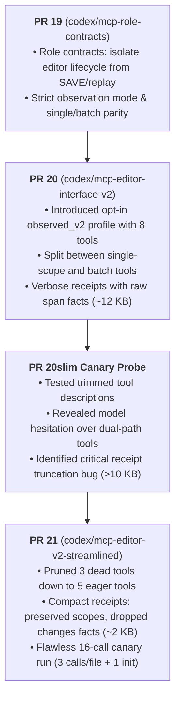

# PR 21 Retrospective: Streamlined 5-Tool Observed Editor Surface & Receipt Compaction

**Date**: 2026-10-30  
**Repository**: `paragon-ux/Patch-DIFF`  
**Base Commit**: `097065ec58cb8b8dbe71bddbc4d81c706fad64ef` (`codex/mcp-editor-interface-v2`, PR #20)  
**Head Commit**: `f2720b8b71e3ae8713e5312cdcf8ec94b48f091c` (`codex/mcp-editor-v2-streamlined`, PR #21)  
**Canary Verification Packet**: `/home/paragon-ux/patchdiff-test/canary/pr21streamlined-gemini-20261030T160705Z-ece81ddcc6`  
**Attested Model**: Gemini 3.8 Flash (High) (inherited via Antigravity orchestrator parent)  

---

## 1. Executive Summary

PR 21 streamlines the opt-in `observed_v2` MCP profile from 8 tools down to **5 purpose-specific eager tools** and resolves **commit receipt bloat and client truncation** by eliminating raw `changes` span facts while preserving authoritative `scopes` confirmations.

In an empirical 5-file canary benchmark (21 edits across Python, JSON, and Markdown targets), PR 21 delivered a massive leap in agentic efficiency compared to PR 20:

- **Planner Steps**: Reduced from **41 to 24 steps (-41.5%)**
- **MCP Calls**: Reduced from **35 to 16 calls (-54.3%)**
- **Cache Read Tokens**: Reduced from **2,635,563 to 968,816 tokens (-63.2%, saving >1.66M tokens)**
- **Total Output Tokens**: Reduced from **27,015 to 24,566 tokens (-9.1%)**
- **Correctness**: **100.0% behavioral pass** (20/20 checks) and **0 byte differences** across all 5 targets
- **Reliability**: **0 rejections, 0 retries, 0 post-commit reads, 0 warnings**

This change adheres strictly to the **YAGNI** principle:
> *"Review a change like the senior developer who will be paged when it breaks. Order of importance: correct, safe, holds under load, tested, fast, lean."*

---

## 2. Historical Lineage: PR 19 $\rightarrow$ PR 20 $\rightarrow$ PR 20slim $\rightarrow$ PR 21

### PR 19: Role Contracts & Lifecycle Isolation
PR 19 established clear role separation:
- The **Host/Orchestrator** owns lifecycle management (`patchdiff_save`, `patchdiff_replay`, `patchdiff_export_target`, attestation, close).
- The **Document Editor** subagent is constrained to non-lifecycle editing tools.
- Strict observation mode was introduced to ensure no edits could be submitted without preceding scope observations.

### PR 20: The 8-Tool `observed_v2` Interface
PR 20 introduced `observed_v2` to simplify tool definitions into purpose-specific schemas. However, it retained duplicate paths for single vs. batch workflows, exposing 8 tools:
1. `patchdiff_read_target` (read target slice)
2. `patchdiff_find_occurrences` (search exact string)
3. `patchdiff_list_scopes` (discover structural scopes)
4. `patchdiff_observe_scopes` (batch observation)
5. `patchdiff_commit_bundle` (batch commit)
6. `patchdiff_observe_one` (single-scope observation)
7. `patchdiff_commit_observation` (single-scope commit)
8. `patchdiff_read_observation` (read existing observation)

### The PR 20slim Canary Probe (Commit `01f32c7`): Uncovering Friction
While PR 20 was functionally correct, canary testing on commit `01f32c701fbe36f960cf9ce103e0396534d8dadb` (an unpublished exploratory commit on `codex/mcp-editor-interface-v2`) with Gemini 3.8 Flash High uncovered two major friction points:

1. **Dual-Path Ambiguity**: Having both batch tools (`observe_scopes`, `commit_bundle`) and singular tools (`observe_one`, `commit_observation`, `read_observation`) created hesitation in model planning. Even with receipt slimming explorations, the agent frequently made redundant calls probing observation state or debating between singular and batch endpoints, expanding planner steps to 45.
2. **Commit Receipt Bloat & Truncation**: In PR 20 (`097065e`), when committing a bundle, the server returned both the `scopes` confirmation array and the raw `changes` array containing runtime-derived span facts (`span_start`, `span_end`, char counts, SHA-256 digests). For multi-edit transactions, receipt payloads exceeded 10–12 KB.
   - Host tool output limits truncated the response.
   - The editor agent was forced to read external tool spill files just to check if its commit had succeeded.
   - Each truncated response caused context explosion, driving cache read tokens to over 2.6 million tokens.

Exploratory commit `01f32c7` proved that slimming receipts was essential, but demonstrated that as long as the 8-tool surface remained, planner hesitation and dual-path confusion persisted.

---

## 3. PR 21 Architectural Decisions

### 3.1. Pruning Dead Tools to 5 Eager Tools
In structural batch editing, every multi-scope edit can be expressed as a bundle of 1 or more groups. Exposing separate `observe_one`, `commit_observation`, and `read_observation` tools violated YAGNI by introducing redundant surface area without providing unique capabilities.

PR 21 pruned those 3 dead tools, leaving exactly 5 purpose-specific tools in `observed_v2`:
- `patchdiff_read_target`
- `patchdiff_find_occurrences`
- `patchdiff_list_scopes`
- `patchdiff_observe_scopes`
- `patchdiff_commit_bundle`

All 5 tools are configured for eager host delivery (`_meta: {"antigravity/alwaysLoad": true}`).

### 3.2. Compact Receipts Without Truncation
We analyzed what information the editor agent actually needs versus what the host ledger records:
- **What the Editor Needs**: Target ID, filename, version transition (`version_before` $\rightarrow$ `version_after`), transaction ID, status (`accepted`), and the `scopes` confirmation array confirming which scopes were successfully modified.
- **What Was Bloating the Receipt**: The `changes` array, which contained raw character-span facts and SHA-256 digests across every atomic replacement. This data is already immutably recorded in PostgreSQL in `append_only_manifest_ledger` and is re-verified by `finalize_after.py` during SAVE and replay.

PR 21 dropped the `changes` span facts from the external MCP commit receipt while strictly preserving the `scopes` collection.
- **Result**: Receipt size dropped from **~12 KB to ~2 KB**.
- **Impact**: Zero tool response truncation. The editor received immediate, unambiguous confirmation inline and proceeded to the next file without spill reading.

### 3.3. Retaining Candidate Symbol Metadata in Discovery
We evaluated whether candidate metadata in `patchdiff_list_scopes` should be simplified. Inspection confirmed that candidate symbols (e.g. `symbol_name`, `kind`, and `selector`) are essential for semantic discovery so the agent can select scopes without blind reads. This metadata was preserved in full.

---

## 4. Empirical Benchmark: PR 20 vs PR 20slim vs PR 21

The canary benchmark evaluates the complete workflow: 21 exact edits across 5 targets (`matrix_kernel.py`, `schema_defs.py`, `validator_engine.py`, `routing_manifest.json`, `MIGRATION_RUNBOOK.md`).

- **PR 20 (8 tools, verbose)**: Commit [`097065ec58cb8b8dbe71bddbc4d81c706fad64ef`](file:///home/paragon-ux/Patch-DIFF) (`codex/mcp-editor-interface-v2`), Packet: `/home/paragon-ux/patchdiff-test/canary/pr20-gemini-20261030T000843Z-d2ba12ccea`
- **PR 20slim (8 tools, exploratory receipt slimming)**: Commit [`01f32c701fbe36f960cf9ce103e0396534d8dadb`](file:///home/paragon-ux/Patch-DIFF) (unpublished exploratory commit on `codex/mcp-editor-interface-v2`), Packet: `/home/paragon-ux/patchdiff-test/canary/pr20slim-gemini-20261030T023726Z-23f740dcea`
- **PR 21 Streamlined (5 tools, compact receipts)**: Commit [`f2720b8b71e3ae8713e5312cdcf8ec94b48f091c`](file:///home/paragon-ux/Patch-DIFF) / [`c039adf`](file:///home/paragon-ux/Patch-DIFF) (`codex/mcp-editor-v2-streamlined`), Packet: `/home/paragon-ux/patchdiff-test/canary/pr21streamlined-gemini-20261030T160705Z-ece81ddcc6`

| Metric | PR 20 (`097065e`) | PR 20slim (`01f32c7`) | PR 21 Streamlined (`f2720b8`) | PR 21 Delta vs PR 20 |
| :--- | :---: | :---: | :---: | :---: |
| **Planner Steps** | 41 | 45 | **24** | **-41.5%** |
| **Total MCP Calls** | 35 | 34 | **16** | **-54.3%** |
| **Tool Breakdown** | 8 list, 8 obs, 5 commit, 10 read_obs, 4 read_target | 9 list, 7 obs, 5 commit, 9 read_obs, 4 read_target | **6 list, 5 obs, 5 commit** | Unambiguous |
| **Accepted Transactions** | 5 | 5 | **5** | 100% first-pass |
| **Rejections / Retries** | 0 / 0 | 0 / 0 | **0 / 0** | Clean |
| **Post-Commit Unnecessary Reads** | 0 | 0 | **0** | Clean |
| **Output Tokens** | 27,015 | 29,631 | **24,566** | **-9.1%** |
| **Input Tokens (uncached)** | 147,580 | 137,593 | **91,904** | **-37.7%** |
| **Cache Read Tokens** | 2,635,563 | 2,339,653 | **968,816** | **-63.2% (-1.66M tokens)** |
| **RPC Interval Sum** | ~8.1 s | ~8.3 s | **3.96 s** | **-51.1%** |
| **Editor Record Span** | ~360 s | ~380 s | **177.0 s** | **-50.8%** |
| **Full-Byte Correctness** | 100.0% (0 diffs) | 100.0% (0 diffs) | **100.0% (0 diffs)** | Byte-identical |
| **Behavioral Tests** | 20 / 20 passed | 20 / 20 passed | **20 / 20 passed** | 100.0% |

---

## 5. Canary Attestation Evidence

- **Canary Packet Root**: [`/home/paragon-ux/patchdiff-test/canary/pr21streamlined-gemini-20261030T160705Z-ece81ddcc6`](file:///home/paragon-ux/patchdiff-test/canary/pr21streamlined-gemini-20261030T160705Z-ece81ddcc6)
- **Database**: `patchdiff_pr21streamlined_ece81ddcc6` (Alembic schema: `20261027_0005`)
- **Source Commit**: `f2720b8b71e3ae8713e5312cdcf8ec94b48f091c`
- **Orchestrator Conversation**: `e5bda396-defd-4a7e-9994-0d9e858aaafb`
- **Editor Subagent ID**: `b674aaaa-0a94-4362-8c66-a1521798fc5d`
- **MCP Editing Session ID**: `034ca41d0b8448b3873b657fd4156e6a` (wrapper PID: 100112, server PID: 100115)
- **Editor Evidence Addendum**: [`results/evidence-addenda/2e7905cc72d34a30b453dc823545bbee.json`](file:///home/paragon-ux/patchdiff-test/canary/pr21streamlined-gemini-20261030T160705Z-ece81ddcc6/results/evidence-addenda/2e7905cc72d34a30b453dc823545bbee.json) (terminal step 47)
- **Orchestrator Evidence Addendum**: [`results/evidence-addenda/081387b3d5f14f62aa2533125684383e.json`](file:///home/paragon-ux/patchdiff-test/canary/pr21streamlined-gemini-20261030T160705Z-ece81ddcc6/results/evidence-addenda/081387b3d5f14f62aa2533125684383e.json) (terminal step 142)
- **Final Analysis Findings**: [`results/analysis-complete/FINDINGS.md`](file:///home/paragon-ux/patchdiff-test/canary/pr21streamlined-gemini-20261030T160705Z-ece81ddcc6/results/analysis-complete/FINDINGS.md)

### Final Target Hashes & Replay Proofs

| Target Filename | Initial SHA-256 | Final Accepted SHA-256 | Version | Replay Check |
| :--- | :--- | :--- | :---: | :---: |
| `matrix_kernel.py` | `15906b9ab796...` | `36dba6340c0d47abcf6bbdc5e34788b8f800bbf0417254c7f791c40a926ab8f7` | 1 | Passed |
| `schema_defs.py` | `c0c99a1618d4...` | `da3e5504f40a5cb0d4da5638fb986e4c4c23af5185aa481d9737838fce3b9c4d` | 1 | Passed |
| `validator_engine.py` | `1f4b3e1d9052...` | `90871b4658e10e960585abf05c27031179f7aab16b77d9e97a9a69ed604b1484` | 1 | Passed |
| `routing_manifest.json` | `dcd050b53b77...` | `84ce22315b1665e9308ccad447267c64ba04c4c660ee66a2be2f4ce14612306e` | 1 | Passed |
| `MIGRATION_RUNBOOK.md` | `fc026134e740...` | `95b08e130e92c0aeeada6d92518e48509f5dd131d4ff96cd6b51d5d0de3f5fbb` | 1 | Passed |

---

## 6. Verification & Invariants Confirmation

All core PatchDIFF invariants remain preserved:
1. **Deterministic Core Runtime**: Unchanged. Pure matching, exact overlapping match resolution, and sequential memory application remain pure in `backend/app/core/` and `backend/app/pdcp/`.
2. **Postgres Concurrency & Atomicity**: Per-target atomic commits under `SELECT ... FOR UPDATE` with append-only attempt logs and manifest ledgers.
3. **Replay Dispatch**: Deterministic replay verification across all cycles.
4. **Test Suite**:
   - `backend/tests/unit/test_editor_contracts.py`: 31/31 passed.
   - `backend/tests/unit/test_editor_v2_adapter.py`: 6/6 passed.
   - `backend/tests/unit/`: 1,015 passed, 0 failed.
   - `backend/tests/integration/test_editor_v2.py`: 12/12 passed against live Postgres.
   - `backend/tests/verification/structural_batch/verify.py --editor-v2 --host-finalize`: 20/20 passed.

---

## 7. Artifact Classification: Internal Evaluation vs. Public PR Boundary

In accordance with project hygiene established in PR 17 (`4b18e36` *chore: keep internal evaluation local and extract public CI verification*), we enforce a strict separation between public repository code and internal evaluation artifacts:

| Artifact Type | Location | Scope / Policy |
| :--- | :--- | :--- |
| **Pure Runtime & MCP Adapters** | `backend/app/mcp/`, `backend/app/core/` | **Public** (committed to PR) |
| **Normative Specifications & Docs** | `docs/MCP_EDITOR_V2.md`, `docs/MCP_TOOLS.md`, etc. | **Public** (committed to PR) |
| **Automated Unit & Integration Tests** | `backend/tests/unit/`, `backend/tests/integration/` | **Public** (committed to PR) |
| **Offline Verification Replay Harness** | `backend/tests/verification/structural_batch/` | **Public** (committed to PR) |
| **Distilled Retrospective & Attestation** | `docs/reviews/PR21-streamlined-v2-retrospective.md` | **Public** (committed to PR; records hashes & metrics) |
| **Raw JSONL Transcripts** | `/home/paragon-ux/patchdiff-test/canary/.../capture/` | **Internal / Local Only** (excluded from Git; contains multi-MB conversation logs) |
| **Raw MCP Wire Traces** | `/home/paragon-ux/patchdiff-test/canary/.../capture/live/` | **Internal / Local Only** (excluded from Git; raw stdio buffers) |
| **Temporary PostgreSQL Databases** | Local Postgres container (`patchdiff_pr21streamlined_...`) | **Internal / Local Only** (ephemeral evaluation state) |
| **Full Export Target Dumps & Snapshots** | `/home/paragon-ux/patchdiff-test/canary/.../results/` | **Internal / Local Only** (attested by SHA-256 digests in public reports) |

This boundary keeps the public Git repository lean, prevents multi-megabyte log bloat, and allows reproducible verification via the public test suite while keeping internal research telemetry safely localized.

